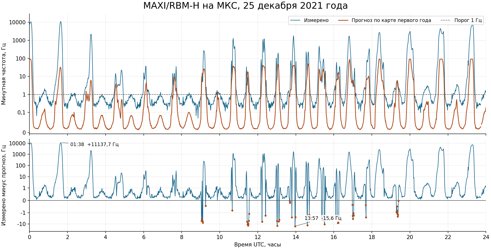

# Прогноз повышения счёта MAXI/RBM-H на 25 декабря 2021 года

**Карта первого года и заранее рассчитанная траектория МКС предсказали
330 из 609 минут с частотой от 1 Гц.** Во всех 330 отмеченных минутах
прибор достиг порога. Ещё 279 повышений пришлись на минуты ниже порога
прогноза. В амплитуде расхождения велики в обе стороны. На общей экспозиции
средний прогноз составил **5,21 Гц**, измерено **235,26 Гц**.



## Что было известно заранее

Для проверки выбраны полные UTC-сутки 25.12.2021, следующие за уже
прочитанным днём 24.12. Из последующего архива до фиксации прогноза был
получен лишь HTTP-заголовок о наличии файла. Интервал и правила опубликованы
в коммите `1dc8307`. Все 86 400 секунд прогноза, границы 25 минутных
интервалов повышения и код сопоставления опубликованы в `1984774` до
скачивания контрольного TXT. SHA-256 распакованного прогноза
`633c9a3898d40ac380d301d41f4656c9b1927fda4888c38728c8a89a985d5b67`.
[Протокол](PLAN.md) · [датированная фиксация](https://github.com/z3tm4n-x/phd-adaptive-memory-ecc/pull/405#issuecomment-6704756586).

NASA/JSC TOPO создал OEM 22.12.2021 в 18:59:48.276 UTC. Использован архивный
выпуск от 23.12, горизонт от создания **53,003–77,003 ч**. Кубическая
интерполяция Эрмита использует положения и скорости в EME2000 с шагом
до 240 с. Для поворота в земные оси взяты предсказанные x, y, UT1−UTC
из Bulletin A от 23.12, модели IAU 2006/2000A и поправка осей J2000.
Получена ретроспективная реконструкция по этим выпускам. Время их фактической
доставки на борт неизвестно. [NASA OEM](https://nasa-public-data.s3.us-east-1.amazonaws.com/iss-coords/2021-12-23/ISS_OEM/ISS.OEM_J2K_EPH.txt) · [IERS XXXIV №51](https://datacenter.iers.org/data/6/bulletina-xxxiv-051.txt).

Источником амплитуды служит верхняя панель рис. 1 Sugizaki, средний
счёт горизонтального RBM за первый год. В указанной публикации значения
представлены цветом. Из векторного PDF прочитаны 37 434 явные ячейки
1°×1°, 99 ступеней логарифмической шкалы 0,01–100 Гц и 95 различных цветов.
Шесть отсутствующих ячеек оставлены неизвестными. Траектория контрольных
суток целиком прошла по заполненным ячейкам. Эксплуатационная карта из §2.1
управляет высоким напряжением GSC. Версия её бортового контура на 25.12.2021
остаётся неизвестной. [Sugizaki, §§2.1–2.2 и рис. 1](https://maxi.riken.jp/FirstYear/proceedings/pdf/Sugizaki_Mutsumi-bin-20110404184221.pdf).

Прогноз равен геометрической середине отображённого цветового диапазона.
Для внутреннего цвета множитель от середины до верхней границы чтения в
той же ячейке ≤1,056 с учётом положения ступени на рисунке. Нижний цвет
читается от 0 до 0,01462 Гц, у верхнего нижний край около 82,39 Гц
и открытая верхняя граница. Графическая огибающая также включает соседние
ячейки в пределах ±0,18° долготы и ±0,13° широты. На 1025 секундах эта
неопределённость допускает смену класса относительно 1 Гц. Основная
подстановка использует геоцентрическую широту. Переход к геодезической
широте меняет секундный класс на 414 из 86 400 секунд.
[Полный прогноз и диагностика оцифровки](forecast.json).

## Сопоставление на общей экспозиции

COUNT_H — число зарегистрированных частиц за номинальную секунду.
Электронный порог **LVL=1 соответствует энерговыделению 50 кэВ**.
Диагностический порог **1 отсчёт/с** выбран по подписанной отметке карты.
RBM-H смотрит вдоль горизонта и при этой настройке чувствителен к электронам
и протонам. [DARTS/JAXA](https://darts.isas.jaxa.jp/en/datasets/darts:maxi-rbm-timeseries/).

TXT содержит 86 232 записи LVL=1, включая 36 164 нулевых отсчёта. Пропущены
168 секунд в 79 разрывах, наибольший разрыв 6 с. При требовании ≥54 общих
секунд исключилась только минута 23:44 UTC с 53 секундами. Осталось
**1439 минут и 86 179 с**. Суммы прибора и секундного прогноза в каждой
минуте поделены на одну и ту же экспозицию. Метка класса прогноза взята
из заранее опубликованного минутного решения.
[Поминутные данные](minutes.jsonl) · [исходная запись JAXA](https://darts.isas.jaxa.jp/pub/maxi/rbm/2021/mx_rbm_20211225.txt).

| Минутный прогноз | Минут / общих секунд | Прогноз, Гц | Измерено, Гц | Измерено − прогноз, Гц | Сумма недооценок, отсч. | Сумма завышений, отсч. |
|---|---:|---:|---:|---:|---:|---:|
| Ниже 1 Гц | 1109 / 66 417 | 0,092 | 2,725 | +2,634 | 174 936,6 | 15,9 |
| От 1 Гц | 330 / 19 762 | 22,433 | 1016,751 | +994,319 | 19 663 655,5 | 13 928,5 |
| Все оценённые минуты | 1439 / 86 179 | 5,215 | 235,255 | +230,040 | 19 838 592,1 | 13 944,4 |

Суммы двух знаков считаются после минутного усреднения с весом общей
экспозиции. Взвешенная средняя абсолютная ошибка — 230,364 Гц.
Для порога 1 Гц получены 330 попаданий, 0 ложных тревог, 279 пропусков и
830 совпадений ниже порога. Полнота — **54,2%**. Предсказанные минуты заняли
22,93% общей экспозиции и содержали 99,11% зарегистрированных в оценённых
минутах отсчётов. Это доли одного дня данного прибора.

- **01:38 UTC**, центр минуты около 37,7° ю. ш., 37,3° з. д. Прогноз
  **29,55 Гц**, измерено **11 167,22 Гц**, отклонение **+11 137,67 Гц**.
  Графическая огибающая прогноза 27,16–32,18 Гц.
- **13:57 UTC**, около 45,9° ю. ш., 118,0° в. д. Прогноз **22,54 Гц**,
  измерено **6,93 Гц**, отклонение **−15,61 Гц**. Графическая огибающая
  18,77–27,09 Гц. Повышение относительно 1 Гц в этой минуте предсказано верно.

Карта завысила точечную амплитуду в 53 минутах. В 43 минутах наблюдаемая
частота оказалась ниже даже нижнего края чтения рисунка. Внутренние цвета
по тому же правилу покрытия дали 1336 минут, в среднем 3,09 Гц по карте и
127,91 Гц по прибору. Расхождение сохраняется и при этом ограничении.
Для суммарного счёта условный пуассоновский масштаб √N/экспозиция составляет
0,052 Гц. Знак отклонения отдельного наблюдения содержит шум регистрации.
[Полные результаты](result.json).

Единицы проверены по CDF того же канала и дня, версия 1.0.0, сформирована
13.05.2024. Поле RATE_H имеет единицу counts и шаг 1 с. Все значения совпали
с COUNT_H, заполнителей не найдено. Наибольшее расхождение Epoch и времени
TXT после учёта пяти високосных секунд составило 0,000501 с. Отдельная
арифметическая сверка по CDF повторила общую экспозицию, суммы обоих знаков
и все четыре числа классификации. [CDF JAXA](https://darts.isas.jaxa.jp/pub/maxi/rbm/2021/mx_rbm_20211225.cdf) · [сверка](archive-check.json).

## Значение для будущей оценки α

Опубликованная карта дала проверяемый исторический профиль в единицах
прибора. Географическое положение повышений оказалось полезнее переноса
их амплитуды на 2021 год. На временах записей угловое расхождение траекторий
NASA и JAXA составило 0,143° по медиане и 0,194° в максимуме. Высота по
OEM над WGS84 была 415–434 км, для первого года авторы указывают 340–360 км.
Влияние высоты, эпохи, углового спектра и состояния прибора на обнаруженное
расхождение этим примером раздельно не определено.

Для **α непредсказуемой надфоновой экспозиции сбоев памяти** нужны
спектральный и угловой прогноз за общим экраном, отклик выбранного полного
слова и граница ошибки ожидаемой интенсивности на весь срок. Для улучшения
амплитуды RBM первыми входами служат карта соответствующей высоты и эпохи
с экспозициями ячеек и неопределённостью, а также сопоставимое состояние
и отклик канала. В общей нормировке памяти для ожидаемой интенсивности λ
и заранее заданной части p требуется совместно обосновать r=λ−p≥0 и
∫₀ᵀr(t)dt≤αF_s. Поэтому при проверке p учитываются и завышения.
Суточное сопоставление даёт процедуру проверки обоих знаков в единицах
прибора. Численная α памяти остаётся открытой.
[Закреплённое правило выбора](../../../../thesis/ORBIT_SELECTION_20261028.md).

## Повторение

Из корня репозитория, Python 3.12, NumPy 2.3.5, PyERFA 2.0.1.5,
pdfplumber 0.11.9 и cdflib 1.3.16. Команда получает недостающие исходники
в указанную папку, сверяет шесть исходных SHA-256, воспроизводит прогноз,
поминутный расчёт и сверку CDF.

```text
python -X utf8 -B docs/literature_mapping/orbit-alpha-data-20261107/rbm-h-20211225/reproduce.py ../rbm-inputs
```

График строится из проверенного поминутного файла командой
`python docs/literature_mapping/orbit-alpha-data-20261107/rbm-h-20211225/plot.py`
с Matplotlib 3.10.1. Воспроизведение является проверкой автора примера.

This research has made use of MAXI data provided by RIKEN, JAXA and the MAXI team.
[Matsuoka et al., 2009](https://doi.org/10.1093/pasj/61.5.999).
