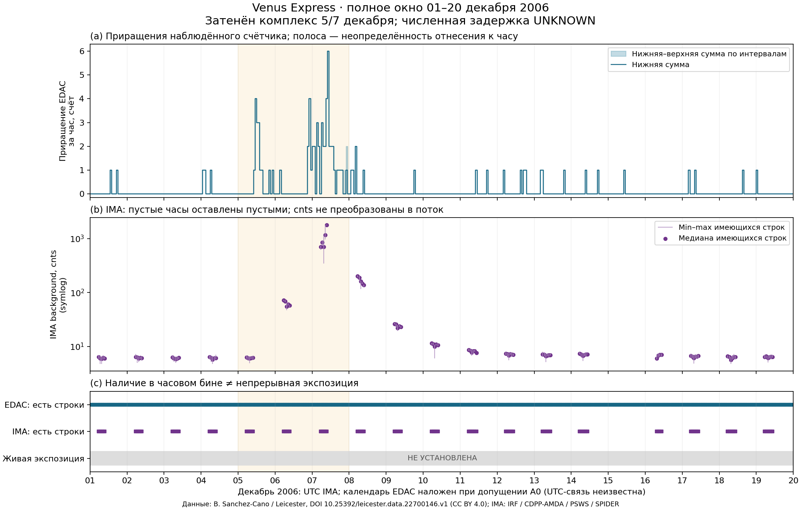

# T197 — VEX2006: приращения и ограниченная сверка

**Первый законченный результат предъявлен 18.10.2026 к сроку 22.10.**
[Задача #197](https://github.com/z3tm4n-x/phd-adaptive-memory-ecc/issues/197),
[draft PR #199](https://github.com/z3tm4n-x/phd-adaptive-memory-ecc/pull/199).
Статус: OWN RESULT, на рассмотрении; научное принятие не присваивается.

В наблюдённом счётчике VEX **89 единиц прироста**, из них **62** приходятся
на заранее выбранный комплекс 5–7 декабря. Медиана доступных значений IMA
в этом комплексе — **49,13 cnts**, до него — 6,13, после — 7,05.
При условном совмещении напечатанного календаря EDAC и UTC IMA это
описательно согласованное повышение в одном опубликованном случае.
**Численная задержка и полнота обнаружения не установлены:** UTC-связь
EDAC и живая экспозиция неизвестны, IMA разрежен.

## Общая фигура и основные числа



Все числа ниже — собственный детерминированный расчёт закреплённых файлов,
не оценка вероятности. Окна заданы в [PLAN](PLAN.md) до новых чисел на
`679961236dbd7eb47aa6bcc196059b253d9dd077`; данные — принятый T188
`e8d0e44b549e7760ce7a72de7b2cdfbe26d09eae`.
Даты — календарные границы 00:00; часовые интервалы имеют конвенцию (a,b].
В исходных данных на указанных границах нет строк, поэтому выбор стороны
точной календарной границы не меняет эту таблицу.

| Окно декабря 2006 | Строк EDAC / IMA | Приращение EDAC, счёт | IMA: медиана [min; max], cnts | Часов с обоими рядами / всего |
|---|---:|---:|---:|---:|
| Полное [01,20) | 25 686 / 1 382 | 89 | 6,70 [4,73; 1819,50] | 96 / 456 |
| До комплекса [01,05) | 5 400 / 322 | 5 | 6,13 [4,73; 7,21] | 20 / 96 |
| Комплекс [05,08) | 4 050 / 165 | 62 | 49,13 [4,88; 1819,50] | 15 / 72 |
| После комплекса [08,20) | 16 236 / 895 | 22 | 7,05 [4,74; 207,48] | 61 / 288 |

Нижняя/верхняя интервальные суммы для этих четырёх окон совпадают с указанным
приростом. Это сумма наблюдённых изменений между имеющимися записями;
числа разных по длительности окон не названы интенсивностями.
Медиана рассчитана по имеющимся строкам IMA без весов: это не среднее за всё
календарное окно. «С обоими рядами» означает валидный интервал EDAC и хотя бы
одну строку IMA в часе при допущении **A0** — календарь EDAC наложен на UTC
без сдвига. Это не подтверждение 96 часов совместного живого наблюдения.

В 360 часах нет валидных строк IMA; в 46 из них есть положительное приращение
EDAC при условном отнесении к правому концу интервала. Нельзя превращать эти
46 часов в ложные срабатывания EDAC или пропуски IMA. До/после комплекса
не объявлены отрицательными эпизодами. Train/test, подбор порога и корреляции
не выполнялись; подтверждённого множества отрицательных интервалов нет.

## Как получены приращения и карта наличия

Два исходных файла повторно проверены по SHA-256 из [inputs.json](inputs.json).
EDAC читается как целое значение, тип FLOAT экспортного столбца не задаёт
разрядность аппаратного счётчика. Источник накопительного смысла —
[Sánchez-Cano et al., §3, с. 5](https://pure.tudelft.nl/ws/portalfiles/portal/157356686/Space_Weather_2023_S_nchez_Cano.pdf).

Из 25 686 наблюдений образовано 25 685 разностей: 25 598 нулевых и
87 положительных. Положительные: 86 по 1 и одна по 3; сумма 89 равна
165−76. Уменьшений, неоднозначных повторов и межстрочных разрывов >96 с
в этом EDAC-файле не обнаружено; отсутствие скрытого сброса этим не доказано.
Первое значение 76 используется как база, не как 76 новых ошибок.

Каждое положительное приращение хранится с двумя сырыми временными метками,
значениями и номерами строк исходника в
[edac_positive_intervals.csv](outputs/edac_positive_intervals.csv).
Например, 76→77 заключено между **01.12 13:12:14.127 и 13:13:18.127**
в неустановленной шкале EDAC. Ширины всех 87 положительных интервалов —
63,989–64,019 с. Это расстояния между экспортированными метками, не
доказанные границы времени физического сбоя или реакции системы.
46,121 с до первой записи и 17,659 с после последней в полном окне
не достраиваются; для них нет пары наблюдений.

Для часа нижняя сумма содержит интервалы целиком внутри него, верхняя —
все пересекающие его интервалы. Только две соседние ячейки неоднозначны:
07.12 21:00–22:00 даёт [0;1], 22:00–23:00 — [1;2]. Один переход пересекает
22:00. Поэтому сумма почасовых нижних значений 88, верхних 90, хотя общая
сумма строго 89: верхние значения не складываются как независимые ошибки.
Это границы распределения **наблюдённого** прироста, а не доверительные
интервалы и не границы всех физических ошибок.

В IMA — 1 382 валидные строки, без fill/повторных меток; 60 блоков близких
меток и 59 разрывов >288 с. Наибольший разрыв:
**14.12 10:09:51.008Z–16.12 07:10:49.003Z**, 162 057,995 с ≈45,02 ч.
Блоки — группы меток с шагом не более 288 с, а не непрерывные экспозиции.
Пробелы не интерполируются, пустые часы не получают IMA=0.

[hourly.csv](outputs/hourly.csv) содержит все 456 часов: число строк,
протяжённость допустимых интервалов EDAC, границы прироста, статистику IMA
и **отдельные пустые поля живой экспозиции** памяти/IMA/совместного наблюдения.
В JSON неизвестное записано как `null`, в CSV — пустым полем.
[Блоки IMA](outputs/ima_row_blocks.csv) и [разрывы](outputs/ima_gaps.json)
сохраняют UTC и локаторы строк. Число записей и их протяжённость не заменяют
маску экспозиции.

## Что ограничивает временной вывод

Адресная проверка [первичных описаний и метаданных](source_checks.json)
не закрыла отсутствующие поля:

- **EDAC:** в файле DATE TIME без шкалы. S1 §3.1, с. 8 и рис. 4, с. 9
  используют UT для события и рисунка, но не задают clock correlation,
  фазу опроса или задержку попадания исправления в экспорт. Время солнечной
  вспышки 10:35 UT не присваивается моменту локального обнаружения VEX.
- **IMA:** HAPI устанавливает UTC и cadence192 с. SPASE не задаёт фазу
  интегрирования, строки режима или живое время. В
  [D5.2, §§3/6, с. 5–7](https://spider-europlanet.irap.omp.eu/static/img/about/Deliverable_D5.2.pdf)
  дан цикл192 с, предупреждение о ненадёжности вариаций короче часа и
  влиянии режимов. Указание канала/цикла не является row-wise exposure.
- **Нормировка:** D5.2 задаёт energy2–18/mass25–30; проверенный
  [Futaana et al., §§3–4](https://arxiv.org/pdf/2204.01377) — energy1–12,
  деление на84 и приблизительно28 с эффективного измерения на192-секундный
  цикл. Тождество этих определений конкретной версии AMDA не установлено.
  Поэтому IMA остаётся в исходных `cnts`, не преобразуется в поток и не
  объявляется точным численным воспроизведением кривой S1.
- Два целевых поиска в официальных доменах не дали недостающие сведения.
  Это предел проведённого поиска, не доказательство отсутствия документации.

Если бы оба интервала E=(e0,e1], I=(i0,i1] и относительное смещение δ были
известны, разность времён лежала бы между e0−i1+δ и e1−i0+δ с учётом
открытых концов. Здесь δ и интервал измерения I не установлены, а связь
регистрации исправления с физическим сбоем отдельно неизвестна.
**Конечный численный интервал задержки из этих входов не следует.**
Даже направление «EDAC раньше/позже IMA» не заявляется. Шаги64/192 с
не дают гарантии задержки, полноты обнаружения или 10-мкс реакции.

## Вывод, проверка и следующее действие

Цепочка вывода: закреплённые два файла → разности/интервальные суммы и
статистика имеющихся IMA → описательное согласование в опубликованном
широком комплексе **при A0**. Неизвестные UTC, режим/экспозиция, нормировка
и отбор одного положительного случая ограничивают перенос. Причинность,
эффективность управления, Q(T), редкие квантили и квалификация CY62167/D*
из этого результата не следуют.

Восемь адресных тестов проверяют границу часа, пересечение границы,
пустые значения, сброс/повторы/разрыв, обратный ход времени, fill против
нуля, блоки IMA и целочисленность/сохранение шкалы. Отдельный
[verify.py](verify.py), без импорта рабочего читателя, читает CSV/Decimal
и проверяет прямым перебором все456 часов, 87 положительных интервалов,
четыре окна и разрывы. Это отдельный пересчёт тем же автором,
не независимая научная рецензия. Результаты — [checks.json](outputs/checks.json),
[summary.json](outputs/summary.json), [хеши](outputs/sha256.json).
Фигура просмотрена визуально: общие даты/единицы читаются, пропуски видимы.

Подготовка среды (Python3.12.14; версии закреплены):

```powershell
python -m pip install --target .cache/t197/vendor -r experiments/flight-vex-validation-20261018/requirements.txt
```

Одна команда расчёта, рисунка, отдельного пересчёта и тестов из корня репозитория:

```powershell
python -X utf8 -B experiments/flight-vex-validation-20261018/reproduce.py --fetch --vendor .cache/t197/vendor
```

`--cache` и `--out` позволяют повторить в новых каталогах, сохраняя поставку.
Вход с другим хешем останавливает выполнение. Два полных входа и зависимости
не копируются в Git. Среда и хеши кода — [run.json](outputs/run.json).

Рекомендую передать этот законченный ограниченный результат на одну
адресную рецензию, как назначено #197. Дополнительный расчёт тех же рядов
не устранит неизвестные: для временной валидации потребуются спецификация
UTC/опроса EDAC, фаза и режимы IMA, точная версия нормировки и маска экспозиции.
Сейчас расширение на Solar Orbiter не требуется: его статус сохраняется из
принятого T188. Альтернативы завершения на доступности или новой кампании HIS
рассмотрены в PLAN; выбранная сверка закрывает вычислимый объём #197.

Атрибуция: EDAC — B. Sanchez-Cano / University of Leicester, DOI
[10.25392/leicester.data.22700146.v1](https://doi.org/10.25392/leicester.data.22700146.v1),
CC BY4.0; IMA — IRF, CDPP-AMDA, PSWS/SPIDER (исходные метаданные в T188).
