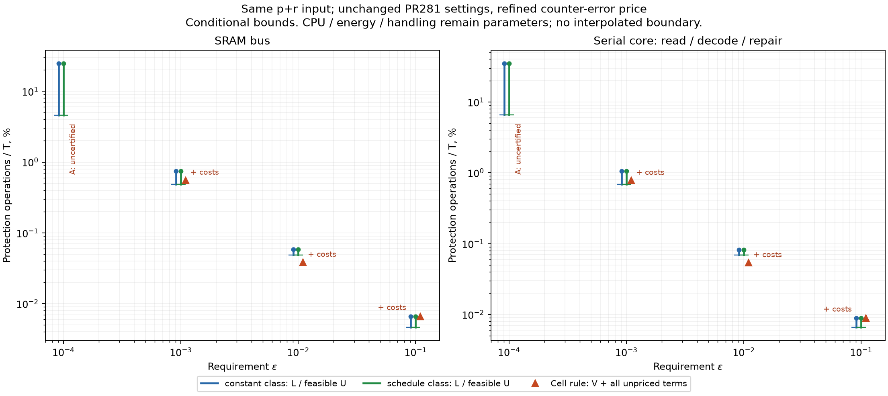

# Новый клеточный срез: исполнение и полная цена

27.10.2026, #186. **OWN RESULT, условная инженерная поставка:** таблица
всех четырёх ε связывает принятый PR281 с прежними слотами/сервисом и
опубликованным уточнением C1–C5 PR283. Старую серию PR280 не считали.
Настройки, Q, физический вход, cFE, δ₀ и проектный δ_C≤5e-5 сохранены.

[Одна таблица всех ε и двух сравнений](TABLE.md) · [точные дроби](result.json) ·
[исполнение/условия](CONTRACT.md) · [полная цена и численные области](COST.md).

**Главный результат.** По прежним batch8/frame1568 дана последовательность
фиксированных клеток, полного первого двухблочного прохода и следующих
основных посещений. Сохраняются app-grant, pending/release, общая epoch
и source/processed/health. Поздний результат не перезапускает клетку;
потеря после выбора не сдвигает её календарь. При любом ошибочном значении
C остаётся7/61/859 максимум основных проходов на клетку для .1/.01/.001.
Неверный install двух календарей .01 дал бы94 вместо61 и явно отвергается.

Тем самым C3 применим к выбранному **условному алгоритмическому исполнению**:
на ошибке значения C оплачивается M_b, на нарушении общего исполнения — N_h.
Порча epoch/таймера/очереди вне прежнего покрытия сохраняет δ_escape и его
численный дорогой коэффициент. Новая аппаратная защита или меньшая квота
для этого вывода не вводится. Числовые ξ/J сами по себе не доказывают
фиксированные старты: сдвиг по завершению ERR-процедуры — точное место,
где E4 неприменимо. Для допустимого отображения старты назначены по общей
эпохе, а обработка обязана уложиться в существующие окна.

После оплаты прежнего δ_C при .01 остаётся **5.875573мкс шины/с и
15.481007мкс core/с** для всех G/z/escape/обработки, для20% против каждого
из двух полных классов. Это достаточная совместная область, не измеренный
выигрыш. Её границы рассчитаны по каждому ε; точный оптимум не требуется.
При .1/.001 данный верх не устанавливает20%, при .0001 нет нового
адаптивного Q. Для30% остатки отрицательны во всех обязательных точках.
Эти выводы относятся к сертификату выбранного правила, не запрещают А.

Полная обработка раскрыта:250002.5 cut/ready в секунду даже на пустой
истории, потенциальные gate, dispatch, raw/veto, закрытия проходов и
клеток,6 сумм, source/cause/prefix/health, CPU/энергия/память и плохое
исполнение. App/init отдельно. В bus-координате .01 один только cut
может занимать не больше.02350205ns в среднем, если формально отдать ему
весь остаток; все реальные добавки делят этот же бюджет. Поэтому нельзя
оставить один SRAM-доступ на каждый cut и заявить20%. Размещение обработки
в локальной памяти/логике требует своей ненулевой CPU/энергетической цены.

В выбранном эталоне сообщения только обновляют наблюдение и не создают
extra E, поэтому отсутствие extra E — свойство командного потока. Старый
OUR wrapper, который сам включает FAST, нельзя оставить подключённым и
объявить G=0. Для внешнего guard/старой маски сохранён G, включая неверный
C и post-A, и его влияние на z. Raw/veto не ограничены квотами outage.
Без связанного закрытого префикса z=1;20%-условие не выполняется.

**Остаток к30.10 конкретен:** подтвердить для выбранной реализации fixed
anchors/однократный install и покрытие escape; закрытие C и новые шаги в
пределах3900ns/пакет и1270.8848ns финального окна; принадлежность реальных
G/z/raw и ненулевых единичных цен области COST. Новых измерений или
транспорта не запускали, аппаратные WCET/δ_C/энергия не присвоены.
Один общий численный срез предъявлен; полная аппаратная экономия и решение
о завершении А остаются за автором. А этой поставкой не закрывается.

Рекомендация: использовать сформулированное клеточное отображение и
численные условия, без новой сетки. Если доступна только legacy OUR-маска
либо переносимый по ERR старт, сохранить G/неприменимость E4 и точный
незакрытый остаток, не уменьшать δ_C. Проверки и чистый повтор — VALIDATION.md.
