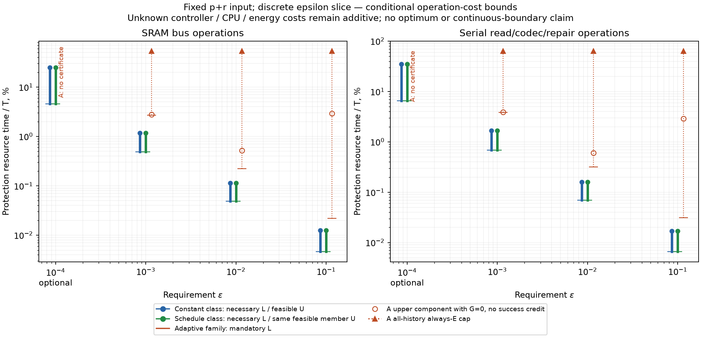

# #186: обязательный ε-срез рассчитан для одного семейства

27.10.2026. **OWN RESULT, условный инженерный кандидат:** получены три
обязательные подстановки ε=.1,.01,.001, отдельная проверка .0001, таблица
и график. Полный вход p+r/W/T/код/приложение/сервис неизменен; меняются ε
и настройки решений. Пакет .001 и принятые результаты не переписаны.
Совместная подпись переноса/семейства #196 ещё ожидается; **А не закрыто**.

Во время проверки опубликован план другого клеточного семейства
[PR281@06f9aa9b](https://github.com/z3tm4n-x/phd-adaptive-memory-ecc/pull/281).
Срез ниже сохраняется как диагностика A11; он не заменяет совместную
клеточную таблицу. [Ответ по обязательному сервису и guard](SERVICE_HANDOFF.md)
передан #196. Новые числа клеточного Q ожидают применимого основания.

[Таблица основных чисел](TABLE.md) · [график SVG](cost-epsilon.svg) ·
[PNG](cost-epsilon.png) · [точные дроби](result.json).

На графике разные необходимые низы/достаточные верхи, а не три измеренные
средние кривые. Неизвестное управление/CPU/энергия добавляется параметрами.
Точки не соединены доказанной непрерывной границей. Для расписания дан
низ всего класса и верх его допустимого постоянного члена; непостоянный
минимизатор по известной p пока не найден. Этот пробел явно сохранён.

## Что установлено

Постоянные кандидаты перенастроены по общему A7–A8 на весь ε после δ₀:
k=2215/220/21 для .1/.01/.001; для .0001 проходит k=1. Это максимальные
целые по использованному достаточному тесту, не доказанные оптимумы.
OFF исключён необходимым условием всего календарного класса во всех
четырёх точках. В нижней цене при .1 использован точный −log(1−ε−δ₀).

Одно зарегистрированное повторяемое семейство A11 настроено заново:
для .1/.01/.001 получены (k_b,k_e,N)=(1106,3318,608),
(109,654,581),(9,522,72). Число проходов обучения M=190/1921/23256,
хвост q=2, пороги C≤14/13/10, K=1. В каждой строке назначены новые
α_j/ζ_j/β_j; общий бюджет включает фиксированную δ₀ и **требование**
δ_C≤5e-5 за весь T. Оно не доказано измерением/тестами и не делится
бесплатно между попытками. Q⁺≈.0999964024/.00999324324/.000979385750.

| ε | Q_b⁺ | Σα=Σζ, каждая | Σβ | α_j=ζ_j, каждая | Допустимый δ_C, не измерение |
|---:|---:|---:|---:|---:|---:|
| .1 | .0499684023652 | .0099944 | .0299832 | 1.64381578947e-5 | ≤5.35976348191e-5 |
| .01 | .0049652432357 | .0009944 | .0029832 | 1.71153184165e-6 | ≤5.67567642991e-5 |
| .001 | .000451385750297 | .0000944 | .0002832 | 1.31111111111e-6 | ≤7.06142497033e-5 |

β_j=Σβ/N. Десятичные подписи округлены для чтения; проверяются точные
дроби result.json. δ₀=6e-6 неизменна. Соперник получает весь остаток
ε−δ₀, без α/ζ/β/δ_C адаптации. Неиспользованный численный запас не
является доказательством физического покрытия δ_C.

Даже при успехе всех попыток снимается лишь около .0109531%/.00257881%/
.000300814% основных чтений базы за T. Обязательный read-низ данного
семейства составляет .0218986%/.222219%/2.69138% шины; достаточные
верхи постоянного кандидата с repair — .0124731%/.113786%/1.17972%.
Поэтому **в координате известных операций это семейство не даёт20–30%**
ни против постоянного оптимума, ни против оптимального расписания.
Это сравнение нижней цены семьи с верхом допустимого соперника,
а не ошибочное сравнение двух верхов. Неизвестные добавки сохранены:
вывод об отсутствии преимущества остаётся при u_F≤.00942554/.108433/
1.51166 процентного пункта шины, соответственно, и любом u_A≥0.

Общей положительной вероятности допуска здесь также нет: выбранные
608/581/72 попытки можно сделать invalid одним распознанным outage100мкс
на группу с восстановлением. Это укладывается в прежние1001 episodes/
1000 restores/31557.6с outage. Это допустимый канал, а не распределение
на r и не средняя потеря для реального аппарата. Полная цена включает
такие истории, обучение/базу/guard, все попытки, repair, края и post-A.

При .0001 данное семейство не сертифицируется: база с непустым A5-окном
требует k_b≥2, чей A7–A8 верх уже не проходит этот ε. Это отказ
достаточной конструкции, не запрет всех адаптивных методов.

## Условия и остаток к30.10

SOURCE — принятые формулы PR267/271/272/276 и сервис PR250. Локальные
ε-переносы, цена и повторяемый инженерный кандидат выписаны в
[DERIVATION.md](DERIVATION.md), настройки закреплены до расчёта в SETTINGS.
Полный C/closed prefix/health, предсказуемые времена, обязательный основной
сервис, отсутствие pending, all-history release/gates, WCET и δ_C остаются
явными условиями. Ни байтовая полнота, ни аппаратный Q не присваиваются.
Приложение315569688607 reads и начальная загрузка показаны отдельно.

Точный остаток: (1) согласование #196 относительных времён повторных
групп и локального постоянного низа; (2) сильный непостоянный кандидат
или достаточное сужение интервала оптимума; (3) для содержательной
экономии — иное распределение/амортизация риска повторений в том же
входе, а не больше прогонов этой настройки. Неизвестные единичные цены
и δ_C/WCET не устраняются Python-расчётом.

Рассмотрены три уровня действий. Локальная перенастройка N/k/статистики
в зарегистрированном семействе выполнена для всех обязательных ε;
снятие проходов остаётся слишком малым. Следующий содержательный вариант
внутри А — адресно уточнить глобальный базовый резерв/оплату повторений
с #196; это научный переход, а не новый численный поиск ради коэффициента.
Изменение канала/среды/сервиса могло бы изменить постановку, но в текущем
срезе не разрешено и не выполнялось. Рекомендую второй вариант только
в объёме конкретного основания к30.10; общего запрета А и автоматического
продления на4–5 недель не объявлять. Итоговая проверка к06.11 сохраняется.
