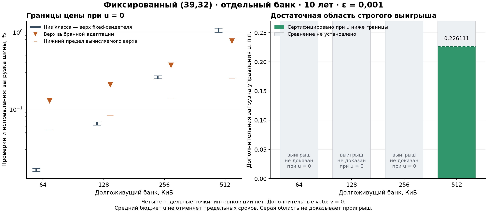

# #206: объём долгоживущего банка и цена управления

24.10.2026. Первый срез принят после [независимой проверки](REVIEW_20261024.md).
512 КиБ сохраняются как опорная точка этого среза; уменьшение
банка при неизменном per-bit входе не сохраняет доказанный выигрыш
автоматически. Для 256 КиБ выбранная допустимая адаптация уже не даёт
положительного остатка шины. Для 128 и 64 КиБ новый ценовой фильтр
исключает такой остаток у используемой пары оценок при любом k.
Это предел сертификата сравнения, а не доказательство проигрыша адаптации.
Окончательный выбор главного примера остаётся контрольным решением 06.11.

## Результат и основание выбора

Единственная [таблица сравнения](TABLE.md) получена из
[точного результата](outputs/result.json). [Карта SVG](outputs/volume-control-map.svg)
показывает четыре отдельные точки без интерполяции:



SOURCE — принятые PR250/T196: условный singleton-класс, (39,32),
E с исправляющей записью только при исправимой ошибке, постоянный класс
с одним общим периодом и произвольными фазами, правило 90/180 секунд,
направленные оценки Q(T) и цена за весь срок. План зафиксирован до новых
чисел в коммите `c2da6522285038a10380051476c217550ae2cec3`;
[уточнение порядка расчётов](PRICE-GATE.md) записано до пропуска дорогих
интегралов для 128/64 КиБ. Принятые файлы не изменены.

ASSUMPTION — каждый объём представляет отдельный банк без полезных
перезаписей, с прежним ненулевым календарём полезных чтений. Чтения
приложения не ремонтируют память и не дают ERR. Вход среды и аппаратные
коэффициенты не подбирались; меняются только `words` и `useful_bytes`.
Полное слово занимает три адреса x16: 39 активных и 9 padding-битов.
Физически выделено 1,5 полезного объёма: 96–768 КиБ для четырёх строк.

OWN RESULT — для 256 КиБ рассчитаны ровно три информационные пробы:
k183 не проходит достаточный верх, k91 и k137 проходят. Выбран k137
с меньшей верхней ценой шины из двух допустимых проб. Для 128/64 КиБ
сохраняются политики k363/k1457 с достаточным mandatory-only верхом Q;
дополнительные корректные E не ухудшают первое событие превышения.
Это допустимые свидетели, не оптимумы всех адаптивных правил.

Для 512 КиБ из принятой базы остаётся достаточное условие
`u_A_upper < 0,226111 п.п.` чистой шины, v=0 дополнительных veto.
Точный порог чуть выше указанного округления вниз и записан в JSON.
Для других трёх точек положительного достаточного бюджета нет.
Необходимое исключение по сравнению с допустимым fixed-свидетелем
требует его собственного верха управления: неизвестная цена постоянного
контроллера не обнулена. Поэтому красная область проигрыша не нарисована.

INFERENCE — при уменьшении W постоянный режим получает сразу два
источника экономии: меньше слов и больший допустимый период. Его цена
в этом срезе падает примерно как W². Верх адаптивной цены содержит
слагаемые, убывающие только как W, и квоты ложных флагов, восстановления
и потерь, которые здесь не масштабируются с W. Даже без обязательной
опоры и парных членов этот вычисляемый верх для 128/64 КиБ уже превышает
используемый низ постоянного класса. [Вывод фильтра](PRICE-GATE.md)
не превращает верхнюю квоту в обязательное число событий.

Практический вывод: одного заявления «данные долгоживущие» недостаточно
для выбора адаптации. Нужны размер банка, нижняя цена постоянного класса
и измеримая верхняя цена управления. На малом банке постоянный режим
остаётся обеспеченным простым кандидатом; вывод о победителе по полной
цене пока UNKNOWN. Переход между 256 и 512 КиБ не локализован как
математическая граница по W: проверены только эти отдельные точки.

## Бюджеты и полная цена

В каждой строке T=315576000 с, epsilon=0,001, общий delta=0,000006
включён один раз. Запасы Q относительно epsilon для выбранных строк
512/256/128/64 КиБ составляют примерно 26,19% / 11,23% / 0,436% / 0,0955%.
Все строки достаточны при исходном epsilon; ориентир Q<=epsilon/2
не выполнен. Это не физическая вероятность миссии.

Для доли f<1 внутри общей памяти необходимо заново объявить
`U_long_without_delta + U_rewrite_without_delta + delta_common <= epsilon_total`
и совместный календарь одной шины. Остаток epsilon после одной строки
не разрешает автоматически обслужить остальную память. Q всей исходной
памяти в результатах явно UNKNOWN; основная постановка не ослаблена.

Приложение отдельно занимает <=0,006850% сериализованного сервиса
(полезные чтения), включая общую часть ECC. Общая инициализация,
число проверок, исправлений, наблюдений и решений сохранены в JSON.
CPU задаётся временем каждого действия, энергия — добавочной энергией
непересекающихся действий и мощностью простоя. Они не сложены с LUT/BRAM
или шиной. Сохранены 131136 байт прежнего канала и состояния потерь;
память правила, регистры кодека и прочие ресурсы остаются параметрами.
Работа после первого превышения и незавершённые операции оплачены.

Сервис и консервативные пиковые ограничения одинаковы во всех строках:
E<=124,50124 нс, свободный остаток его окна 38,99712 нс;
ответ приложения <=2533,01712 нс при обязательных 3000 нс;
пиковое сериализованное резервирование <=0,638086 при пределе 0,8.
Старое write-окно приложения сохранено как консервативный резерв, хотя
полезных записей нет. 20%-ориентир по ответу (2400 нс) не достигнут;
обязательное ограничение выполнено. Неизвестные дополнительные операции
должны укладываться и в эти окна, и в средний бюджет u. Подтверждённого
аппаратного WCET нет. При v>0 к u добавляется прежний оплаченный коэффициент
veto (точное значение в JSON) и собственная обработка уведомлений.

## Воспроизведение и передача

[Входы и хеши](frozen-inputs.json), [метод переноса](METHOD.md),
[план и календарь](PLAN.md). Python 3.12+, стандартная библиотека для чисел.
Из корня репозитория:

```text
python -B experiments/regime-map-methodology-20261019/volume-slice-20261024/run.py --check
python -B -m unittest discover -s experiments/regime-map-methodology-20261019/volume-slice-20261024 -p test_volume.py -v
python -B experiments/regime-map-methodology-20261019/volume-slice-20261024/table.py
```

`--check` проверяет замороженные зависимости и побайтовый replay итогов
из сохранённых интервальных сертификатов, без повторного интегрирования.
Для полного пересчёта трёх новых сертификатов использовать `--recompute`
вместо `--check`; принятая база k53 переиспользуется. Пробы k183/k91/k137
заняли 577 / 280 / 427 с, около 21,4 минуты суммарно. `--compute` позволяет
продолжить прерванный запуск, переиспользуя существующие сертификаты.
Для рисунка установить `requirements-plot.txt` и выполнить `plot.py` из
того же каталога эксперимента; рисунок не нужен для численного replay.

Проверки автора: семь тестов нового переноса, адресов/таймеров, нижнего
постоянного свидетеля, фильтра обеих ветвей цены, масштаба/мажорант,
бюджета области и направленного отображения. Результат и таблица
проверяются также в чистом архиве коммита; запись — [VALIDATION.md](VALIDATION.md).
Эти проверки не заменяют независимую научную рецензию.

Оркестратору: назначить проверку подстановки W, фильтра цены и выводов
нового среза. Принятый PR250 не переаудировать. После рецензии связать
таблицу с ядром карты; контроль примера 06.11 и срок научного итога 08.12
сохраняются. Отдельная архитектурная иллюстрация PR252 не переносит
сюда свой код или физический отклик; новый физический поиск не требуется.
