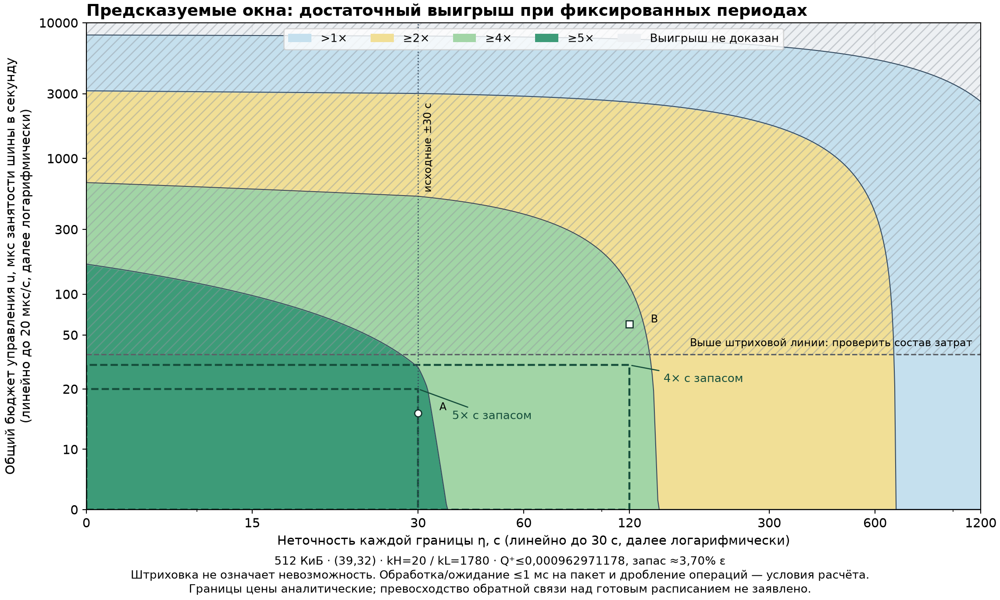

# #206: карта неточности окон и цены управления

25.10.2026. **Область с запасом по цене существует при сохранённых
k_H=20/k_L=1780.** Достаточно, например:

- 5× при неточности каждой границы от 0 до 30 с и общем u<=20 мкс/с;
- 4× при неточности от 0 до 120 с и общем u<=30 мкс/с.

Это прямоугольники достаточных условий, включая описанный ниже общий
сервис. В худших углах остаётся ещё соответственно более 8,88 и 83,71
мкс/с до границы сравнения. Запас Q во всём срезе прежний — около 3,70%
epsilon, а не новый 20/50%-запас. Главный пример этой поставкой не выбран.

Единственная [короткая таблица](TABLE.md) и [точный результат](outputs/result.json):



[Векторная карта SVG](outputs/window-management-map.svg). Границы вычислены
аналитически; частая сетка использована только для рисования линий.
Цвета относятся к защите на шине с общим ECC/инициализацией. Выше
штриховой линии нужно проверить конкретное сочетание затрат; это не
область невозможности. A/B — два условных сочетания из ENGINEERING.

## Что определяет границы

SOURCE — принятая [теория PR260](../../../theory/t196-predictable-windows-20261025.md)
и её [приёмка](../../comparison-foundations-20261018/predictable-windows-20261025/REVIEW_20261025.md).
512 КиБ, (39,32), T/epsilon, per-bit пределы, E, часы, k_H/k_L и квоты
не менялись. Новый диапазон eta=0…1200 с объявлен в [плане до чисел](PLAN.md),
коммит `af5f24a8ecc2d5fc3a3eccca5af464aac7302cb0`.

OWN RESULT — расширение окон линейно увеличивает оплачиваемую частую
работу; одинаковые периоды сохраняют U_A<=0,000962971178 и запас
>=0,000037028822. Новый нижний постоянный свидетель PR260 применим
во всём диапазоне: все его подъёмы/плато лежат уже внутри номинальных
окон. Сравнение использует lower всего постоянного класса, а не отношение
верхов двух кандидатов. Достаточный постоянный k22 и его верх также
сохранены в JSON; его неизвестная цена управления не объявлена нулевой.

При формальном u=0 предел сертификата 5× достигается около eta=36,304 с,
4× — 144,816 с, 2× — 687,379 с. Это границы используемого достаточного
сравнения, не доказанные переходы реального оптимума. Верх Q не растёт
с eta, поскольку общая солнечная масса и быстрый период неизменны:
неточность увеличивает длительность обслуживания, не массу сверх Fs.
Ориентир Q<=epsilon/2 при этих периодах не выполняется даже при eta=0.

## Календарь и цена управления

Проверены реальные восемь начал в кадре, p mod20/mod1780, адрес 3j modW,
freeze, частичные краевые проходы и таймер возврата с округлением вверх.
Полный срок посчитан прогрессиями, без десятилетнего перебора.
Операции после первого превышения и незавершённые при T оплачены.
При потере канала работает частая опора k_H=20; после свежей проверки
удерживается не менее H=1 с. Старый LOW или таймер старого поколения
не отменяет новое FAST. Чистого состояния при возврате не появляется.

Общий u расходуется **совместно** на проверку канала, команды, таймеры
и дополнительную работу. В [ENGINEERING.md](ENGINEERING.md) даны количества,
линейное среднее ограничение и отдельный предел ответа <=10 мс.
Для управления использовано свободное окно в конце исходного кадра;
scrub/app окна сохранены. Учтены транзакции до 32 нс и незаполненный
остаток рабочего окна. При местной обработке/ожидании <=1 мс на пакет
любое объявленное сочетание с u<=36,01 мкс/с проходит этот консервативный
сервис; большие сочетания проверяются по составу.

Например, верхние цены **8/4/2/2 мкс** на check/command/timer/extra
дают общий u≈16,000250 мкс/с и обеспечивают 5× при eta=30. Это требования
к реализации, не измеренные коэффициенты. Локальная логика выбора слота
не должна обращаться к общей шине на каждом потенциальном начале:
один x16 beat на такое начало уже занимает >=7,908% шины.
CPU, энергия, память канала и стоимость локальной логики остаются параметрами.

Обязательные временные/пиковые условия выполнены в этом договоре:
ответ приложения <=2533,01712 нс при 3000 нс; пиковый верх с управлением
<=0,679365765 при пределе 0,8. Ориентиры 2400 нс и 0,64 не выполнены.
Неизвестный аппаратный WCET не подменяется численным запасом.
Полезные обращения показаны отдельно в JSON; общий ECC и инициализация
остаются в отношении цен, второй раз не добавляются к приложению.

## Соперник с готовым расписанием и вывод

При том же таймере и исправном канале готовое расписание совпадает
с оконным правилом. Польза установлена для временных сведений против
постоянного периода; преимущество обратной связи над этим расписанием
не заявляется. При утрате достоверной таблицы/времени нужен одинаковый
FAST и свежий возврат. Если достоверность сохранена по общему договору,
потеря только внешней связи сама по себе не требует нового расписания.
Распознанная потеря на весь срок сохраняет достаточный верх
Q<=0,000878408514 при k_H=20, но нарушает экономную квоту потерь:
верх проверок/исправлений около 1,262765% шины уже вне этой карты цены.

Рекомендация оркестратору: принять к независимой проверке область с
ценовым запасом, особенно менее чувствительную область 4×. Не выбирать
главный пример по одному значению 5×: запас Q здесь ограничен исходными
3,70%, а доступность конкретных цен управления ещё должна быть обеспечена.
Физические данные, новые периоды и аппаратура для этого вывода не нужны.

## Воспроизведение

Python 3.12+, стандартная библиотека; входы и SHA256 — [manifest](frozen-inputs.json).
Из корня репозитория:

```text
python -B experiments/regime-map-methodology-20261019/window-slice-20261025/run.py --check
python -B -m unittest discover -s experiments/regime-map-methodology-20261019/window-slice-20261025 -p test_slice.py -v
python -B experiments/regime-map-methodology-20261019/window-slice-20261025/table.py
```

Без `--check` run.py заново создаёт точный итог; около 10 секунд на
использованной машине. Для рисунка установить зависимости из
requirements-plot.txt и выполнить:

```text
python -B experiments/regime-map-methodology-20261019/window-slice-20261025/plot.py
```

Старые кампании и интегралы не повторяются. Проверки автора и чистый
Git-replay записаны в [VALIDATION.md](VALIDATION.md); они не заменяют
независимую рецензию. Поставка — PR261 к #206, срез к 30.10 подготовлен;
контроль главного примера 06.11 сохранён.
