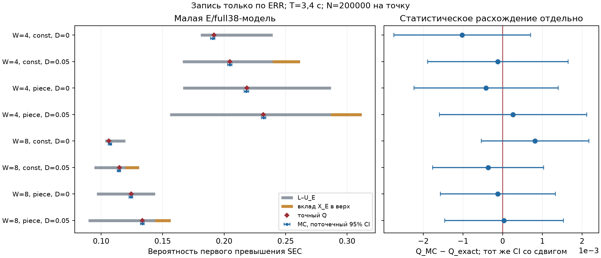

# #177 — точный малый эталон записи по ERR

**Пакет E/full38 получен 18.10.2026.** Во всех восьми заранее закреплённых
точках выполнено L≤Q_exact≤U_E. Точный расчёт учитывает запомненный ERR,
попадания после чистого снимка, незавершённую условную запись и первое
превышение за весь срок. Независимые MC и полное перечисление согласованы
с эталоном. Статус новых чисел — **OWN RESULT, ожидает одной независимой рецензии**.

При проверке задела 18.10 готового E-расчёта/ветки/PR не было; найден только
принятый U/full39. Запись STATUS о выполнении не подтверждалась артефактами.
Плановые первый эталон 16.10 и пакет 17.10 не были поставлены.
Фактическое начало и первая численная поставка — 18.10.
После проверки была дана оценка полного пакета 19.10 с резервом 20.10;
малый расчёт оказался выполним сегодня, результат опубликован без ожидания.
Даты 16–17 октября не приписываются новому запуску.

План/входы/seed до расчёта:
[b11115a](https://github.com/z3tm4n-x/phd-adaptive-memory-ecc/commit/b11115a7d7bd422c0271dcce8f5d93e935570bd8).
База: 3300d614442977bcc750cffe853270298cc8d377.
[Модель, формулы и таблица условий](METHOD.md) · [источники](sources.json) ·
[входы](inputs.json) · [машинные числа](outputs/results.json) ·
[проверки](outputs/validation.json).

## Что именно проверено

W=4/8, полное условное 32+6, коррекция одной ошибки, чистое начало.
Период 1 с, T=3,4 с; равномерные независимые одиночные XOR-инверсии.
λ массива: const=0,8 с⁻¹; piece=0,4 до 0,6 с, 1,6 до 1,4 с,
затем 0,6 с⁻¹ до T. В обоих профилях интеграл λ равен 2,72.
Это восемь синтетических условий, не новый физический вход CY62167.

Начало и снимок слова w: k+w/W. При ERR=1 исправленный образ записывается
через D=0/0,05 с; при ERR=0 записи нет. Окончание и release совмещены,
начало и снимок также совмещены — явное допущение малого эталона.
Чистое чтение не гарантирует чистоту на release. Все ошибки в зазоре
учитываются до записи, и поздний ремонт не отменяет событие Q.
В W=8/D=0,05 одна операция начата в 3,375 с и не окончена до T.

E-договор T110/T114 задаёт свойства сервиса, а не уникальное точное Q.
Предъявленная атомарная запись — допустимая частная реализация этих свойств.
Времена и календарь r4, физическая карта микросхемы и иной оператор
удаления новых ошибок этим не квалифицированы.
Принятый #166/U/full39 сохранён и заново не запускался;
его числа не вычитались из E/full38 как сопоставимая пара.

## Основная таблица

Q_exact* — середина интервала JSON, здесь округлённая до 9 знаков;
ошибка печати до 5·10⁻¹⁰. δ_num — радиус полного численного интервала
**до печатного округления**, 5·10⁻³⁷. Его концы сохранены с 36 знаками
в каждой строке results.json. Остальные вероятности показаны с 6 знаками.
Проверка направления сделана по интервалам, не по печатным значениям.
CI — поточечный 95% Clopper–Pearson; при нулевом Q относительная
величина была бы «не определено»/null.

| W | λ | D, с | L | Q_exact*; δ_num | U_E | Q_MC [95% CI] | Q−L | U_E−Q | U_E−L | (Q−L)/Q | (U_E−Q)/Q | (U_E−L)/Q | abs(MC−Q) |
|---:|---|---:|---:|---:|---:|---|---:|---:|---:|---:|---:|---:|---:|
| 4 | const | 0.00 | 0.180931 | 0.191752496; 5.0e-37 | 0.239332 | 0.190730 [0.189010; 0.192459] | 0.010821 | 0.047579 | 0.058400 | 5.643% | 24.813% | 30.456% | 0.001022 |
| 4 | const | 0.05 | 0.166438 | 0.204675115; 5.0e-37 | 0.261726 | 0.204550 [0.202784; 0.206325] | 0.038238 | 0.057051 | 0.095289 | 18.682% | 27.874% | 46.556% | 0.000125 |
| 4 | piece | 0.00 | 0.166463 | 0.218505506; 5.0e-37 | 0.286811 | 0.218085 [0.216277; 0.219901] | 0.052042 | 0.068305 | 0.120348 | 23.817% | 31.260% | 55.078% | 0.000421 |
| 4 | piece | 0.05 | 0.156027 | 0.231895492; 5.0e-37 | 0.311920 | 0.232155 [0.230306; 0.234012] | 0.075868 | 0.080024 | 0.155892 | 32.717% | 34.509% | 67.225% | 0.000260 |
| 8 | const | 0.00 | 0.103253 | 0.106408213; 5.0e-37 | 0.119544 | 0.107220 [0.105867; 0.108584] | 0.003155 | 0.013136 | 0.016291 | 2.965% | 12.345% | 15.310% | 0.000812 |
| 8 | const | 0.05 | 0.094437 | 0.114793426; 5.0e-37 | 0.130741 | 0.114425 [0.113033; 0.115828] | 0.020357 | 0.015948 | 0.036305 | 17.733% | 13.893% | 31.626% | 0.000368 |
| 8 | piece | 0.00 | 0.096382 | 0.124381931; 5.0e-37 | 0.143900 | 0.124255 [0.122812; 0.125709] | 0.028000 | 0.019518 | 0.047518 | 22.511% | 15.692% | 38.203% | 0.000127 |
| 8 | piece | 0.05 | 0.089576 | 0.133429261; 5.0e-37 | 0.156557 | 0.133460 [0.131972; 0.134958] | 0.043853 | 0.023128 | 0.066981 | 32.866% | 17.333% | 50.200% | 0.000031 |

N=200000 на точку, всего 1,6 млн реализаций.
Числа событий Q в порядке таблицы:
38146, 40910, 43617, 46431, 21444, 22885, 24851, 26692.
PCG64 SeedSequence([2026101801,index]), index=0...7; seed/N не менялись.
Повтор с тем же seed не увеличивает число независимых реализаций.

Оранжевый отрезок показывает X_E в верхе V+X_E; это вклад оценки,
не выделенная вероятность отказов. Справа показано MC−Q_exact
с тем же сдвинутым CI. [Векторный рисунок](outputs/comparison.svg).

## Смысл результата

При D=0,05 точный Q выше соответствующего D=0 в каждой из четырёх пар:
на 0,0129226 (W4/const), 0,0133900 (W4/piece),
0,0083852 (W8/const), 0,0090473 (W8/piece), или примерно на 6,13–7,88%.
Это сравнение внутри одного E/full38-договора на заданных фазах.
Общая монотонность по зазору или перенос на реальную SRAM не утверждаются.

Верх использует виртуальные начала, а не предполагает очистку на каждом
release: U_E=min(1,V+X_E). Для ненулевого D значения X_E равны примерно
0,0223947; 0,0251089; 0,0111974; 0,0126571 в том же порядке четырёх пар.
При D=0 член точно нулевой. Последнее неполное окно включено.
Структурный тест двух разных инверсий через начало операции показывает,
какую категорию пар потерял бы верх без X_E.

Ширина [L,U_E] составляет 15,31–67,23% от Q. Нижняя оценка отступает
на 2,97–32,87%, верхняя превышает Q на 12,34–34,51%.
Увеличение зазора расширяет область, исключаемую из нижних ячеек,
и добавляет парный член в верхе. Корректность и теснота оценок разделены.

Все восемь поточечных CI содержат Q; наибольшее |Q_MC−Q|≈0,00102250.
Это наблюдённый статистический исход, не совместная 95%-гарантия.
Попадание не было условием успешности расчёта и не использовалось
для подбора seed. Ошибка MC не заменяет неопределённость сервисной модели.

## Численная достоверность и воспроизведение

Рациональный эталон переносит 5 состояний каждого слова через весь срок,
включая pending; произведение применяется только к независимым историям слов.
Ряд k=0,...,32 имеет явную оценку хвоста, каждое внутреннее округление
выполнено наружу до 48 знаков. Максимальная ширина итогового Q-интервала
10⁻³⁶, ширина промежуточного интервала суммы компонент не более 4,1·10⁻⁴⁷;
единица входит во все проверенные интервалы массы.

Отдельная полная цепь из 33/513 состояний дала максимальное отличие
2,4981·10⁻¹⁶ и дрейф массы 1,5544·10⁻¹⁵. Это float64-сверка,
а не основание погрешности основного эталона.
Пройдена **41 адресная проверка**, включая ERR=0, ERR=1, XOR-погашение,
сохранение исторического превышения, нулевой зазор, последнее pending,
нулевой поток, аналитические пределы, хвост/массу, границы и нулевой MC-счёт.
Намеренная подмена release безусловной очисткой отвергнута.

Проверены 9 закреплённых файлов-источников, 2 хеша PLAN/inputs и
неизменность принятого дерева #166. Воспроизводимость чисел, таблицы
и рисунка зафиксирована в [repeat.json](outputs/repeat.json).
Один полный расчёт в подготовленном локальном окружении занял около 4 с;
это время вычисления после запуска Python, не срок инженерной проверки.

Из корня, с Python 3.12, Git-историей и [закреплёнными зависимостями](requirements.txt):

~~~text
python -B experiments/sequential-err-small-validation-20261015/reproduce.py
~~~

Команда проверяет источники и план, выполняет тесты, восемь точных расчётов,
полную цепь и MC, обновляет outputs/ и локальный игнорируемый .cache/.
Таблица REPORT сверяется с автоматически полученной.
Численный пакет не требует новых физических испытаний.

## Передача и остаток

Для §2.6/«Достоверности» получена адресная проверка применения границ
к первому превышению в малой E/full38-модели, сопровождающей CY-пример.
Из неё не выводится точное Q десятилетней полной памяти, аппаратный WCET,
стоимость адаптации, применимость при MCU или физическая квалификация CY62167.

Инженерный объём #177 поставлен. Осталась **одна независимая адресная
рецензия точного SHA PR**: оператор и принадлежность E, перенос pending,
сохранение ошибки после чистого снимка, X_E/края, интервальная погрешность
и независимость MC. Рецензия ещё не выполнена; ориентир 19.10
теперь возможен по опубликованному пакету, но не объявлен исполненным.
Принятый U заново рецензировать не требуется.
Писателю проверенные E-числа передаются после принятия; до него — статус.
Main не сливается, организационные документы и глава не меняются.
