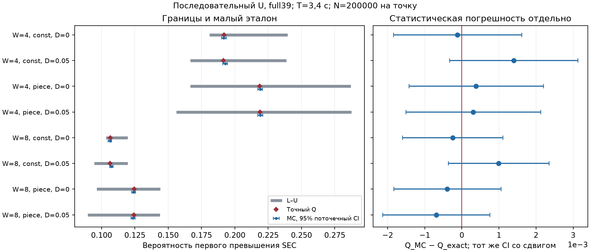

# #166 — точный Q(T) и MC последовательного обхода 4–8 слов

**15.10.2026. Первый точный эталон и основной пакет готовы в первый рабочий день.**
Восемь заранее закреплённых синтетических точек прошли проверку
L≤Q_exact≤U с учётом численной погрешности. Независимое MC моделирует
то же первое превышение SEC за весь срок. Новые результаты — **OWN RESULT,
ожидает одной адресной рецензии**; научная приёмка и передача проверенных
чисел писателю пока не выполнены.

План/seed до расчёта: [1627981](https://github.com/z3tm4n-x/phd-adaptive-memory-ecc/commit/1627981320243d5537f50b89a17f268bfd05fa46).
База d135c665039a30014f12e2946a676da7ee64e2aa.
[Входы](inputs.json) · [источники и локаторы](sources.json) ·
[модель, доказательство погрешности и таблица условий](METHOD.md) ·
[полная машинная таблица](outputs/results.json) · [проверки](outputs/validation.json).

## Что именно проверено

Полное внешнее SEC-DED(39,32), t=1, W=4/8; чистое начало, период 1 с,
T=3,4 с. λ — поток одиночных независимых равномерных XOR-инверсий по массиву.
const: λ=0,8 с⁻¹. piece: λ=0,4 до 0,6 с; 1,6 до 1,4 с; 0,6 доT.
В обоих профилях F=2,72 родителя. Это объявленные модельные условия.

Каждое слово читается в k+w/W и безусловно записывается через D=0/0,05 с.
Чтение не очищает память. Превышение в зазоре необратимо как событие Q,
хотя последующая запись очищает слово. Сохраняются отдельные фазы,
начало и неполный последний проход; при W8/D=.05 одна начатая запись
заканчивается за T и не выполняется в расчёте.
Это U-сервис T52/T57, отдельный от записи только по ERR в T110.

L — произведение ячеечных границ T45 вне обслуживания, с разрезом на
границах λ. U — межfence парный верх T52 с коэффициентом разных битов.
Токенные верха T57/T36 сохранены отдельными полями JSON.
Проверяется применение этих оценок на фиксированном расписании;
полный адаптивный прогноз T57 и его непрерывный рост не заявлены
для скачка выбранного кусочного потока.
Полный сертификат T52 с его классом роста также не подставляется:
используются включение первого превышения и парный член (3).

## Сравнительная таблица

**Все значения в таблице показаны с округлением до 6 знаков.**
Q_exact* — середина сертифицированного интервала в JSON с радиусом
не более 5·10⁻³⁷; округление этой середины для печати добавляет до 5·10⁻⁷.
Проверка направлений выполнена по полным интервалам, не печатным числам.
95% CI — поточечный Clopper–Pearson. Относительные отклонения считаются
от середины Q_exact; при нулевом знаменателе код возвращает null.

| W | λ | D, с | L | Q_exact* | U | Q_MC [95% CI] | Q−L | U−Q | U−L | (Q−L)/Q | (U−Q)/Q | (U−L)/Q | abs(Q_MC−Q) |
|---:|---|---:|---:|---:|---:|---|---:|---:|---:|---:|---:|---:|---:|
| 4 | const | 0.00 | 0.181045 | 0.191872 | 0.239497 | 0.191755 [0.190032; 0.193487] | 0.010827 | 0.047625 | 0.058452 | 5.643% | 24.821% | 30.464% | 0.000117 |
| 4 | const | 0.05 | 0.166543 | 0.191338 | 0.238718 | 0.192735 [0.191008; 0.194471] | 0.024794 | 0.047380 | 0.072175 | 12.958% | 24.763% | 37.721% | 0.001397 |
| 4 | piece | 0.00 | 0.166569 | 0.218640 | 0.287010 | 0.219025 [0.217214; 0.220844] | 0.052071 | 0.068369 | 0.120440 | 23.816% | 31.270% | 55.086% | 0.000385 |
| 4 | piece | 0.05 | 0.156128 | 0.218833 | 0.287436 | 0.219140 [0.217329; 0.220959] | 0.062706 | 0.068603 | 0.131308 | 28.655% | 31.349% | 60.004% | 0.000307 |
| 8 | const | 0.00 | 0.103321 | 0.106478 | 0.119627 | 0.106230 [0.104883; 0.107589] | 0.003157 | 0.013149 | 0.016306 | 2.965% | 12.349% | 15.314% | 0.000248 |
| 8 | const | 0.05 | 0.094499 | 0.106360 | 0.119481 | 0.107350 [0.105997; 0.108715] | 0.011860 | 0.013121 | 0.024982 | 11.151% | 12.337% | 23.488% | 0.000990 |
| 8 | piece | 0.00 | 0.096446 | 0.124463 | 0.144000 | 0.124070 [0.122628; 0.125523] | 0.028017 | 0.019537 | 0.047554 | 22.510% | 15.697% | 38.207% | 0.000393 |
| 8 | piece | 0.05 | 0.089635 | 0.124337 | 0.143833 | 0.123645 [0.122205; 0.125096] | 0.034702 | 0.019496 | 0.054198 | 27.909% | 15.680% | 43.589% | 0.000692 |

N=200000 на каждую строку, всего 1,6 млн реализаций в основной таблице.
Числа реализаций с Q в её порядке:
38351,38547,43805,43828,21246,21470,24814,24729.
SeedSequence([2026101501,index]), PCG64, index=0…7; seed/N не менялись
после просмотра результатов. Повтор с тем же seed не увеличивает N.



Один рисунок: слева [L,U] и оценки, справа отклонение MC от точного Q
с тем же сдвинутым интервалом. Ошибка точного расчёта на этом масштабе
неразличима. [Векторный SVG](outputs/comparison.svg).

## Смысл результата и теснота

- Во всех 8 точках выполняется интервальная проверка
  L_hi≤Q_lo≤Q_hi≤U_exact. Весь диапазон Q здесь примерно 0,106–0,219;
  это доступные статистической проверке вероятности, не миссионный
  редкий хвост большой SRAM.
- Ширина U−L составляет 15,3–60,0% от Q. Верх превышает Q примерно
  на 12,3–31,4%; низ отступает примерно на 3,0–28,7%.
  Особенно ослабевает выбранный низ при исключении сервисного окна
  и разбиении кусочного профиля. Корректность не означает тесноту
  или оптимальность этих границ.
- При одной F форма потока меняет Q: для W4/D0 он растёт с 0,191872
  до 0,218640; для W8/D0 — с 0,106478 до 0,124463.
  Вывод относится к закреплённым фазам и двум профилям.
- Добавление D сдвигает все fence при неизменных чтениях, а не удлиняет
  каждый межfence интервал на D. В постоянном потоке изменение риска
  определяется началом/хвостом срока; при кусочном меняются также
  пересечения с пиком. Поэтому ΔQ при D:0→.05 равно примерно
  −0,0005345; +0,0001931; −0,0001184; −0,0001256
  для W4/const, W4/piece, W8/const, W8/piece.
  Это не общий вывод о пользе задержки. Тест с двумя разными инверсиями
  внутри зазора подтверждает поглощение до последующей очистки.
- Все 8 поточечных CI содержат Q_exact; максимальное
  abs(Q_MC−Q_exact)≈0,00139719. Это полученный статистический исход,
  не совместная 95%-гарантия для 8 строк. CI не обязан целиком лежать
  в [L,U]; его отдельный выход не доказывал бы нарушение теоремы.

## Численная достоверность и повтор

Основная конечная цепь рассчитана через рациональную равномеризацию:
сумма по k=0,…,32, явный геометрический хвост положительного ряда и направленный
десятичный вывод. Максимальная ширина интервала Q —10⁻³⁶.
Случайное время не дискретизируется; число приходов не обрезается
без оплаты остатка. Полное объединённое состояние имеет 17/257 элементов;
его отдельное перечисление даёт максимальное отличие 2,4981·10⁻¹⁶,
максимальный дрейф массы 1,7764·10⁻¹⁵.
Float64-перечисление проверяет реализацию, но не определяет основной
сертифицированный интервал.

Численный параметр 32 трактуется как последний индекс k: с нулевым
членом это 33 слагаемых. Это уточнение краткой записи «32 члена» в плане;
параметр inputs.json, матрица, seed и N не менялись.

Проверены 9 неизменённых источников,2 хеша предварительного закрепления,
30 адресных аналитических/краевых проверок и все 8 полных цепей.
Пределы без потока/без сервиса, синхронный контроль, отмена одинакового
XOR-бита, зазор, отдельные фазы, последнее pending, хвост ряда, масса,
нулевой MC-счёт и неопределённый относительный знаменатель включены.
Повтор чисел и рисунка фиксируется в [repeat.json](outputs/repeat.json).

Одна команда из корня в подготовленном Python 3.12 с
[закреплёнными зависимостями](requirements.txt):

```text
python -B experiments/sequential-small-validation-20261014/reproduce.py
```

Нужна Git-история с закреплёнными источниками. Команда проверяет их,
выполняет точный расчёт, MC и тесты, перезаписывает только outputs/
и локальный игнорируемый .cache/. Таблица отчёта сверяется с машинной.

## Вывод для §2.6 и «Достоверности» после рецензии

Пакет даёт адресную вычислительную проверку применимости нижней и верхней
оценок к одному историческому событию в малой последовательной модели.
Он отдельно показывает запас границ, статистическое расхождение и
численную погрешность; сохранены read–fence и конечный горизонт.
Это не заменяет доказательство общей теоремы и не устанавливает
физическую применимость большой SRAM, MCU/MBU, адаптивного правила,
приложения/ARM или иной семантики исправления.

**Следующее действие:** одна адресная независимая рецензия точного SHA
в свободном слоте; проверить событие/сервис, объединение состояний,
контроль хвоста и области формул, независимо повторить ключевые числа.
До неё писателю передаётся только статус готового ожидающего пакета.
Обязательного инженерного остатка по объёму #166 не выявлено;
новый перебор и распределение числа сигналов не открываются.
