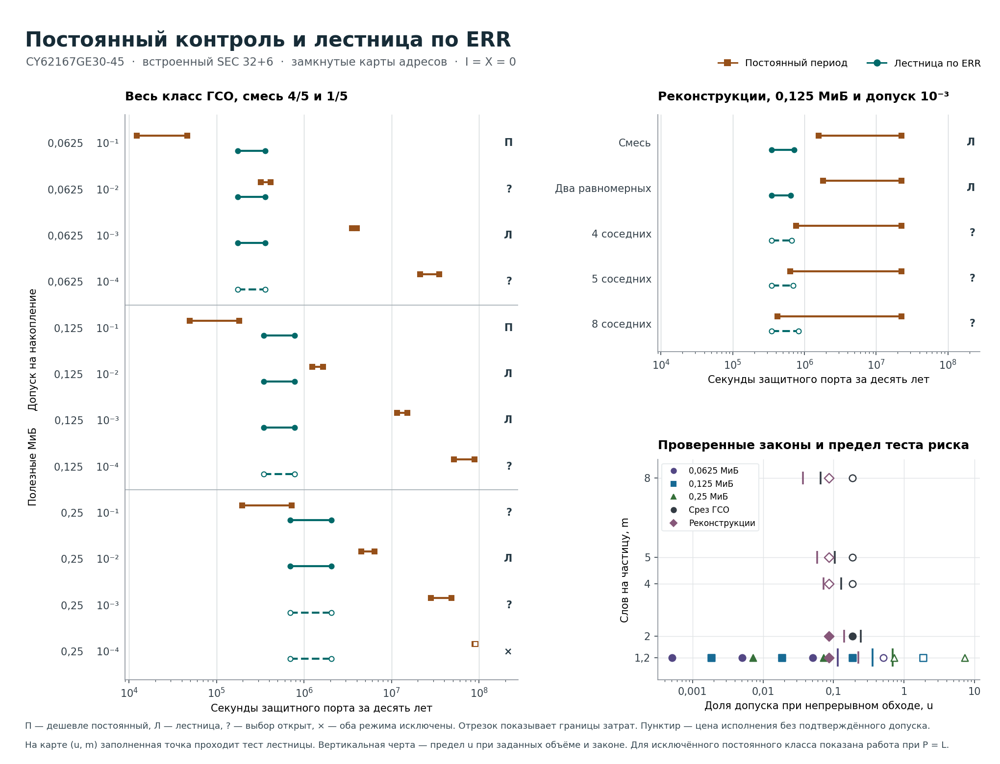

# Когда дешевле менять период по ERR

На всём заданном классе геостационарной орбиты (ГСО) из 12 сочетаний **в двух дешевле постоянный период, в четырёх — лестница по ERR**. Ещё в двух строках допустимы оба режима и пересекаются границы затрат. В трёх подтверждён только постоянный период. В последней строке, 0,25 МиБ и допуск $10^{-4}$, строгий нижний свидетель исключает оба режима на этом порту.

Под затратами понимаем наибольшую по указанному множеству профилей ожидаемую занятость защитного порта за $T=315\,576\,000$ с. Соперник $F_\star$ выбирает один допустимый постоянный период для всего того же множества и той же карты. Низ $F^-$ гарантирован для всего класса таких периодов. Верх $F^+$ даёт конкретный допустимый кандидат. Дешевизна лестницы доказана при $C_\pi^+<F^-$, обратное предпочтение — при $F^+<C_\pi^-$. В таблице базовое исполнение регистровое, дополнительных испорченных ячеек и другой защитной работы порта нет. Условие при их наличии дано ниже. [Исходное поручение](https://github.com/z3tm4n-x/phd-adaptive-memory-ecc/issues/186#issuecomment-6845792805) · [Регистрация до численного этапа](PROTOCOL.md).

## Весь класс ГСО и принятый поперечный срез

У смежной пары равномерно выбрано начало блока на кольце, у равномерной пары — два различных слова всего банка. В основной смеси одно слово поражается с вероятностью 4/5, два соседних — с вероятностью 1/5. В каждом задетом слове инвертируется одна из 38 позиций. Вторая координата $m$ — среднее число разных слов на непустую частицу. Первая, $u^+=Q^+_{\rm непр,нак}(L)/\varepsilon$, использует прежний верх непрерывного обхода №457. Уточнённый учёт двух половин входит только в проверку постоянного кандидата, поэтому ось воспроизводит принятую точку.

Колонка $\eta$ показывает число разных частиц со своевременным ERR на одну инверсию. Слева стоит гарантированный законом минимум, справа — достаточное для данного допуска значение. Порог выбран на сетке с шагом $1/16384$, оба края сохранены в ведомости. «Нет» означает, что предъявленный верх выше допуска даже при $\eta=1$. Физически доступно $\eta\le1/m$. Для каждого объёма периоды лестницы равны $L,2L,\ldots,P_{\rm ст}$. В порядке возрастания объёма $L=11{,}4688,\ 22{,}9376,\ 45{,}8752$ мс, $P_{\rm ст}=512L,256L,128L$ соответственно, во всех трёх случаях 5,8720256 с местных часов. Указанный в таблице $P$ — исполнимый период **постоянного** кандидата в местных секундах. Нижние границы округлены вниз, верхние вверх. Точные периоды, обе границы порога видимости, вероятности кандидатов и раздельные составляющие цены сохранены в [численной ведомости](result.json).

| Обстановка, МиБ, закон | ε | u⁺ | m | η гарант. / достат. | P кандидата, с | F⋆, с (% срока) | Q⁺ лестницы | Лестница, с (% срока) | Выбор |
|---|---:|---:|---:|---:|---:|---:|---:|---:|---|
| ГСО 0,0625, смесь | 10⁻¹ | 0,000509 | 1,2 | 0,833292 / 0,00232 | 25,5546018 | 12 204–46 162 (0,003–0,015%) | 0,000443266 | 174 260–358 396 (0,055–0,114%) | **постоянный** |
| ГСО 0,0625, смесь | 10⁻² | 0,005089 | 1,2 | 0,833292 / 0,034607 | 2,5592406 | 320 345–413 395 (0,101–0,131%) | 0,000443266 | 174 260–358 396 (0,055–0,114%) | цены пересекаются |
| ГСО 0,0625, смесь | 10⁻³ | 0,05089 | 1,2 | 0,833292 / 0,357544 | 0,2597042 | 3 518 494–4 026 924 (1,114–1,277%) | 0,000443266 | 174 260–358 396 (0,055–0,114%) | **лестница** |
| ГСО 0,0625, смесь | 10⁻⁴ | 0,5089 | 1,2 | 0,833292 / нет | 0,02975 | 21 258 128–35 112 343 (6,736–11,127%) | 0,000443266 | 174 260–358 396 (0,055–0,114%) | подтверждён постоянный |
| ГСО 0,125, смесь | 10⁻¹ | 0,001856 | 1,2 | 0,833312 / 0,002747 | 12,7859018 | 49 087–181 259 (0,015–0,058%) | 0,000513899 | 348 497–782 799 (0,110–0,249%) | **постоянный** |
| ГСО 0,125, смесь | 10⁻² | 0,018556 | 1,2 | 0,833312 / 0,034791 | 1,2882212 | 1 248 360–1 639 401 (0,395–0,520%) | 0,000513899 | 348 497–782 799 (0,110–0,249%) | **лестница** |
| ГСО 0,125, смесь | 10⁻³ | 0,185554 | 1,2 | 0,833312 / 0,367005 | 0,138453 | 11 527 603–15 105 097 (3,652–4,787%) | 0,000513899 | 348 497–782 799 (0,110–0,249%) | **лестница** |
| ГСО 0,125, смесь | 10⁻⁴ | 1,855538 | 1,2 | 0,833312 / нет | 0,0234766 | 51 639 627–88 994 552 (16,363–28,201%) | 0,000513899 | 348 497–782 799 (0,110–0,249%) | подтверждён постоянный |
| ГСО 0,25, смесь | 10⁻¹ | 0,007243 | 1,2 | 0,833323 / 0,003235 | 6,4101534 | 196 890–720 003 (0,062–0,229%) | 0,001044024 | 696 624–2 040 509 (0,220–0,647%) | цены пересекаются |
| ГСО 0,25, смесь | 10⁻² | 0,072421 | 1,2 | 0,833323 / 0,035096 | 0,6613124 | 4 533 152–6 385 611 (1,436–2,024%) | 0,001044024 | 696 624–2 040 509 (0,220–0,647%) | **лестница** |
| ГСО 0,25, смесь | 10⁻³ | 0,724204 | 1,2 | 0,833323 / нет | 0,086429 | 28 156 816–48 405 503 (8,922–15,339%) | 0,001044024 | 696 624–2 040 509 (0,220–0,647%) | подтверждён постоянный |
| ГСО 0,25, смесь | 10⁻⁴ | 7,242033 | 1,2 | 0,833323 / нет | 0,0458752† | класс пуст L† 89 260 593–91 135 749 (28,284–28,880%) | 0,001044024 | 696 624–2 040 509 (0,220–0,647%) | **оба исключены** |
| ГСО 0,125, пара | 10⁻³ | 0,185554 | 2 | 0,5 / 0,367005 | 0,0934444 | 10 930 377–22 423 783 (3,463–7,106%) | 0,000762771 | 348 410–694 756 (0,110–0,221%) | **лестница** |
| ГСО 0,125, 4 сосед. | 10⁻³ | 0,185554 | 4 | 0,25 / 0,367005 | 0,0934444 | 5 828 395–22 423 783 (1,846–7,106%) | 0,001437636 | 348 175–717 644 (0,110–0,228%) | подтверждён постоянный |
| ГСО 0,125, 5 сосед. | 10⁻³ | 0,185554 | 5 | 0,2 / 0,367005 | 0,0934444 | 4 949 513–22 423 783 (1,568–7,106%) | 0,001785084 | 348 053–760 921 (0,110–0,242%) | подтверждён постоянный |
| ГСО 0,125, 8 сосед. | 10⁻³ | 0,185554 | 8 | 0,125 / 0,367005 | 0,0934444 | 3 400 266–22 423 783 (1,077–7,106%) | 0,002830837 | 347 689–921 381 (0,110–0,292%) | подтверждён постоянный |
| Архив 0,125, смесь | 10⁻³ | 0,085937 | 1,2 | 0,833312 / 0,297242 | 0,0934444 | 1 585 505–22 385 828 (0,502–7,094%) | 0,000379566 | 348 543–717 260 (0,110–0,228%) | **лестница** |
| Архив 0,125, пара | 10⁻³ | 0,085937 | 2 | 0,5 / 0,297242 | 0,0934444 | 1 803 512–22 385 828 (0,571–7,094%) | 0,000604578 | 348 465–641 299 (0,110–0,204%) | **лестница** |
| Архив 0,125, 4 сосед. | 10⁻³ | 0,085937 | 4 | 0,25 / 0,297242 | 0,0934444 | 765 787–22 385 828 (0,242–7,094%) | 0,001184038 | 348 263–659 133 (0,110–0,209%) | подтверждён постоянный |
| Архив 0,125, 5 сосед. | 10⁻³ | 0,085937 | 5 | 0,2 / 0,297242 | 0,0934444 | 634 468–22 385 828 (0,201–7,094%) | 0,00147312 | 348 162–694 243 (0,110–0,220%) | подтверждён постоянный |
| Архив 0,125, 8 сосед. | 10⁻³ | 0,085937 | 8 | 0,125 / 0,297242 | 0,0934444 | 417 129–22 385 828 (0,132–7,094%) | 0,002343112 | 347 859–826 388 (0,110–0,262%) | подтверждён постоянный |

† При пустом классе $F_\star$ не определён. Для абсолютной цены показано исполнение постоянного $P=L$ и заданной лестницы. Их фактические посещения продолжаются до конца срока. В строках «подтверждён постоянный» допустимость лестницы по имеющемуся верху остаётся открытой, поэтому отнесение к более дешёвому режиму невозможно.

На нижней правой панели короткая черта отмечает $u_{\rm гр}=Q^+_{\rm непр,нак}(L)/\widehat q_\pi(\eta)$ для конкретного объёма, закона и множества профилей. При изменении только допуска предъявленный тест проходит слева от этой границы и на ней. Линии между разными законами не проводятся. Одно $m$ не определяет размещение, видимость или цену.

## Что определяет выбор

- **Главная точка, 0,125 МиБ и $10^{-3}$.** Лестница требует до 782 798,885 с (0,248054%), с $Q(T)\le0{,}000513898181$. Лучший допустимый постоянный режим требует **не менее 11 527 603,947 с**, а период 0,138453 с даёт верх 15 105 096,076 с. Доказанное отношение цен не меньше 14,72. В №473 нижняя цена 10 654 383,813 с была получена при запасе по диапазону $W\le44529$, кандидат 0,0934444 с давал верх 22 423 782,864 с. Новый интервал использует объявленное точное $W=32768$ и обе фазы закрытой пары. Риск и обе цены лестницы воспроизводятся до последнего опубликованного знака. [Принятая строка №473](../../theory/t196-cluster-main-20261112.md).
- **Оба направления выбора видны при том же объёме.** При $10^{-1}$ период 12,7859018 с стоит максимум 181 258,696 с, обязательные чтения лестницы стоят минимум 348 497,097 с. При $10^{-2}$ верх лестницы уже ниже необходимой цены постоянного режима, доказанный нижний коэффициент экономии равен 1,59 при требовании двукратной экономии. При $10^{-4}$ период 0,0234766 с проходит с $Q_F^+\le0{,}000099998928$. Лестница при этом допуске не подтверждена.
- **Две цены остаются неразделёнными.** При 0,0625 МиБ и $10^{-2}$ нижняя цена постоянного режима на 38 049,348 с меньше верха лестницы. При 0,25 МиБ и $10^{-1}$ достаточная цена постоянного кандидата на 23 378,061 с выше нижней цены лестницы. Потребовался бы более тесный интервал затрат хотя бы одного режима. На 0,25 МиБ при $10^{-3}$ препятствие уже в вероятности. Даже при $\eta=1$ значение предъявленного сертификата не меньше 0,001007138696. Фактическая вероятность в этой строке остаётся открытой.
- **Доказанное исключение.** В 0,25 МиБ оба режима при $10^{-4}$ имеют $Q(T)\ge0{,}000241506317$ на допустимом высоком плато, даже со всеми посещениями быстрой сетки. Выбор другого периода внутри данной пары политик задачу не решает. Сохранение этого допуска требует изменения хотя бы одного условия сервиса или защиты, например времени до повторного исправления слова. Вывод ограничен этим законом, картой и набором допустимых посещений.
- **Закон поражения и реконструкции.** На 0,125 МиБ при $10^{-3}$ доказанный выбор лестницы сохраняется у смеси и у равномерной пары как на ГСО, так и отдельно на всех реконструкциях SEPEM и GOES №459 с принятым заполнением. Для архивной смеси достаточно $I\le2219$ для 2× при $X_\pi=0$, для равномерной пары — $I\le7656$. У 4, 5 и 8 соседних слов даже наблюдение каждой непустой частицы даёт лишь $1/4,1/5,1/8$ на инверсию. Это ниже обоих порогов, 6013/16384 и 4870/16384. Архивная граница постоянного режима использует своё десятилетие SEPEM 1996–2006. Верх лестницы действует на всём указанном множестве реконструкций. [Архивные входы и нижний свидетель](../../theory/t196-archive-same-map-20261110.md).

## От адресов до интервалов цены

**Общая память и наблюдение.** При $W=16384,32768,65536$ читаются все $A=2W$ адресов ×16, слово $w$ хранится по адресам $w,w+W$. Частота инверсий на разряд $\nu/(38\cdot524288)$ сохраняется. Пороговые числа полных нулевых ячеек для старших ступеней получаются из одной формулы №457 с коэффициентом 0,00168. В порядке увеличения объёма это $(3,5,10,19,38,75,149,298,596)$, $(5,10,19,38,75,149,298,596)$ и $(10,19,38,75,149,298,596)$. Крайние фазы, часы, установка команды к следующему проходу и фазы обеих половин проверены на календаре. Верх одного старшего интервала по одной фазе — 5,872084321256 с. Верх с запасом на **все** фазы не превышает 5,917961 с. Следующая ступень превышает 6 с. На пригодной истории истинная нулевая ячейка требует своевременного полного результата всех назначенных операций. Ложный ноль, сорванная физическая запись и непокрытое начальное состояние входят в единую сроковую квоту $\delta=6\cdot10^{-6}$. Распознанный пропуск возвращает к $L$ и имеет другую цену. [Модель обслуживания](../../theory/t196-native-err-20261110.md) · [Регистровое управление](../t457-native-err-local/REPORT.md).

**Допустимый постоянный период.** Сдвиг на $W$ адресов переводит каждый старт в одноимённый слот кадра через $L/2$. Для фиксированного $P\ge L$ зазоры одного слова чередуются как $L/2$ и $P-L/2$. Начальный зазор при чистом старте не длиннее $L/2$, конечный обрезается в $T$. Поэтому максимальный местный зазор равен $h=P-L/2$. С $\xi_\pm=1\pm10^{-5}$, $J=0{,}5$ нс, $d_E=201{,}502$ нс и $c=1/524288$ верх первого превышения равен

$$
Q_F^+\;=\;\delta+\frac{37Wc^2}{76}
 \left[(\xi_+h+2J+d_E)S_2+2Bd_ES_1\right].
$$

В ячейках между посещениями сумма квадратов экспозиций ограничена длиной наибольшего зазора, умноженной на $S_2$. Переходы через конечную запись добавляют не более $2Bd_ES_1$ внутри скобок, поскольку каждая апертура имеет экспозицию не более $Bd_E$, а следующие интервалы одного слова не перекрываются. Сохраняются остатки при записи, исправление любой из 38 позиций и оба края срока. Для оси $u$ в этой же формуле используется прежний консервативный $h=L$ при $P=L$. [Квадраты экспозиций и апертуры, формула (9)](../../theory/t196-c01-direct-certificate-20261029.md) · [Исходная подстановка №457](../../theory/t196-native-err-20261110.md).

Пусть $N_h$ — жёсткий верх числа возможных посещений порта до $T$, $n=\min\{N_h,A[2+T/(\xi_-P-2J)]\}$, $H=(W+1)cS_1$. На обычном исполнении фиксированный календарь задаёт не более $n$ чтений, включая работу после вспомогательной остановки. Дополнительные чтения сверх этой оценки в ожидании ограничены $e=\delta(N_h-n)$. Для записей используем **отдельный** верх вероятности вспомогательной остановки $q_s$ по №457, допускающий попадания даже в одну и ту же позицию. До остановки достаточно $H$, после неё на обычном календаре остаётся не более $n$ возможных записей, на исключении — не более $N_h$. Получаем $R^+=n+e$ и $V^+=\min(R^+,H+q_sN_h,H+q_sn+e)$. Верх стоимости равен $c_R R^++c_W V^+$, где $c_R=c_W=101{,}001$ нс, $c_W$ оплачивает добавочную запись. Исполнительская квота входит в вероятность один раз, а одна и та же исключительная траектория может занимать порт и чтением, и записью.

**Нижняя цена всех постоянных периодов.** На высоком плато №457 используем два достаточных события первого превышения, сохраняя более сильный низ. Первое — ровно две частицы в общем свободном интервале по (3)–(6) №472 при $W_l=W_u=W$. У смеси при $p=37/38$ множитель пересечения двух меток $a=36p/25-p^2/25$. Второе — два касания одного слова в промежутке без визита этого слова. Приведём подстановку для второго события, которая даёт физическое исключение в последней строке. [Разбиение на свободные интервалы](../../theory/t196-native-err-20261110.md) · [Общий компонент у соседних слов](../../theory/t196-visible-parents-20261112.md).

На допустимом начальном плато берём отрезок после первой секунды и делим на $n_b$ равных блоков длины $t$. Положим $v=cB$, $\mu=vt$. На выбранных $M$ словах среднее по словам и блокам число возможных апертур ограничено $\ell=2(t/P_0+2/n_b)+(n_b-1)/(n_b M)$ для всех физических $P\ge P_0$ на часах свидетеля. Слагаемое на границе двух блоков учитывает один последовательный порт. На каждом слове и блоке ровно два касания в одном свободном промежутке дают вероятность превышения с долей хотя бы $37/38$ при любом безопасном входе. Сумма квадратов свободных длин снизу ограничена по Коши, а усреднение использует выпуклость $(t-\ell d_E)_+^2/(1+\ell)$. Чтобы исключить двойной счёт по двум словам, вычитается верх совместного факториального момента. Для соседей общий пуассоновский компонент имеет среднее $\rho=\mu/6$. Для остальных пар он равен нулю. Если $E$ — число **неупорядоченных** соседних пар, то

$$
Z=n_b\left[
 M\,\frac{37}{76}(1-\mu)v^2\frac{(t-\ell d_E)_+^2}{1+\ell}
 -{M\choose2}\frac{\mu^4}{4}
 -E(\rho\mu^2+\rho^2/2)\right]_+,\qquad
Q^-\;=\;\max\{0,Z/(1+Z)-\delta\}.
$$

Для всего кольца $(M,E)=(W,W)$, для чётных слов $(W/2,0)$. Свидетель используют лишь при строгом $Q^->\varepsilon$. Поскольку из каждого блока пары берутся на безопасном входе, перемножаются условные оценки выживания. Длительности блоков — параметры доказательной оценки. Для исключения обоих режимов при 0,25 МиБ и $10^{-4}$ взяты полное кольцо, $P_0=\xi_+L$ и $n_b=\lceil(t_{\rm плато}-1\,{\rm с})/(1/8\,{\rm с})\rceil$. На штатных часах с нулевым джиттером **все** возможные посещения лестницы входят в быструю сетку. В свободном промежутке этой полной сетки ни одно решение лестницы не обслужит данное слово. Та же успешная пара даёт ту же нижнюю оценку риска для лестницы при любом её безопасном прошлом. При постоянном $P\ge P_0$ применяется счёт апертур выше. Так охвачен весь хвост постоянных периодов и отдельно лестница. Для непустого класса верх физического периода $P_0$ даёт низ цены $(1-\delta)A(100\,\xi_-\,{\rm нс}-2J)[T/(P_0+2J)-2]$. Выданные $P_0$, вид свидетеля и строгие нижние вероятности есть в каждой основной строке [ведомости](result.json).

**Цена лестницы и запас управления.** При каждой дополнительной испорченной общей ячейке приходится повторно набирать нулевую историю. Пусть $D_r$ — верх таких добавочных секунд порта, $I$ — верх ожидаемого числа этих ячеек до остановки. Истинные чтения, исправления, возможный повторный ERR после слабой записи, одна либо две испорченные ячейки одной частицы, пуск, начатый доступ на краю и полная работа после остановки уже входят в таблицу. В частности, после остановки оплачен верх $(c_R+c_W)N_h\widehat q_\pi$ до конца десятилетия. Для рассматриваемых объёмов $D_r=20{,}397479$, $34{,}016758$ и $57{,}866218$ с, округлено вверх. Прочие защитные секунды порта обозначены $X_\pi$ для лестницы и $X_F$ для постоянного кандидата. Ложные записи, инициализация, захват и передача отчёта сверх модели регистров, восстановления и дополнительный guard входят в соответствующий $X$. Загрузка приложения и его чтения общие. Процессорное время, энергия и физическая полнота ERR требуют своих данных.

В строках с подтверждённой лестницей для строгой дешевизны достаточно $D_r I+X_\pi<F^--C_\pi^+$, для двукратной — $D_r I+X_\pi\le F^-/2-C_\pi^+$. Для обратного выбора достаточно $X_F<C_\pi^--F^+$. В главной точке при $X_\pi=0$ для 2× достаточно $I\le146427$ за десять лет либо в общем случае $34{,}016758 I+X_\pi\le4\,981\,003{,}088$ с. При $10^{-1}$ на том же банке для доказанной дешевизны постоянного достаточно $X_F<167\,238{,}401$ с. В архивной смеси соответствующий бюджет 2× равен 75 493,123 с при консервативном расчёте по уже округлённым концам №473. [Раздельные суммы и запасы для всех строк](result.json).

**Перенос на кристалл.** В пяти условных законах одна частица даёт в слове одну инверсию, прямой вклад здесь равен нулю по построению. При заявке на изделие требуются отдельный бюджет прямых многобитовых поражений и пересчёт оставшегося допуска, если прямой вклад входит в одно общее требование. Нужны карта полных слов с шестью проверочными позициями, закон меток, достоверный своевременный ERR, очистка старого дефекта при попадании во время записи и сроковой верх исполнительских исключений. Эти величины открытые тяжёлоионные данные не определяют. [Экспериментальные ограничения №477](../t186-heavy-ion-transfer-1-5/README.md) · [Границы физического переноса](../../thesis/GEO_NATIVE_DESIGN_CASE.md#direct-budget).

## Воспроизведение

Из корня репозитория, Python 3.11+ для чисел, Matplotlib 3.10.1 для рисунка.

~~~text
python experiments/t186-native-cost-map/calculate.py --check
python experiments/t186-native-cost-map/check.py
python experiments/t186-native-cost-map/figure.py
~~~

Без ключа `--check` первая команда записывает `result.json` заново. Вся арифметика сертификатов рациональна. Отдельная реализация проверяет 229 376 адресных фаз и повторяет нижние и достаточные постоянные оценки всех 12 точек. В десятичной арифметике с 72 значащими цифрами она независимо воспроизводит цены, вероятности лестницы и оба доступных края каждого порога видимости до опубликованного знака. Все десять прежних сочетаний закона и обстановки сверяются с №473. Команда `python experiments/t186-native-cost-map/check.py --table` выводит опубликованную таблицу. Повторный рациональный расчёт в Python 3.13.5 занял 11 с.
