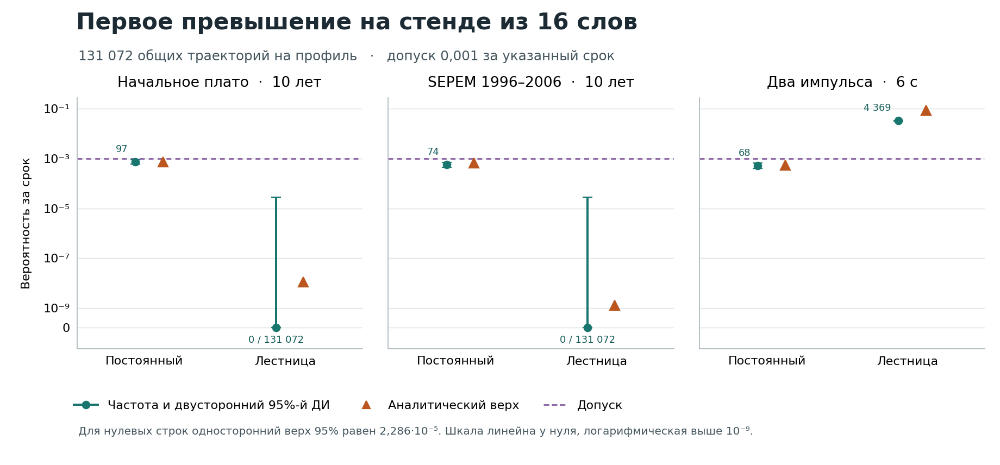

# Четыре способа контроля на 16 словах

**На обоих десятилетних профилях дешевле подтверждённый постоянный период.** При начальном плато достаточно 187,9048192 с между проходами, на десятилетии SEPEM — 1503,2385536 с. За весь срок они занимают в среднем 5,374231 и 0,671780 с порта. Лестница в обоих случаях занимает около 352 205 с. На шестисекундном стрессе допустим постоянный период 22,4 мкс. Для лестницы и порога с коротким удержанием вероятность строго выше допуска 0,001 уже на первом импульсе. [Регистрация до новых прогонов](https://github.com/z3tm4n-x/phd-adaptive-memory-ecc/blob/1648e80b6e80cfe1be349f7083eaae7262e7f6a0/experiments/t186-reduced-comparison/PROTOCOL.md) · [Независимая сверка теоретика](https://github.com/z3tm4n-x/phd-adaptive-memory-ecc/issues/186#issuecomment-6853178772)

В банке 64 байта, 16 слов по 32 информационных и шесть проверочных позиций. Одна частица поражает одно слово с вероятностью 4/5 и два соседних с вероятностью 1/5, по одной позиции в каждом. Исполнители получают одни и те же частицы. Каждый увидит свой ERR только при чтении. Один проход L=11,2 мкс охватывает оба адреса каждого слова. Q — вероятность того, что хотя бы раз за [0,T) в одном слове одновременно ошибочны две разные позиции. После первого превышения модель продолжает читать все назначенные адреса и платить за фактические исправляющие записи до конца срока. [Календарь и закон меток](../t186-cluster-laws/PROTOCOL.md)

### Вероятность и занятость защитного порта

В каждой строке 131 072 траектории. Частота и двусторонний 95%-й интервал Клоппера–Пирсона даны **в процентах**, аналитические границы **в долях единицы**. Цена — средние секунды и процент срока. Последняя колонка делит среднюю цену строки на среднюю цену выбранного постоянного кандидата того же профиля. Для двух строго недопустимых режимов стресса сравнение цен при общем допуске неприменимо. Полные значения, доли, одновременные интервалы 95% по 12 строкам и суммы наносекунд чтений и записей приведены в [ведомости](result.json).

| Профиль | Режим | Превышений | Частота, % [95% ДИ] | Аналитическая граница Q и статус | Порт за T, с | Порт, % | Цена / постоянная |
|---|---|---:|---|---|---:|---:|---:|
| Начальное плато, 10 лет | Постоянный 187,9048192 с | 97 | 0,07401 [0,06001–0,09028] | ≤0,000718185, проходит | 5,374231 | 0,000001703 | 1 |
| Начальное плато, 10 лет | Лестница | 0 | 0 [0–0,002815] | ≤1,094·10⁻⁸, проходит | 352 205,447199 | 0,11160717 | 65 536,0 |
| Начальное плато, 10 лет | Красников, удержание | 0 | 0 [0–0,002815] | ≤2,31·10⁻¹¹, проходит | 90 164 571,428572 | 28,57142857 | 16 777 204,4 |
| Начальное плато, 10 лет | Порог, короткое удержание | 0 | 0 [0–0,002815] | ≤1,094·10⁻⁸, проходит | 352 205,361848 | 0,11160714 | 65 536,0 |
| SEPEM 1996–2006, 10 лет | Постоянный 1503,2385536 с | 74 | 0,05646 [0,04433–0,07088] | ≤0,000665877, проходит | 0,671780 | 0,0000002129 | 1 |
| SEPEM 1996–2006, 10 лет | Лестница | 0 | 0 [0–0,002815] | ≤1,269·10⁻⁹, проходит | 352 205,437875 | 0,11160717 | 524 287,1 |
| SEPEM 1996–2006, 10 лет | Красников, удержание | 0 | 0 [0–0,002815] | ≤3,27·10⁻¹², проходит | 90 164 571,428572 | 28,57142857 | 134 217 469,6 |
| SEPEM 1996–2006, 10 лет | Порог, короткое удержание | 0 | 0 [0–0,002815] | ≤1,269·10⁻⁹, проходит | 352 205,361361 | 0,11160714 | 524 287,0 |
| Два импульса, 6 с | Постоянный 22,4 мкс | 68 | 0,05188 [0,04028–0,06577] | ≤0,000533424, проходит | 0,857144 | 14,285734 | 1 |
| Два импульса, 6 с | Лестница | 4369 | 3,33328 [3,23675–3,43189] | 0,0018455 < Q ≤ 0,089172, исключена | 0,055642 | 0,927367 | — |
| Два импульса, 6 с | Красников, удержание | 27 | 0,02060 [0,01357–0,02998] | ≤0,000184455, проходит | 1,714286 | 28,571441 | 2,0000 |
| Два импульса, 6 с | Порог, короткое удержание | 7449 | 5,68314 [5,55839–5,80984] | 0,0018455 < Q ≤ 0,089172, исключён | 0,011164 | 0,186073 | — |



При **0/131 072** односторонний 95%-й верх при округлении вверх равен 0,00002285536224, двусторонний — 0,00002814352070 (оба в долях). На десятилетних входах эти интервалы значительно шире аналитического верха лестницы. Выборка не разрешает риск на уровне 10⁻⁹…10⁻⁸. На плато частота у постоянного периода немного выше расчётного верха, но сам верх лежит внутри доверительного интервала. На стрессе верх 0,089172 охватывает наблюдаемые частоты обоих адаптивных правил с запасом, поскольку для всего срока он использует лишь гарантированные общие проходы. Реальные переходы на L добавляют защиты. Неопределённость частот относится к меткам на зафиксированных входах. [Данные рисунка](result.json)

### Почему различается выбор

**Цена.** На десятилетии на банк в среднем приходится лишь 5,721 инверсии на плато и 5,011 на SEPEM. Старший период обеих адаптивных схем ограничен 256L=2,8672 мс. Одни обязательные чтения на этом шаге требуют за десять лет **не менее 352 205,357145 с** независимо от ERR. На том же входе верх математического ожидания полной цены постоянного кандидата равен **5,374232 с** на плато, **0,671781 с** на SEPEM. Для постоянного календаря время всех чтений известно точно, включая край. Ожидаемое число оплачиваемых записей сверху ограничено удвоенным ожидаемым числом инверсий. Каждая ненулевая выборка требует попадания между стартом предыдущего посещения и текущей выборкой. Для одного слова такими окнами одно попадание покрывается не более двух раз, в том числе при слабом ремонте во время записи. При стрессе у постоянного 22,4 мкс полный верх 0,857145 с, а у удерживающего Красникова одни чтения занимают не менее 1,714285 с. Эти неравенства устанавливают порядок ожидаемых портовых затрат при сопоставимой гарантии независимо от точности Монте-Карло. Истинно оптимальный постоянный период среди всех физически допускаемых значений не локализован. [Пределы по каждому профилю](result.json)

**Две длинные истории и стресс.** Обозначим через $\ell(t)$ интенсивность попаданий в данное слово, $S_i=\int_0^T\ell(t)^i\,dt$ и $B_w\ge\sup\ell$. Пусть $P$ — период обязательных проходов, $d=L/2$, $H=\max(d,P-d)$, $e=160$ нс. При двух различных родителях в одном слове доля разных позиций равна 37/38. До первого превышения для пары попаданий в одном межфазном интервале $J$ их ожидаемое число до выбора позиций не превышает $|J|\int_J\ell^2/2$. Перенос через ближайший старт возможен до фронта ремонта. Учёт этого перехода добавляет полосу массы не больше $eB_w$ на первое попадание. После отмены и нового рождения дефекта берётся его новый родитель. Начальная и конечная неполные фазы входят в разбиение. Поэтому $Q\le\min(1,16(37/38)(H S_2/2+eB_w S_1))$. Границы $256L$ обязательны для обоих адаптивных правил даже на их собственных историях. Положительный отчёт только добавляет посещения к этому основанию. Для стресса подставлены собственные $S_1=0,4$, $S_2=4$ с⁻¹, $B_w=10$ с⁻¹ на слово. [Подстановка и границы моментов для каждого входа](bounds.py)

На первом импульсе после тихого старта оба правила достигли 256L. В проходе с началом 2,0013056 с ещё нет ERR при отсутствии родителей до его конца. В следующей паузе 2,856 мс достаточно появления двух однословных родителей, первыми попадающих в разные позиции одного слова. Вероятность события «тишина до конца прохода, в паузе не менее двух родителей, первые два дают такую пару» **больше 0,0018455**. Этот нижний свидетель доказывает нарушение допуска двумя правилами до следующего наблюдения. Результат относится к заданному шестисекундному профилю. [Точное выражение, условия и расчёт](https://github.com/z3tm4n-x/phd-adaptive-memory-ecc/issues/186#issuecomment-6853178772)

**Красников и порог.** В первоисточнике счёт за цикл определяет новый период при изменении счёта. Нуль, запуск, число полных слов и квантование периода для общего порта заданы в протоколе. На новом стенде $\alpha=2\cdot16 M_sL/T_s<1{,}136\cdot10^{-15}$. Из L при ненулевом целом счёте $m$ формулы дают $P^*/L=1/m+\alpha/m^2<2$. Нуль и равенство цели сохраняют L. Поэтому выбранная реализация Красникова в точности совпадает с постоянным L по риску и портовой цене на каждой траектории. Это позволяет использовать его готовую строку, включая работу после превышения. Порог после одного полного чистого окна возвращается на 256L. Лестнице для верхней ступени нужны 596 чистых окон. На стрессе более ранний возврат сопровождается меньшей занятостью и большим числом превышений. Для переноса на изделие нужны физическая граница прямых многобитовых поражений слова, своевременность ERR, подтверждённое поведение после двух ошибок и затраты управления, CPU и энергии. [С. 74–75, формулы (7)–(10), рис. 4](https://www.niime.ru/upload/zhurnal-mikroelektronika/001-080%20Book%20B.pdf#page=74) · [Условия главного примера 64 КиБ](../../thesis/GEO_NATIVE_DESIGN_CASE.md#selected-volume)

### Повтор

Python 3.13.5, NumPy 2.2.4, Numba 0.61.2, SciPy 1.15.2, Matplotlib 3.10.1. Рабочий каталог — корень репозитория, в T141_CACHE нужен исходный <code>bands.npy</code>. База, регистрация, хеши расчёта 1.1 и всех трёх повторно полученных потоков приведены в результате. Первичный прогон нового правила на одном блоке занял около 4 с с компиляцией. После прогрева три полных профиля (393 216 реализаций) заняли около 2,4 с. Прежние 136 строк сохраняются. Направленные проверки отдельно сравнивают буквальную и ускоренную службы, собственные сбросы, совпадения с границами и расходы до T. [Источники и сводки 1.1](../t186-cluster-laws/README.md)

```sh
python -B experiments/t186-cluster-laws/verify.py --results
python -B experiments/t186-reduced-comparison/checks.py
python -B experiments/t186-reduced-comparison/compare.py --cache T141_CACHE --check
python -B experiments/t186-reduced-comparison/figure.py
```
