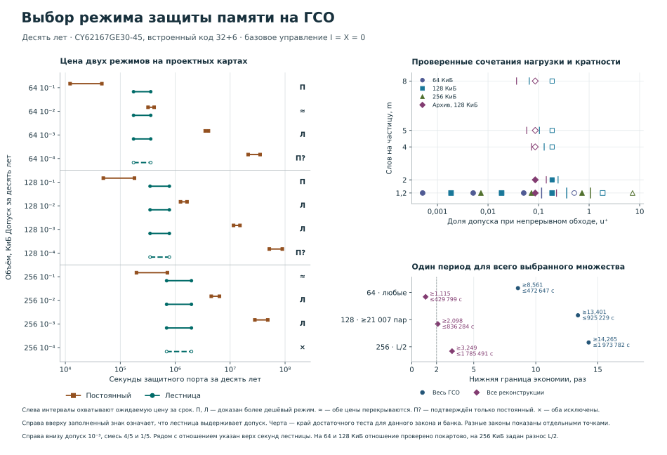

# Глава 4. Выбор периода обхода по объёму, допуску и карте адресов

На проектных картах трёх банков в **пяти из 12 сочетаний** дешевле лестница по сигналу исправления ERR, в двух — постоянный период. Ещё в двух оба режима допустимы, но цены перекрываются. В двух подтверждён только постоянный режим. В одном нижняя оценка вероятности исключает оба. Изменилась одна строка исходной карты — **256 КиБ при допуске 10⁻³**. Для выбора участка без сведений о парах опорным примером остаются **64 КиБ**. [Критерии до сборки](PROTOCOL.md) · [Исходная карта](../t186-native-cost-map/README.md) · [Задание №542](https://github.com/z3tm4n-x/phd-adaptive-memory-ecc/issues/542).

<a id="regime-table"></a>

## Как читать таблицу

Исследуется CY62167GE30-45 в режиме ×16 с внутренним словом из 32 информационных и шести проверочных разрядов. Вероятность $Q$ относится к первому появлению двух ошибочных разрядов хотя бы в одном слове за $T=315\,576\,000$ с. Параметр $\varepsilon$ ограничивает эту вероятность от накопления, включая $\delta=6\cdot10^{-6}$ на исключения исполнения. Одна частица задевает одно слово с вероятностью 4/5 и два соседних слова на кольце с вероятностью 1/5. В каждом задетом слове инвертируется одна из 38 равновероятных позиций. В основной смеси среднее число затронутых слов $m=6/5$. Начало чистое, обе половины слова хранят долгоживущие данные. [Закон, календарь порта и наблюдение ERR](../t186-native-cost-map/PROTOCOL.md).

**П** выбирает один постоянный период на весь сравниваемый класс профилей и данную карту. Слева в его интервале затрат стоит обязательный низ для *любого* допустимого периода, справа — достаточный верх для указанного кандидата. **Л** — лестница, которая повышает период после серии полных своевременных нулевых отчётов и возвращается на частую ступень после ERR или непригодного отчёта. Затраты — наибольшее по этому же классу ожидание секунд защитной занятости одного порта до конца срока. Включены пуск, края, обратные записи, повторные исправления и обслуживание после доказательной остановки. Дополнительных испорченных интервалов $I$ и прочей портовой занятости $X$ в базовых числах нет. [Состав цены](../t186-native-cost-map/README.md#от-адресов-до-интервалов-цены).

Первые 12 строк относятся **только** к полным парам адресов $(w,w+W)$ с разносом чтений на половину прохода $L$. В порядке 64, 128 и 256 КиБ полный проход длится 11,4688, 22,9376 и 45,8752 мс. Вторая часть таблицы указывает, какие выводы сохраняются при меньших сведениях о размещении и при другом классе соперника. «Рек.» означает один период для **всех** принятых реконструкций, включая все допустимые сдвиги десятилетия SEPEM и заданные заполнения GOES. Число $u^+=Q^+_{\rm непр}(L)/\varepsilon$ на 12 точках вычислено по однофазному верху исходной карты. Для главного примера отдельно требуется $u^+\le1/4$ **на ГСО**, а также двукратная экономия. Знак «¼» в обеих строках каждого охвата указывает результат именно этого теста ГСО. [Покартовая проверка обоих требований](../t186-pair-service-table/README.md).

Число после выбора — доказанная нижняя граница отношения дорогого режима к дешёвому. Когда известен только класс карт, берётся опубликованный минимум отношения, составленного **на каждой карте**, либо две границы, одновременно действующие на каждой карте. В колонках с секундами концы округлены наружу до целой секунды. Прочерк означает отсутствие соответствующей оценки или допустимого соперника. В строке частичного охвата указан общий верх по всем картам. [Ведомость с точностью исходных чисел и адресами строк](map.json).

<!-- table -->

| КиБ · карта | Класс · ε | u⁺ | Период П, мс | Q П / Л | П, с | Л, с | Выбор · ≥ раз |
|---|---|---:|---:|---|---:|---:|---|
| 64 · разнос L/2 | ГСО · 10⁻¹ | 0,000509 | 25 554,6018 | ≤0,099999995104 / ≤0,000443265661 | 12 204–46 162 | 174 260–358 396 | П дешевле · 3,7750× |
| 64 · разнос L/2 | ГСО · 10⁻² | 0,005089 | 2 559,2406 | ≤0,009999998958 / ≤0,000443265661 | 320 345–413 395 | 174 260–358 396 | цены перекрываются |
| 64 · разнос L/2 | ГСО · 10⁻³ | 0,050890<br>¼ есть | 259,7042 | ≤0,000999998247 / ≤0,000443265661 | 3 518 494–4 026 924 | 174 260–358 396 | Л дешевле · 9,8173× |
| 64 · разнос L/2 | ГСО · 10⁻⁴ | 0,508900 | 29,75 | ≤0,000099995984 / ≤0,000443265661 | 21 258 128–35 112 343 | 174 260–358 396 | подтверждён П |
| 128 · разнос L/2 | ГСО · 10⁻¹ | 0,001856 | 12 785,9018 | ≤0,099999992569 / ≤0,000513898181 | 49 087–181 259 | 348 497–782 799 | П дешевле · 1,9226× |
| 128 · разнос L/2 | ГСО · 10⁻² | 0,018556 | 1 288,2212 | ≤0,009999996422 / ≤0,000513898181 | 1 248 360–1 639 401 | 348 497–782 799 | Л дешевле · 1,5947× |
| 128 · разнос L/2 | ГСО · 10⁻³ | 0,185554<br>¼ есть | 138,453 | ≤0,000999995712 / ≤0,000513898181 | 11 527 603–15 105 097 | 348 497–782 799 | Л дешевле · 14,7261× |
| 128 · разнос L/2 | ГСО · 10⁻⁴ | 1,855538 | 23,4766 | ≤0,000099998928 / ≤0,000513898181 | 51 639 627–88 994 552 | 348 497–782 799 | подтверждён П |
| 256 · разнос L/2 | ГСО · 10⁻¹ | 0,007243 | 6 410,1534 | ≤0,099999987498 / ≤0,000677662949 | 196 890–720 003 | 696 879–1 973 782 | цены перекрываются |
| 256 · разнос L/2 | ГСО · 10⁻² | 0,072421 | 661,3124 | ≤0,009999980392 / ≤0,000677662949 | 4 533 152–6 385 611 | 696 879–1 973 782 | Л дешевле · 2,2966× |
| 256 · разнос L/2 | ГСО · 10⁻³ | 0,724204<br>¼ не подтв. | 86,429 | ≤0,000999990641 / ≤0,000677662949 | 28 156 816–48 405 503 | 696 879–1 973 782 | Л дешевле · 14,2654× |
| 256 · разнос L/2 | ГСО · 10⁻⁴ | 7,242033 | — | ≥0,000241506317 / ≥0,000241506317 | — | 696 879–1 973 782 | оба исключены |
| **Допуск 10⁻³. Область действия и класс соперника** | | | | | | | |
| 64 · любые пары · смесь | ГСО · 10⁻³ | 0,095780<br>¼ есть | 93,4444 | ≤0,000737457381 / ≤0,000552582076 | 3 452 586–11 186 562 | ≤472 647 | Л дешевле · 8,5619× |
| 64 · любые пары · смесь | Рек. · 10⁻³ | 0,045970<br>¼ есть | 93,4444 | ≤0,000331640287 / ≤0,000452525056 | 412 236–11 181 903 | ≤429 799 | Л дешевле · 1,1151× |
| 128 · любые пары · смесь | ГСО · 10⁻³ | 0,365108<br>¼ не подтв. | 45,8752 | ≤0,000724203204 / ≤0,000715389615 | 11 204 184–45 568 422 | ≤1 152 929 | Л дешевле · 13,4014× |
| 128 · любые пары · смесь | Рек. · 10⁻³ | 0,165873<br>¼ не подтв. | 45,8752 | ≤0,000325739714 / ≤0,000460210665 | 1 599 567–45 549 788 | ≤1 024 307 | Л дешевле · 2,0983× |
| 128 · ≥21 007 пар · смесь | ГСО · 10⁻³ | 0,249999<br>¼ есть | 45,8752 | ≤0,000499764703 / ≤0,000609394852 | 11 204 184–45 557 926 | ≤925 229 | Л дешевле · 13,4014× |
| 128 · ≥21 007 пар · смесь | Рек. · 10⁻³ | 0,114627<br>¼ есть | 45,8752 | ≤0,000225821054 / ≤0,000431118997 | 1 599 567–45 545 116 | ≤836 284 | Л дешевле · 2,0983× |
| 64 · разнос L/2 | Рек. · 10⁻³ | — | 576,2064 | ≤0,000999999459 / ≤0,000363220045 | 413 262–1 815 568 | ≤331 526 | Л дешевле · 1,2465× |
| 128 · разнос L/2 | Рек. · 10⁻³ | 0,085937 | 93,4444 | ≤0,000331640287 / ≤0,000379565121 | 1 599 567–22 385 828 | 348 543–717 260 | Л дешевле · 2,2301× |
| 256 · разнос L/2 | Рек. · 10⁻³ | — | 165,5542 | ≤0,000999993788 / ≤0,000414082744 | 5 801 306–25 265 870 | ≤1 785 491 | Л дешевле · 3,2491× |
| 256 · любая замкнутая | ГСО · 10⁻³ | 0,724204<br>¼ не подтв. | 63,4914 | ≤0,000999990641 / ≤0,000993406142 | 28 156 816–65 868 344 | ≤2 031 290 | Л дешевле · 13,8615× |
| 256 · любая замкнутая | Рек. · 10⁻³ | — | 63,4914 | ≤0,000999990641 / ≤0,000993406142 | 5 801 306–65 868 344 | ≤2 031 290 | Л дешевле · 2,8559× |
| 256 · все снаружи | ГСО · 10⁻³ | — | — | — / ≥0,001074030302 | — | — | Л исключена |
| 256 · частичный охват | ГСО · 10⁻³ | — | — | — / ≤0,002082047487 | — | — | выбор открыт |

<!-- /table -->

<a id="regime-figure"></a>



## Что изменили уточнения

**На 256 КиБ с разносом $L/2$** исполненное второе чтение с обратной записью устраняет прежний дефект. Пропущенный проход возможен лишь после пригодной истории, разрешившей как минимум первую редкую ступень. Учёт этих двух случаев уменьшил верх вероятности остановки с 0,001044023744 до 0,000677662949, включая рождения во время записи. Уменьшилась и цена хвоста до конца срока. При допуске 10⁻³ у Л теперь верх **1 973 781,020 с**, у П необходимый низ **28 156 816,664 с**, выигрыш **≥14,265420 раза**. Исполнимый кандидат 86,429 мс имеет отдельный верх 48 405 502,012 с. Критерий четверти для этой проектной точки не подтверждён даже двухфазным верхом непрерывного режима 0,000365107490. [Доказательство двух фаз №528](../../theory/t525-two-phases-256k.md) · [Оба верха непрерывного режима](../t186-native-cost-map/result.json).

Тот же календарь, те же семь порогов и та же квота $\delta$ действуют при всех четырёх допусках исходной карты. Поэтому для 256 КиБ один проверенный интервал цены Л **696 879,993–1 973 781,020 с** можно сравнить с каждым своим П. При 10⁻¹ верх П 720 002,571 с всё ещё на 23 122,578 с выше низа Л. Выборочное среднее Л на SEPEM выше цены этого кандидата, однако для строгого выбора П нужен низ ожидаемой цены Л. При 10⁻² Л и прежде была дешевле, новая граница составляет ≥2,296684 при необходимой цене П 4 533 152,362 с. При 10⁻⁴ свидетель $Q\ge0{,}000241506317$ сохраняет строгое исключение обоих. Лучшего допустимого П в этой строке нет. [Исходные постоянные кандидаты и свидетель](../t186-native-cost-map/README.md) · [Обе цены прежней лестницы после уточнения](../t525-two-phases/result.json).

**Проверка остальных восьми строк.** При тех же проектных адресах отдельно подставлены фактические фазы, видимость, число ступеней и пороги каждого банка в двухфазную оценку №528 и в однофазную оценку роста №540. В первом случае сдвиг на $W$ сохраняет слот кадра и сдвигает чтение на $L/2$. Во втором проверены положительность нижнего уровня частоты, накопленной массы и скидки на уже известную историю, а также длина минимальной истории. Предпосылки и арифметика проверяются при сборке. Для 64 КиБ лучший из двух верхов даёт однофазный учёт роста, $Q^+\le0{,}000413212013$ и цена Л ≤352 921,259 с. При 10⁻² низ П 320 345,764 с остаётся ниже этого верха. На 128 КиБ сильнее двухфазная подстановка, $Q^+\le0{,}000463505833$, цена Л ≤773 620,621 с. На обоих банках при 10⁻⁴ этих верхов недостаточно. Ни одна из восьми категорий не изменилась. Это отдельная численная проверка на имеющихся точках. Для этих банков таблица и фигура воспроизводят ранее принятые основные цены и исходные пороги видимости. [Обе подстановки со сроковыми низами и верхами](map.json) · [Неравенство для подъёмов №540](../../theory/t534-address-phase-256k.md).

## Что требуется знать о парах при допуске 10⁻³

- **64 КиБ, любая карта, основная смесь.** На ГСО непрерывный обход использует не более 9,578% допуска. Лестница занимает до 472 646,894 с, сокращение цены ≥8,5619 раза. Для одного периода на всех реконструкциях верх лестницы 429 798,746 с и отношение ≥1,1151. Деление общего низа П 412 236,428 с на общий верх Л для разных карт утратило бы покартовый результат. [Расчёт по интервалам охвата](../t186-pair-service-table/README.md).
- **128 КиБ, та же смесь.** На любой карте ГСО даёт до 1 152 928,709 с и ≥13,4014 раза, архивное множество — до 1 024 306,445 с и ≥2,0983 раза. Верх непрерывного обхода на ГСО достигает 36,5108% допуска. Для четверти достаточно, чтобы из 65 536 адресов в области находились обе половины как минимум **21 007** пар. Тогда охвачено не более 44 529 слов, а верх Л на ГСО снижается до 925 228,885 с. На конкретной проектной карте архивный низ П ≥1 599 567,384 с из результата для любых карт применим и к ней. При её собственном верхе Л 717 259,503 с это даёт ≥2,230109 раза. [Области и положение четверти](../t186-pair-service-table/result.json) · [Архивная смесь на проектной карте](../t186-native-cost-map/result.json).
- **256 КиБ, замкнутость установлена, перестановка произвольна.** Верх $Q^+\le0{,}000993406142$ оставляет 0,000006593858 допуска. Нижняя цена П ≥28 156 816,664 с и верх Л ≤2 031 289,241 с дают ≥13,861549 раза на каждой карте. Постоянный кандидат 63,4914 мс квалифицирован однофазным тестом. Подстановка его периода в прежний календарный счёт чтений и записей, одинаковый по парованию при данных числе слов и адресов, даёт верх 65 868 343,114 с. На всех реконструкциях сохраняются этот достаточный кандидат и верх цены Л по включению множеств. Архивный свидетель даёт собственный необходимый низ П 5 801 306,127 с на каждой замкнутой карте, откуда ≥2,855972 раза. При установленном разносе $L/2$ действует более тесный архивный верх Л 1 785 490,791 с. Тот же низ даёт **≥3,249138 раза** вместо ≥3,239474 по первоначальному свидетелю. [Низ П и произвольная перестановка №540](../../theory/t534-address-phase-256k.md) · [Архивные верхние оценки №535](../t534-archive-comparison/README.md) · [Включение реконструкций в класс ГСО](../t186-ost-geo-3g/README.md).
- **256 КиБ, партнёры могут оказаться снаружи.** Если все 131 072 партнёра снаружи, на допустимом начальном плато у самой лестницы $Q\ge0{,}001074030302>0{,}001$. Этот свидетель опровергает общую гарантию без сведений об охвате. Для конкретной частично замкнутой области требуется число полных пар $p$, число охваченных слов $W=131\,072-p$, нормировка меток по этим словам и сохранность обеих половин при работе приложения. При использовании обеих фаз нужен также порядок фактических посещений. В однофазном расчёте одновременно меняются множитель $Wc^2/2$ и скорость наблюдения $c(5W-4)/6$, где $c=1/524288$. Общий верх 0,002082047487 оставляет выбор для конкретной частичной карты открытым. Для строки со всеми партнёрами снаружи приведён вывод о данной лестнице. [Свидетель, область частичного охвата и требования к разводке](../../theory/t534-address-phase-256k.md#тесные-пары-и-внешние-партнёры).

**Объёмы за пределами сетки.** При 0,5, 1, 2 и 4 МиБ, том же допуске 10⁻³, проектном разносе $L/2$, основной смеси и одном последовательном порту нижние свидетели для обеих политик равны соответственно 0,001074030302, 0,003939504704, 0,015591300581 и 0,059592307767. Каждый превышает допуск. Для 4 МиБ приняты два кристалла с общим портом и поражение одной частицей только одного кристалла. [Область исключения №504](../t504-large-bank/README.md).

## Видимость кластера и архивная имитация

На рисунке $u^+$ характеризует верх непрерывного обхода, $m$ — среднее число разных слов на частицу. Заполненный знак означает выполнение достаточной границы риска Л. Короткая черта — предел $u$ данного теста при фиксированных законе, объёме и видимости. Для 256 КиБ с разносом $L/2$ показан уточнённый достаточный предел ≥1,068677583 при фактической видимости $81919/98304$. Порог при изменении самой видимости в №528 не искали. Сетки допустимой видимости №481 сохранены с пометкой версии. На 128 КиБ проверенный срез охватывает пять законов с одинаковой частотой инверсий на разряд. Своевременная видимость $\eta$ — число **разных** частиц, дающих пригодный ERR, на одну инверсию. Достаточны $\eta\ge6013/16384$ для ГСО и $\eta\ge4870/16384$ для реконструкций. Смесь ($13653/16384$) и два случайных различных слова (1/2) проходят. При 4, 5 или 8 соседях даже максимально возможные $1/4,1/5,1/8$ ниже этих порогов. Имеющиеся верхи оставляют допустимость Л открытой. Между законами с разным расположением нет интерполяции. [Вероятности, цены и края порогов всех десяти сочетаний](../t186-native-cost-map/README.md).

**Архивный опыт** показывает средние для заданного десятилетия и конкретной карты. На SEPEM 16.12.1996–16.12.2006 при разносе $L/2$ на 64 КиБ получено 240 270,46 с, стандартная ошибка 90,97 с, аналитический верх этой истории 331 190,613 с. На 256 КиБ — 1 274 365,16 с, стандартная ошибка 461,52 с, верх 1 780 783,486 с. На восьми отдельных рядах GOES средние лежат между 201 370,80 и 205 545,30 с для 64 КиБ и между 1 002 347,77 и 1 041 538,65 с для 256 КиБ. В каждой истории 128 реализаций. Стандартная ошибка описывает выборочный разброс при заданных метках и заполнениях. Для одного периода, выбранного на всё архивное множество, доказанные отношения даны в таблице. Период, выбранный после предъявления одной истории, имеет другой класс сравнения. [64 КиБ](../t534-archive-comparison/64KiB.md) · [256 КиБ](../t534-archive-comparison/README.md).

**Для изделия** нужны достоверный ERR от любой из 38 позиций, устранение старого дефекта завершённой записью при допускаемом слабом остатке, отдельный верх прямых многобитовых поражений, подтверждение исполнительской квоты и бюджет добавочных сбросов и портовой работы. На проектных 256 КиБ для двукратности достаточно $57{,}866218 I+X\le12\,104\,627{,}312$ с. Процессорное время, энергию и задержку запроса приложения оценивают отдельно от секунд защитного порта. [Физические условия главного примера](../../thesis/GEO_NATIVE_DESIGN_CASE.md#chip-tests).

## Воспроизведение

База `a5df64aab07ef149f3547479c6a5f96f5a3468e1`, Python 3.13.5, Matplotlib 3.10.1. Из корня репозитория первая команда собирает таблицу, ведомость и векторный рисунок из принятых файлов. Вторая сверяет все три. Архивные выборки взяты из опубликованных ведомостей.

```sh
python -B experiments/t542-regime-map/build.py
python -B experiments/t542-regime-map/build.py --check
```
