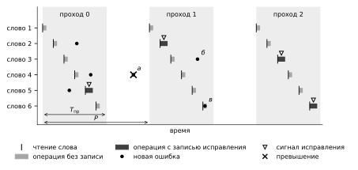
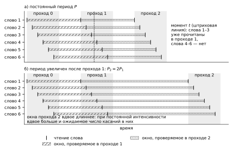

# Глава 2. Модели сбоев и коррекции ошибок в цифровой памяти

## 2.3. Модель последовательного контроля памяти

Сбой в памяти и его обнаружение разделены во времени. Ошибка, внесённая частицей в слово, не проявляется, пока это слово не прочитано, а исправленный образ, записанный при проверке обратно, меняет состояние слова и тем самым то, какие ошибки могут встретиться в нём при следующей проверке. Поэтому модель контроля должна ответить на три вопроса: когда ошибка может быть обнаружена, какие ошибки снимает запись исправления и что можно узнать об обстановке по сообщениям памяти о выполненных исправлениях.

### 2.3.1. Порядок контроля и условия обнаружения ошибок

Память содержит $W$ кодовых слов. Состояние слова в каждый момент описывается множеством разрядов, значения которых отличаются от правильного образа; их число назовём весом ошибки слова. Частица инвертирует затронутые разряды, поэтому повторная инверсия ошибочного разряда возвращает его к правильному значению. Код слова исправляет не более $t_{\text{код}}$ ошибок; это число называют корректирующей способностью кода. Если при чтении вес ошибки не больше $t_{\text{код}}$, декодер выдаёт правильные данные и, когда исправление потребовалось, формирует сигнал исправления — признак того, что в прочитанном слове исправлена ошибка. Превышением корректирующей способности назовём момент, когда вес ошибки хотя бы одного слова становится больше $t_{\text{код}}$. При $t_{\text{код}} = 1$ оно наступает, например, когда частица изменяет другой разряд слова, в котором уже есть неисправленная ошибка. Частица, изменившая сразу несколько разрядов одного слова (прямое многобитовое воздействие), вызывает немедленное превышение, если слово до неё было чистым и затронуто больше $t_{\text{код}}$ разрядов; в слове, где уже была ошибка, такое воздействие может её и погасить, так что результат определяется весом получившегося состояния. Превышение остаётся состоявшимся событием, даже если затем запись восстановит слово.

Контроллер периодического контроля (скраббинга) читает слова в постоянном порядке; такие чтения назовём контрольными, в отличие от чтений приложения. Однократное контрольное чтение всех $W$ слов называется проходом, а время между двумя последовательными контрольными чтениями одного и того же слова — периодом контроля $P$. Календарь контроллера заранее отводит каждому слову интервал, достаточный для самой длинной операции контроля; длительность прохода $T_{\text{пр}}$ охватывает отведённые интервалы всех слов и паузы между ними, предусмотренные календарём. При постоянном периоде $T_{\text{пр}} \le P$; если следующий проход начинается сразу после окончания предыдущего, $T_{\text{пр}} = P$.

Слова читаются в разные моменты прохода. Обозначим через $r_w(k)$ момент контрольного чтения слова $w$ в $k$-м проходе, $k = 0, 1, 2, \ldots$, — момент, в который фиксируется состояние слова (снимок), а через $v_w(k) \ge r_w(k)$ — фактический момент окончания операции контроля этого слова, включающей декодирование и, если она выполняется, запись. Границы отведённых интервалов не зависят от того, обнаружены ли ошибки, а фактическое окончание операции внутри интервала зависит от того, понадобилась ли запись. Будем считать календарь идеальным: снимок делается в заданный календарём момент. Тогда при постоянном периоде

$$
r_w(k) = t_0 + kP + \varphi_w, \qquad 0 \le \varphi_w < T_{\text{пр}},
\tag{2.7}
$$

где $t_0$ — начало первого прохода; $\varphi_w$ — сдвиг чтения слова $w$ от начала прохода. Каждое слово проверяется ровно через $P$ после предыдущей проверки, но для разных слов эти моменты сдвинуты на разность сдвигов $\varphi_w$. Если период меняется между проходами, порядок чтений внутри прохода по-прежнему задаётся календарём, а меняется время между проходами.

Ошибка, возникшая в слове $w$ в момент $s$, не может быть обнаружена контролем раньше ближайшего контрольного чтения этого слова $r_w(k) \ge s$. Если к этому чтению она сохранилась и исправима, она обнаруживается при нём, и задержка обнаружения не превышает $P$; момент сбоя при этом не восстанавливается. Для проходов $k \ge 1$ известно лишь, что сбой произошёл на интервале $[r_w(k-1),\, r_w(k))$ между двумя контрольными чтениями слова; этот интервал назовём окном наблюдения слова $w$ в $k$-м проходе. Окна разных слов в одном проходе сдвинуты так же, как моменты их чтения, а последовательные окна одного слова примыкают друг к другу без промежутков. Если ошибка попала в слово, уже прочитанное в текущем проходе, контроль может обнаружить её только в следующем проходе. Поэтому окончание прохода не означает, что в памяти нет ошибок: часть слов может содержать ошибки, пришедшие после их чтения.

Операция контроля слова занимает интервал $[r_w(k),\, v_w(k)]$: чтение, декодирование и, если она предусмотрена, запись исправленного образа. Исправление поэтому не мгновенно, и его результат зависит от того, когда выполняется запись. Рассматривается слово, снимок которого исправим: до первого превышения вес ошибки в момент чтения не больше $t_{\text{код}}$, и декодер восстанавливает правильный образ; результат декодирования неисправимого снимка моделью не задаётся. Различаются три варианта обслуживания.

При обслуживании с безусловной записью исправленный образ записывается после каждого чтения. К окончанию записи слово совпадает с правильным образом: снимаются ошибки, имевшиеся при чтении, и ошибки, попавшие в слово до окончания записи. Ошибки, пришедшие после записи, остаются до следующего прохода.

При обслуживании с записью после исправимой ошибки запись выполняется, только если при чтении обнаружена исправимая ошибка; тогда к окончанию записи слово также восстановлено. Если ошибки при чтении нет, записи нет, и последней проверкой слова служит само чтение: ошибка, пришедшая после него, остаётся до следующего прохода.

При обслуживании с записью по сигналу исправления память исправляет ошибку в выдаваемых данных и формирует сигнал исправления, но ячейки сама не перезаписывает; получив сигнал, контроллер в той же операции записывает исправленный образ. К окончанию операции снимаются все ошибки, существовавшие до её начала, но ошибки от попаданий во время операции могут остаться. Если сигнала нет, записи нет, и слово к окончанию операции может содержать ошибку, пришедшую во время неё.

Во всех вариантах превышение, возникшее внутри операции, например изменение другого разряда слова, в котором уже есть ошибка, до окончания записи, считается состоявшимся событием, даже если запись затем восстановит слово. Момент чтения поэтому нельзя считать моментом мгновенного восстановления слова. Описанные случаи — обнаружение ошибки только в следующем проходе, ошибка во время операции без записи и превышение — сопоставлены на временной диаграмме обхода (рисунок 2.8).

Рисунок 2.8 — Временная диаграмма последовательного контроля: а — ошибка в другом разряде слова, уже содержащего неисправленную ошибку (превышение корректирующей способности); б — ошибка в уже прочитанном слове, обнаруживаемая в следующем проходе; в — ошибка во время операции без записи, остающаяся до следующего прохода

Для числовой иллюстрации рассмотрим память на микросхеме CY62167GE30. По документации изготовителя у неё есть вывод сигнала исправления ERR, который указывает на обнаружение и исправление одиночной ошибки при чтении, а автоматической обратной записи исправленных данных в ячейки нет [@CY62167RevF]. Внутренняя организация кристалла документацией не раскрыта, поэтому для расчёта приняты допущения: внутреннее слово содержит 32 информационных и 6 проверочных разрядов, и код исправляет одну ошибку ($t_{\text{код}} = 1$); два 16-разрядных обращения по известной паре внешних адресов читают одно внутреннее слово; сигнал исправления отражает исправление в любом из 38 разрядов слова. При ёмкости 16 Мбит и этих допущениях память содержит $W = 524\,288$ слов. Используется обслуживание с записью по сигналу исправления; записей приложения в контролируемую область нет.

Времена операций заданы проектными верхними границами контроллера, а не измерениями; они и остальные параметры примера приведены в таблице 2.8. Календарь отводит каждому слову одинаковый интервал, и в рассматриваемом календаре проходы следуют друг за другом без пауз, поэтому длительность прохода равна периоду $P$, который не превышает 0,1028 с. Длительность прохода задаётся календарём и от числа сигналов не зависит. От числа сигналов зависит суммарная занятость интерфейса операциями контроля за проход: не более 48,50 мс, если сигналов нет, и не более 77,86 мс при сигнале в каждом слове. Ошибка, возникшая в уже прочитанном слове, если она сохранится до следующего контрольного чтения и будет при нём исправима, обнаруживается не позже чем через 0,1028 с.

Таблица 2.8 — Параметры примера памяти на CY62167GE30

| Параметр | Значение | Основание |
|---|---|---|
| Вывод сигнала исправления ERR | есть | документация изготовителя [@CY62167RevF] |
| Автоматическая обратная запись исправленных данных | нет | документация изготовителя [@CY62167RevF] |
| Внутреннее слово | 32 информационных и 6 проверочных разрядов, $t_{\text{код}} = 1$ | допущение расчёта |
| Чтение внутреннего слова | два 16-разрядных обращения по известной паре адресов | допущение расчёта |
| Охват сигнала исправления | все 38 разрядов слова | допущение расчёта |
| Число слов $W$ | 524 288 | ёмкость 16 Мбит при допущенной структуре слова |
| Чтение слова без исправления | не более 92,51 нс | проектная верхняя граница |
| Чтение с исправлением и записью | не более 148,6 нс | проектная верхняя граница |
| Период $P$ рассматриваемого календаря, равный $T_{\text{пр}}$ | не более 0,1028 с | календарь контроллера |
| Занятость операциями за проход: без сигналов / при сигнале в каждом слове | не более 48,50 / не более 77,86 мс | $W$, умноженное на неокруглённую верхнюю границу времени операции |

### 2.3.2. Информативность сигнала исправления

Сигнал исправления сообщает лишь, что в прочитанном слове была исправимая ошибка. Он относится к слову и к моменту контрольного чтения, а не к частице и не к моменту сбоя. Обозначим через $C_k$ число сигналов при контрольных чтениях $k$-го прохода, то есть число слов, в которых при этих чтениях обнаружена исправимая ошибка; сигналы при чтениях приложения в это число не входят.

Связать число сигналов с обстановкой можно через касания слов. Непрямым касанием слова назовём изменение частицей ровно одного разряда этого слова. Частица, задевшая несколько слов, даёт по одному касанию в каждом из них; прямое многобитовое воздействие касанием не считается. Пусть $\nu(t)$ — верхняя граница интенсивности непрямых касаний: средняя интенсивность касаний каждого слова не больше $\nu(t)/W$. Обозначим через $N_k$ число непрямых касаний слов в их окнах наблюдения $k$-го прохода, $k \ge 1$. Окна заданы календарём заранее, поэтому

$$
\mathrm{E}\,N_k \le \frac{1}{W}\sum_{w=1}^{W}\int_{r_w(k-1)}^{r_w(k)} \nu(t)\,dt .
\tag{2.8}
$$

Связь $C_k$ с $N_k$ устанавливается лишь в узком случае: в рассматриваемой истории нет прямых многобитовых воздействий и ложных сигналов, то есть сигналов без исправленной ошибки; сигнал полный, то есть отражает исправление в любом разряде слова; обслуживание корректно — контроллер записывает правильный образ и не вносит новых ошибок; $k \ge 1$, и до контрольного чтения превышения не было. Тогда ошибочными при чтении могут быть только разряды, затронутые в окне наблюдения слова, так как более ранние ошибки сняты предыдущей операцией, и $C_k \le N_k$. Обратное неверно: повторная инверсия того же разряда снимает ошибку, и касание остаётся без сигнала. Вне этого случая связь между $C_k$ и $N_k$ моделью не задаётся.

Из (2.8) следует, что ожидаемое число касаний в окнах прохода определяется интенсивностью на этих окнах, а не в момент прохода, и их длиной. При постоянном периоде все окна имеют длину $P$ и $\mathrm{E}\,N_k \le P \max_t \nu(t)$. Пусть до некоторого прохода период был равен $P_1$, а после него увеличен до $P_2 = 2P_1$. Окна следующего прохода удлиняются вдвое, и при постоянной интенсивности касаний их ожидаемое число в этих окнах тоже вдвое больше; число сигналов даже в узком случае не больше числа касаний и вдвое расти не обязано. Сдвинутые окна при постоянном периоде и их удлинение после увеличения периода показаны на рисунке 2.9. Поэтому и число выявленных ошибок нельзя истолковать без учёта ранее выбранного периода: сравнивать счёт проходов с разными периодами можно только с учётом длины окон.

Рисунок 2.9 — Окна наблюдения слов при последовательном контроле: а — постоянный период $P$; б — увеличение периода от $P_1$ до $P_2 = 2P_1$ после прохода 1

Сигналы сообщают о словах, а не о частицах. Частица, задевшая несколько слов, может привести к сигналам в нескольких из них, если внесённые ошибки сохранятся до контрольных чтений и будут исправимы; сигналы появятся в разные моменты прохода, а если часть слов уже прочитана, — в разных проходах. Одна неисправленная ошибка, напротив, может быть сообщена несколько раз: каждое чтение неисправленного слова повторяет сигнал. В модели примера, где внутреннее слово читается двумя 16-разрядными обращениями, так действует и чтение второй половины того же слова; повторяют сигнал и чтения приложения без последующей записи. Такие повторы не являются новыми ошибками.

В примере памяти на CY62167GE30 используется верхняя граница интенсивности непрямых касаний 0,2447 с⁻¹ из расчётного набора данных для геостационарной орбиты при поверхностной плотности защиты 3 г/см²; этот набор служит иллюстрацией и применимости к реальному полёту не подтверждает. Интенсивность касаний каждого слова принимается не больше $W$-й доли этой величины. При периоде рассматриваемого календаря правая часть (2.8) не превышает 0,0252. Это верхняя граница математического ожидания числа непрямых касаний во всех окнах наблюдения одного прохода, а не вероятность и не среднее число сигналов; многобитовые воздействия на одно слово в неё не входят.

Отсюда следуют ограничения на выводы по сигналам исправления.

1. Отсутствие сигналов само по себе не удостоверяет спокойную обстановку: даже при наибольшей интенсивности, принятой в примере, среднее число касаний в окнах одного прохода много меньше единицы. Счёт сигналов относится к прошедшим окнам наблюдения и зависит от периода.
2. Момент сигнала определяется моментом контрольного чтения слова, а не сбоя, поэтому порядок сигналов повторяет порядок обхода.
3. Число сигналов не равно ни числу ошибок, ни числу частиц; его смысл зависит от правил учёта повторов.
4. Сигналы не позволяют установить, произошло ли превышение: модель описывает показания декодера только до первого превышения, для слов с весом ошибки при чтении не больше $t_{\text{код}}$.

Условия, принятые в разделе, сведены в таблицу 2.9.

Таблица 2.9 — Условия модели последовательного контроля и последствия их нарушения

| Условие | Что обеспечивает | Что меняется при нарушении |
|---|---|---|
| Календарь идеален: контрольные чтения выполняются в моменты (2.7), каждое слово читается контролем один раз за проход, операция завершается внутри отведённого интервала | Окна наблюдения заданы заранее; задержка обнаружения сохранившейся и исправимой ошибки не больше $P$ | Снимок и окончание операции смещаются внутри интервала; нужны верхние границы этих моментов |
| Наблюдение ограничено контрольными чтениями | Счёт $C_k$ относится к словам и контрольным чтениям | Чтения приложения могут обнаружить ошибку раньше и повторяют сигнал неисправленного слова |
| Средняя интенсивность непрямых касаний каждого слова не больше $\nu(t)/W$ | Оценка (2.8) | Нужна иная нормировка, например по наиболее уязвимому слову |
| До первого превышения снимок исправим, декодер восстанавливает правильный образ и формирует сигнал при каждом исправлении | Описание трёх вариантов обслуживания; смысл сигнала | Показания декодера моделью не задаются |
| Сигнал полный: отражает исправление в любом разряде слова, включая проверочные | Ошибка любого разряда обнаруживается при контрольном чтении | Часть ошибок остаётся невидимой; в примере на CY62167GE30 полнота — допущение расчёта |
| Контроллер записывает правильный образ, не вносит новых ошибок и не прерывает начатое исправление | Состояние слова после операции | Требуется модель отказов контроллера |
| Записей приложения в контролируемую область нет либо каждая выполняется после чтения с регистрацией результата коррекции, включая отсутствие сигнала | Ошибка не стирается без регистрации | Запись может стереть ошибку без сигнала |
| Для неравенства $C_k \le N_k$ дополнительно: нет прямых многобитовых воздействий и ложных сигналов, $k \ge 1$ | Неравенство $C_k \le N_k$ | Связь $C_k$ и $N_k$ не задаётся; в первом проходе сигналы могут относиться к ошибкам начального состояния |

Таким образом, ошибка обнаруживается только при контрольном чтении своего слова и только если к этому чтению она сохранилась и исправима; задержка обнаружения не превышает периода, а момент сбоя по сигналу не восстанавливается. Запись исправления снимает ошибки, существовавшие до начала операции, но не обязательно попадания во время неё, поэтому момент чтения не является моментом восстановления слова. Ожидаемое число касаний в окнах прохода определяется интенсивностью на этих окнах и их длиной, то есть ранее выбранным периодом, а число сигналов в названном узком случае не превышает числа касаний. Отсутствие сигналов само по себе не удостоверяет спокойную обстановку, а превышение корректирующей способности по сигналам не наблюдается.
