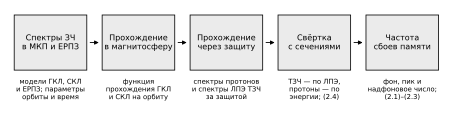
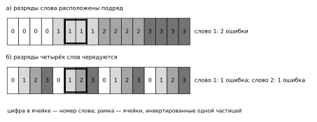
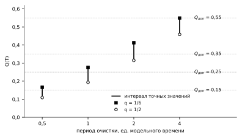
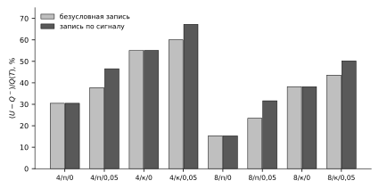

# Глава 2. Модели сбоев и коррекции ошибок в цифровой памяти

## 2.1. Радиационные условия эксплуатации и интенсивность сбоев

Одиночные сбои в микросхемах памяти бортовой радиоэлектронной аппаратуры (БРЭА) космических аппаратов (КА) вызывают заряженные частицы космического пространства (ЗЧ КП) естественного происхождения. Совокупность значений характеристик ЗЧ КП, действующих на БРЭА и её электрорадиоизделия, называют радиационными условиями [@OST1341044, п. 3.2]. Нормативные документы задают радиационные условия расчётными спектрами, по которым вычисляют частоту сбоев и сравнивают её с допустимой. Для оценки вероятности неисправимой ошибки за срок работы этого недостаточно: нужно знать, как интенсивность сбоев может меняться во времени. Поэтому ниже рассматриваются нормативное задание радиационных условий, описание возможных изменений интенсивности сбоев за срок и переход от спектров ЗЧ КП к интенсивности сбоев памяти.

Раздел опирается на следующие допущения.

1. Радиационные условия заданы для КА на фиксированной орбите и не зависят от работы аппаратуры.
2. При заданных радиационных условиях моменты попаданий ЗЧ, вызывающих сбои, образуют пуассоновский поток.
3. Чувствительность электронной компонентной базы (ЭКБ) к ЗЧ описывается сечением возникновения одиночного сбоя, которое зависит от вида ЗЧ, её энергии или линейной передачи энергии (ЛПЭ) и направления падения и не меняется за срок работы.

### 2.1.1. Расчётные радиационные условия

Одиночные эффекты на околоземных орбитах вызывают протоны естественных радиационных поясов Земли (ЕРПЗ), а также протоны и тяжёлые заряженные частицы (ТЗЧ) галактических космических лучей (ГКЛ) и солнечных космических лучей (СКЛ) [@OST1341044, пп. 5.1, 6.2]. Потоки ГКЛ постоянно существуют в межпланетном космическом пространстве и меняются в ходе цикла солнечной активности [@OST1341044, прил. В, пп. В.1, В.2]. Потоки ЗЧ СКЛ возрастают эпизодически, на относительно короткое время, обычно до 10 суток; их причиной служит событие СКЛ — инжекция ЗЧ с поверхности Солнца [@OST1341044, прил. Б, п. Б.1]. Спектры протонов ЕРПЗ рассчитывают непосредственно для орбиты КА, а потоки ГКЛ и СКЛ на орбитах внутри магнитосферы ослаблены геомагнитным полем, что учитывают функцией прохождения ЗЧ в магнитосферу [@OST1341044, п. 5.2].

Соотношение вкладов этих составляющих зависит от орбиты, защиты и чувствительности изделия. Например, в расчётах пиковых частот сбоев для микросхем памяти на круговых орбитах при защите 1 г/см² в отсутствие событий СКЛ на высотах до 10 000 км преобладает вклад протонов ЕРПЗ, на более высоких орбитах — вклад ГКЛ, а при больших событиях СКЛ определяющими на рассмотренных орбитах становятся потоки СКЛ [@KuznetsovCRD]. В соответствии с этим РД 134-0139-2005 различает обычный режим работы радиоэлектронной аппаратуры (РЭА), определяемый суммарной частотой сбоев от ГКЛ и ЕРПЗ, и экстремальный режим, обусловленный эпизодическим появлением потоков ЗЧ СКЛ продолжительностью от нескольких часов до суток [@RD1340139, п. 5.1].

Радиационные условия, от которых зависит работоспособность БРЭА по эффектам одиночных сбоев, ОСТ 134-1044-2007 задаёт спектрами максимальных плотностей потоков протонов ЕРПЗ и ГКЛ, спектрами ЛПЭ максимальных плотностей потоков ТЗЧ ГКЛ, спектрами пиковых потоков протонов СКЛ и спектрами ЛПЭ пиковых потоков ТЗЧ СКЛ [@OST1341044, п. 6.2]. Характеристики ЗЧ СКЛ установлены при вероятности 0,1 их превышения за срок активного существования (САС) КА [@OST1341044, п. 6.6]. Для типовых орбит, в том числе геостационарной, они рассчитаны программой COSRAD для защиты в форме сферы с толщинами алюминия от 0,01 до 10 г/см² [@OST1341044, пп. 6.4, 6.5].

В техническом задании устанавливают эти спектры за типовыми защитами и показатель сбоеустойчивости — допустимую частоту сбоев [@OST1341044, п. 7.3.1]. По РД 134-0139-2005 частота сбоев — число сбоев РЭА в единицу времени, с⁻¹; её вычисляют по указанным спектрам и сравнивают с допустимой [@RD1340139, пп. 4.8, 5.1, 5.6]. Обозначим эту частоту $\nu_{\text{РЭА}}$. Вероятность за срок РД вычисляет только для одиночных отказов [@RD1340139, п. 5.2].

Модель потоков ЗЧ СКЛ вероятностная. ГОСТ Р 25645.165-2025 устанавливает спектры флюенсов и пиковых потоков протонов СКЛ, превышение которых при заданном уровне солнечной активности ожидается за заданное время с заданной вероятностью П [@GOST25645165, п. 5.1]. Параметрами модели служат П и среднее ожидаемое число солнечных протонных событий (СПС) с флюенсом протонов с энергией более 30 МэВ выше 10⁵ см⁻²; это число пропорционально сумме среднемесячных чисел Вольфа за время полёта [@GOST25645165, пп. 5.6, 5.7]. Число событий модели и частота эпизодов в выборке наблюдений относятся к разным совокупностям. Эпизоды выборки SEPEM [@SEPEMRDS2] выделены по порогу интенсивности с объединением эпизодов, разделённых менее чем сутками, а события стандарта отобраны по флюенсу. Поэтому на одном и том же интервале наблюдений выборка даёт 31,56 эпизода на 10 лет, а модель — 100,6 события, и одна величина не может служить проверкой другой.

Нормативные характеристики определяют наибольшие потоки и флюенс за срок, но не задают изменения потоков во времени. Чтобы описать это изменение, введём интенсивность родительских событий $\lambda(t)$ — интенсивность пуассоновского потока попаданий ЗЧ, каждое из которых изменяет хотя бы один разряд памяти. Её следует отличать от интенсивности битовых инверсий $\lambda_{\text{инв}}(t)$, вычисляемой по сечениям на бит, и от частоты сбоев $\nu_{\text{РЭА}}$, событие и нормировка которой определяются испытаниями изделия. Одно событие может инвертировать несколько битов, поэтому $\lambda \le \lambda_{\text{инв}}$. Равенство выполняется, когда каждое событие инвертирует ровно один бит; постоянство потоков само по себе этого не обеспечивает.

Почему важно распределение событий во времени, видно на простой модели памяти из одного кодового слова. Пусть код исправляет одну ошибку, каждое событие инвертирует один бит, а разряд для инверсии выбирается независимо по одному и тому же распределению. На промежутке $J$ между двумя проверками слова обслуживания нет. Число событий на $J$ — пуассоновская величина со средним $M_J = \int_J \lambda(t)\,dt$, и среднее число пар событий на нём равно $M_J^2/2$. При том же начальном состоянии слова и той же величине $M_J$ распределение числа событий и последовательности инвертированных разрядов не зависит от формы $\lambda(t)$ внутри промежутка; поэтому одинакова и вероятность превышения корректирующей способности на нём. Существенно распределение $M_J$ между непересекающимися промежутками: при той же суммарной экспозиции сумма $\sum_J M_J^2$ тем больше, чем сильнее экспозиция сосредоточена на немногих промежутках. Так как $M_J^2 \le |J| \int_J \lambda^2(t)\,dt$, для промежутков длиной не больше $P$ выполняется $\sum_J M_J^2 \le P \int_0^T \lambda^2(t)\,dt$. Поэтому для ограничения вклада накопления ошибок используется верхняя граница интеграла квадрата интенсивности; точного значения вероятности неисправимой ошибки этот интеграл не определяет. Его верхнюю границу можно построить, совместно используя ограничения на пик, фон и интегральную экспозицию.

Поэтому для оценки вероятности за срок радиационные условия задают не одним профилем интенсивности, а классом допустимых профилей, ограниченным предельными величинами:

$$
\lambda(t) = \lambda_{\text{ф}}(t) + \lambda_{\text{с}}(t) \le \lambda_{\text{пик}}, \qquad 0 \le \lambda_{\text{ф}}(t) \le \bar\lambda_{\text{ф}}, \qquad \lambda_{\text{с}}(t) \ge 0, \qquad \int_0^T \lambda_{\text{с}}(t)\,dt \le N_{\text{соб}}.
\tag{2.1}
$$

Здесь $\lambda_{\text{ф}}$ — фоновая составляющая, создаваемая постоянно присутствующими ЗЧ (на геостационарной орбите — ГКЛ), $\lambda_{\text{с}}$ — надфоновая составляющая, создаваемая событиями СКЛ, $\lambda_{\text{пик}}$ — наибольшая допустимая интенсивность, $\bar\lambda_{\text{ф}}$ — верхняя граница фона, $N_{\text{соб}}$ — верхняя граница среднего числа надфоновых событий за срок $T$. Класс не фиксирует ни формы событий, ни моментов их наступления: допустим любой профиль, удовлетворяющий этим ограничениям.

Если период контроля выбирается по наблюдениям, класс дополняют ограничением скорости нарастания интенсивности:

$$
H_\ell\bigl(\lambda(t)\bigr) - H_\ell\bigl(\lambda(u)\bigr) \le \rho\,(t - u), \quad u < t, \qquad H_\ell(x) = \begin{cases} x/\ell, & x \le \ell,\\ 1 + \ln(x/\ell), & x > \ell, \end{cases}
\tag{2.2}
$$

где $\ell$ — порог, ниже которого рост интенсивности измеряется линейно, а выше — логарифмически, $\rho$ — наибольшая допустимая скорость роста в этой шкале. Выше порога интенсивность возрастает не быстрее чем в $e$ раз за время $1/\rho$. Спад интенсивности и её начальный уровень условие (2.2) не ограничивает.

Из (2.1) следуют вычислимые верхние границы среднего числа событий за срок и интеграла квадрата интенсивности, а через предыдущее неравенство — и суммы $\sum_J M_J^2 \le P \bar S_2$:

$$
\bar F = \min\bigl(\lambda_{\text{пик}} T,\ \bar\lambda_{\text{ф}} T + N_{\text{соб}}\bigr), \qquad
\bar S_2 = \min\bigl\{\lambda_{\text{пик}}^2 T,\ \lambda_{\text{пик}} \bar F,\ \bar\lambda_{\text{ф}}^2 T + (\lambda_{\text{пик}} + \bar\lambda_{\text{ф}}) N_{\text{соб}}\bigr\}.
\tag{2.3}
$$

Последняя ветвь $\bar S_2$ следует из неравенства $\lambda^2 \le \bar\lambda_{\text{ф}}^2 + (\lambda_{\text{пик}} + \bar\lambda_{\text{ф}})\lambda_{\text{с}}$. Величина $\bar F$ безразмерна, $\bar S_2$ измеряется в с⁻¹.

Требование к памяти формулируется для всего класса: вероятность неисправимой ошибки за время работы $Q(T)$ не должна превышать допустимой вероятности $Q_{\text{доп}}$ ни при каком профиле, удовлетворяющем (2.1). Если сами радиационные условия случайны и выходят за пределы класса с вероятностью не больше $\delta_{\text{ср}}$, то выполнение требования для класса с допустимой вероятностью $Q_{\text{доп}} - \delta_{\text{ср}}$ обеспечивает безусловную вероятность неисправимой ошибки не больше $Q_{\text{доп}}$. Вероятность 0,1, при которой установлены характеристики СКЛ, относится к каждой характеристике в отдельности и такой оценки для класса в целом не даёт.

### 2.1.2. Расчёт интенсивности сбоев по спектрам заряженных частиц

Интенсивность сбоев рассчитывают по алгоритму ОСТ 134-1044-2007 (рисунок 2.1). По параметрам орбиты и времени полёта находят спектры протонов ЕРПЗ на орбите и спектры протонов и ТЗЧ ГКЛ и СКЛ, прошедших в магнитосферу на орбиту КА; затем рассчитывают энергетические спектры частиц и спектры ЛПЭ ТЗЧ за защитой [@OST1341044, п. 5.2, рисунок 5.1]. Частота сбоев получается свёрткой спектров за защитой с сечениями возникновения одиночного сбоя [@RD1340139, п. 5.1].

Рисунок 2.1 — Последовательность расчёта интенсивности сбоев памяти по ОСТ 134-1044-2007 и РД 134-0139-2005

Пусть $\varphi_a(E, \Omega, t)$ — дифференциальная плотность потока частиц вида $a$ с энергией $E$, падающих за защитой с направления $\Omega$, а $\sigma_{a,\text{бит}}(E, \Omega)$ — сечение возникновения сбоя, отнесённое к одному биту. Интенсивность инверсий одного бита и интенсивность битовых инверсий массива равны

$$
\lambda_{\text{бит}}(t) = \sum_a \iint \varphi_a(E, \Omega, t)\,\sigma_{a,\text{бит}}(E, \Omega)\,dE\,d\Omega, \qquad \lambda_{\text{инв}}(t) = N_{\text{бит}}\,\lambda_{\text{бит}}(t),
\tag{2.4}
$$

где $N_{\text{бит}}$ — число учитываемых битов массива. Для полных кодовых слов при одинаковой чувствительности проверочных и информационных разрядов $N_{\text{бит}} = nW$, где $n$ — число разрядов слова, $W$ — число слов. Для ТЗЧ интегрирование ведут по ЛПЭ с сечением, зависящим от ЛПЭ, для протонов — по энергии; в такой форме частота сбоев записана в РД 134-0139-2005 [@RD1340139, п. 5.1, формула (5.1)]. При отсутствии аппроксимаций этих зависимостей РД допускает расчёт по сечениям насыщения, дающий верхнюю оценку [@RD1340139, п. 5.5, формула (5.4)]. Если сечение отнесено к изделию, а не к биту, множитель $N_{\text{бит}}$ не нужен; частота $\nu_{\text{РЭА}}$ совпадает с $\lambda_{\text{инв}}$ только при одинаковом событии и одинаковой нормировке.

Сечения возникновения сбоев обычно измеряют при нормальном падении частиц, тогда как угловое распределение потоков СКЛ в среднем изотропно [@GOST25645165, п. 5.3]. Если угловая зависимость сечения неизвестна, в расчётной модели протонный вклад получают из энергетической свёртки с измеренным при нормальном падении сечением и геометрическим коэффициентом $a_H$. Это параметрическая замена углового интегрирования в (2.4). Для изотропного спектра, заданного на единицу телесного угла, интегрирование по направлениям даёт множитель 4π; для уже всенаправленного спектра этот множитель повторно не вводится. Значение $a_H = 1$ соответствует сечению, не зависящему от угла падения. Угловая зависимость сечения в рассматриваемом расчёте не измерена, поэтому $a_H$ остаётся параметром; ни ОСТ, ни РД выбора этого коэффициента не устанавливают.

Одиночные сбои вызывают ТЗЧ и протоны. ТЗЧ создают заряд в чувствительном объёме ячейки непосредственной ионизацией, и их вклад определяется спектром ЛПЭ. Протоны высоких энергий вызывают сбои главным образом через ядерные реакции, продукты которых ионизируют чувствительный объём [@KuznetsovCRD]; у микросхемы CY62167GE30 сечение сбоя от таких протонов составляет порядка 8·10⁻¹⁴ см²/бит. В микросхемах с глубоко субмикронными топологическими нормами заряд, достаточный для сбоя, может создать непосредственной ионизацией и протон низкой энергии. У CY62167GE30 сечение сбоя от непосредственной ионизации протонами в максимуме, при энергии 0,8–1 МэВ перед слоями металлизации, достигает 1,2·10⁻⁹ см²/бит, что в 15 000 раз больше [@Coronetti2021]. По оценке той же работы непосредственная ионизация протонами может давать до 90 % частоты сбоев таких микросхем в среднем по набору орбит [@Coronetti2021]. Методика испытаний РД 134-0139-2005 предусматривает облучение протонами с энергиями порядка 20–1000 МэВ и эту область энергий не охватывает [@RD1340139, прил. В, п. В.4.1].

Значение этого механизма для памяти показывает сравнение моделей отклика при одних и тех же спектрах COSRAD для геостационарной орбиты и защиты 3 г/см² (таблица 2.1). Рассматривается массив из $W$ = 524 288 слов по 32 информационных и 6 проверочных разрядов, то есть 2 МиБ данных; при одинаковой чувствительности всех разрядов учитываются 19 922 944 разряда. Учёт непосредственной ионизации протонами увеличивает интеграл квадрата интенсивности битовых инверсий в 6,0 раза, а переход от $a_H = 1/2$ к $a_H = 1$, удваивающий протонную составляющую, увеличивает его ещё более чем вдвое. Различие способов численного интегрирования на результат практически не влияет.

Таблица 2.1 — Интеграл квадрата интенсивности битовых инверсий массива при разных моделях отклика (геостационарная орбита, защита 3 г/см², срок 10 лет)

| Модель отклика | $a_H$ | $\int_0^T \lambda_{\text{инв}}^2\,dt$, с⁻¹ |
|---|---|---|
| ТЗЧ и протоны высоких энергий без непосредственной ионизации | 1/2 | 6939,004 |
| ТЗЧ и протоны, включая непосредственную ионизацию | 1/2 | 41 867,13 |
| ТЗЧ и протоны, включая непосредственную ионизацию | 1 | 111 494,6 |

Для того же массива получены условные предельные величины интенсивности битовых инверсий (таблица 2.2). Фон и пик рассчитаны по спектрам COSRAD для среднего цикла солнечной активности и срока 10 лет при вероятности 0,1, с экспериментальным сечением, включающим непосредственную ионизацию протонами, и с коэффициентом $a_H = 1$; взаимные произведения вкладов разных видов частиц в интеграле квадрата учтены. Надфоновое число инверсий оценено как $\tau(\lambda_{\text{пик}} - \bar\lambda_{\text{ф}})$. Эквивалентная длительность $\tau$ = 115 776 с выбрана так, чтобы покрыть наибольшее по узлам спектров отношение флюенса к пиковому потоку; это не длительность отдельного события. $\bar S_2$ вычислен по последней ветви (2.3), что соответствует прямоугольной форме событий. Значения округлены в бо́льшую сторону. Поскольку каждое родительское событие инвертирует хотя бы один бит, те же величины ограничивают сверху и соответствующие величины для $\lambda$.

Таблица 2.2 — Условные предельные величины интенсивности битовых инверсий массива на CY62167GE30 (геостационарная орбита, срок 10 лет)

| Защита, г/см² | $\bar\lambda_{\text{ф}}$, с⁻¹ | $\lambda_{\text{пик}}$, с⁻¹ | $\bar F$ | $\bar S_2$, с⁻¹ |
|---|---|---|---|---|
| 2,5 | 1,702·10⁻⁴ | 1,365 | 211 600 | 215 500 |
| 3,0 | 1,586·10⁻⁴ | 0,9814 | 163 700 | 111 500 |
| 3,5 | 1,490·10⁻⁴ | 0,7454 | 133 300 | 64 330 |
| 4,0 | 1,409·10⁻⁴ | 0,5872 | 112 400 | 39 920 |

При защите 3 г/см² наибольшая интенсивность превышает фоновую в 6200 раз. Приведённые величины не являются ни доверительными границами, ни физическими квантилями уровня 0,9: совместный уровень интеграла квадрата интенсивности, соответствующий вероятности 0,1, по этим данным не установлен. Учёт формы событий по данным SEPEM уменьшил бы $\bar S_2$ при 3 г/см² на 67,8 %, однако обоснования для переноса модельной формы на будущий срок нет, и прямоугольная форма сохраняется.

Для числовых примеров контроля памяти используется отдельный иллюстративный набор предельных величин для той же орбиты, защиты 3 г/см² и того же массива. Он построен по спектрам COSRAD с сечениями ТЗЧ и протонов высоких энергий без непосредственной ионизации и с коэффициентом $a_H = 1/2$. В наборе принято, что каждое попадание инвертирует один бит одного слова; поэтому интенсивности родительских событий, битовых инверсий и одиночных воздействий на слова в нём совпадают. Фон набора не превышает 1,54704·10⁻⁴ с⁻¹, солнечная составляющая пика 0,244528 с⁻¹ складывается из вклада ТЗЧ 0,221182209 с⁻¹ и вклада протонов высоких энергий 0,023345584 с⁻¹, так что $\lambda_{\text{пик}}$ = 0,244682704 с⁻¹. Верхняя граница среднего числа надфоновых событий за срок $N_{\text{соб}}$ = 115 776 · 0,244528 = 28 310,473728. Для условия (2.2) в наборе приняты $\rho$ = 0,048 с⁻¹ и $\ell$ = 1·10⁻³ с⁻¹. Набор служит иллюстрацией свойств контроля, а не оценкой условий полёта.

При переходе к словам памяти нужно различать частицу и её след. Множество разрядов, инвертированных одной частицей, назовём меткой события. Метка может затрагивать один разряд одного слова, разряды нескольких слов или несколько разрядов одного слова. В данных испытаний регистрируются группы сбойных ячеек, и зарегистрированная группа не тождественна метке: близкие по времени и месту метки могут слиться в одну группу, а одна метка — оказаться разделённой. Пересчёт на все 38 разрядов слова предполагает одинаковую чувствительность проверочных и информационных разрядов; испытаниями это не проверено.

Изложенное ограничено следующим. Предельные величины интенсивности условны: геометрический коэффициент, форма событий и совместный уровень интеграла квадрата интенсивности для вероятности 0,1 не установлены. Число событий СКЛ по модели и частота эпизодов в выборке относятся к разным совокупностям. Угловая зависимость сечения сбоя от непосредственной ионизации протонами и чувствительность проверочных разрядов не измерены. Протоны ЕРПЗ, существенные для низких орбит, в расчётах раздела не рассматриваются.

## 2.2. Организация памяти и корректирующего кода

Вероятность неисправимой ошибки зависит не только от того, сколько ячеек памяти инвертировано, но и от того, как сбойные ячейки распределены по кодовым словам. Код исправляет ошибки в пределах одного слова, поэтому одно и то же число инвертированных ячеек может оставить все слова исправимыми или сразу превысить возможности кода. Отсюда два вопроса раздела: что считается кодовым словом и неисправимой ошибкой и как сбой, затронувший несколько ячеек, распределяется по словам.

Раздел опирается на следующие допущения.

1. Память состоит из $W$ кодовых слов одного кода, и каждый разряд каждого слова хранится в отдельной ячейке.
2. Частица одновременно инвертирует все затронутые ею ячейки; повторная инверсия ячейки возвращает её разряд к правильному значению.
3. Исправимость слова определяется по всем его разрядам, включая проверочные, в любой момент работы, в том числе во время обращения к памяти.

### 2.2.1. Структура кодового слова и событие отказа

Кодовое слово содержит $n_{\text{и}}$ информационных разрядов, хранящих данные, и $n - n_{\text{и}}$ проверочных разрядов, которые кодер вычисляет по информационным; всего в слове $n$ разрядов. Корректирующая способность кода определяется минимальным кодовым расстоянием $d$ — наименьшим числом разрядов, в которых различаются два допустимых слова. Код с расстоянием $d$ исправляет в слове любые $t_{\text{код}} = \lfloor (d-1)/2 \rfloor$ ошибок; это число называют корректирующей способностью кода. При $d = 3$ код исправляет одну ошибку, при $d = 4$ исправляет одну и обнаруживает две. Построение кодов второго вида для памяти рассмотрено в [@Hsiao1970].

В работе рассматриваются три варианта слова (таблица 2.5). В микросхеме CY62167GE30 коррекция встроена в саму память: по описанию изготовителя внутреннее слово содержит 32 информационных и 6 проверочных разрядов кода Хэмминга, исправляющего одну ошибку [@InfineonAN88889, разд. 4.1–4.2]. При исправлении ошибки во время чтения микросхема формирует сигнал исправления ERR, а автоматической обратной записи исправленных данных в ячейки не выполняет [@CY62167RevF]. Для памяти с внешним декодером рассматриваются код (39, 32) с расстоянием 4 и более сильный код (44, 32) с расстоянием не менее 5, исправляющий две ошибки. При тех же 32 информационных разрядах второму коду нужно 12 проверочных разрядов вместо 7.

Таблица 2.5 — Варианты кодового слова

| Вариант | $n$ | $n_{\text{и}}$ | Проверочных разрядов | $d$ | $t_{\text{код}}$ | Основание |
|---|---|---|---|---|---|---|
| Внутренний код CY62167GE30 | 38 | 32 | 6 | 3 | 1 | описание изготовителя [@InfineonAN88889, разд. 4.1–4.2] |
| Внешний код (39, 32) | 39 | 32 | 7 | 4 | 1 | расстояние доказано в исследовании |
| Внешний код (44, 32) | 44 | 32 | 12 | не менее 5 | 2 | расстояние доказано в исследовании |

В расчётном банке с внешним кодом (39, 32) на одно кодовое слово отводятся три 16-разрядных адресуемых слова памяти, то есть 48 физических разрядов. Из них 32 разряда информационные, 7 проверочные, а 9 не входят в кодовое слово. Вероятность неисправимой ошибки определяется по 39 разрядам кода, тогда как выделенная ёмкость и число обращений учитываются по 48-разрядной упаковке. Та же упаковка вмещает код (44, 32), для которого вне кодового слова остаются 4 разряда.

Состояние слова $w$ в момент $s$ задаётся множеством $E_w(s)$ его ошибочных разрядов — разрядов, значения которых отличаются от правильного образа. Число элементов этого множества $\operatorname{wt} E_w(s)$ называют весом ошибки. Слово исправимо, пока вес его ошибки не больше $t_{\text{код}}$. Событием отказа за время работы $T$ считается хотя бы одно превышение корректирующей способности хотя бы в одном слове:

$$
A_T = \{\exists\, s \in [0, T],\ w:\ \operatorname{wt} E_w(s) > t_{\text{код}}\}, \qquad Q(T) = \mathrm{P}(A_T).
\tag{2.5}
$$

Показатель $Q(T)$ — вероятность неисправимой ошибки за время работы — определяется первым превышением: учитываются все разряды слова и любой момент работы, а последующее восстановление слова не отменяет состоявшегося события. Такое определение согласуется с моделями надёжности памяти, в которых слово отказывает, как только число ошибок в нём превышает корректирующую способность кода [@Lee2011], а повторное попадание в уже сбойную ячейку не создаёт второй ошибки [@Baeg2009].

Исправление, обнаружение и первое превышение — разные события. Исправление происходит при чтении слова с весом ошибки от 1 до $t_{\text{код}}$: декодер выдаёт правильные данные. Обнаружение без исправления даёт код с запасом расстояния: код с $d = 4$ распознаёт две ошибки в слове, но исправить их не может. Первое превышение наступает в момент сбоя, создавшего вес больше $t_{\text{код}}$, а не в момент чтения. Поэтому обнаружение двойной ошибки не предотвращает превышения: оно сообщает о нём, когда превышение уже состоялось. По той же причине $Q(T)$ не совпадает ни с вероятностью сообщения о неисправимой ошибке, ни с долей слов, содержащих ошибки к концу срока.

Для памяти на CY62167GE30 важно и то, какие физические ячейки образуют одно внутреннее слово: от этого зависит, попадут ли соседние сбойные ячейки в одно слово. Документация изготовителя не раскрывает ни размещения разрядов в массиве, ни соответствия внешних адресов внутренним словам. По открытым данным облучения этой микросхемы [@Zenodo8314389] в исследовании установлено воспроизводимое соответствие между физическими координатами сбойных ячеек и внешними адресами в режиме 2M слов по 8 разрядов [@CY62167RevF]: соответствие, подобранное по одному набору записей, без расхождений подтвердилось на остальных обычных записях. Оно связывает физическое соседство ячеек с внешними адресами, но не показывает, как внешние адреса и проверочные разряды объединены во внутреннее слово. Поэтому группировка разрядов во внутренние слова и соответствие двух 16-разрядных обращений одному слову для CY62167GE30 остаются неустановленными.

### 2.2.2. Многократные сбои и размещение разрядов слова

Частица может инвертировать сразу несколько соседних ячеек; такие многоклеточные сбои зарегистрированы и при облучении CY62167GE30 [@Zenodo8314389]. Число затронутых ячеек — кратность сбоя по ячейкам — само по себе не определяет число ошибок в каждом слове: сбой распределяется между словами, которым принадлежат затронутые ячейки. Рассмотрим его последствия в первоначально чистой памяти. Если соседние ячейки относятся к одному слову, двухклеточный сбой даёт в нём две ошибки, и при $t_{\text{код}} = 1$ это превышение. Если разряды нескольких слов чередуются, так что соседние ячейки принадлежат разным словам, тот же сбой даёт по одной исправимой ошибке в двух словах (рисунок 2.6). На этом основан выбор расстояния чередования разрядов в статической памяти [@Baeg2009].

Рисунок 2.6 — Двухклеточный сбой при разном размещении разрядов: а — соседние ячейки принадлежат одному слову, две ошибки в слове; б — разряды четырёх слов чередуются, по одной ошибке в двух словах

Изменение частицей сразу нескольких разрядов одного слова называют прямым многобитовым воздействием. В изначально чистом слове оно вызывает превышение немедленно, если затронуто больше $t_{\text{код}}$ разрядов. При коде, исправляющем одну ошибку, распределение сбоя по одной ошибке в каждое из чистых слов сохраняет их исправимость. Превышение наступает, если до восстановления такого слова другая частица инвертирует в нём другой разряд. Поэтому для оценки $Q(T)$ нужны не только частоты сбоев по отдельным словам, но и совместное распределение того, какие слова затрагивает одна частица.

Значение совместного распределения видно на учебной модели из четырёх слов с $t_{\text{код}} = 1$, в которой каждая частица затрагивает ровно два разных слова и вносит в каждое одну ошибку в ещё не затронутом разряде. Сравним два случая. В первом частица затрагивает пару слов $\{0, 1\}$ или пару $\{2, 3\}$, каждую с вероятностью 1/2; во втором — любую из шести пар с вероятностью 1/6. В обоих случаях каждое слово затрагивается с вероятностью 1/2, то есть частоты поражения отдельных слов совпадают. Однако две частицы в первом случае затрагивают непересекающиеся пары с вероятностью 1/2, а во втором — только с вероятностью 1/6; в остальных случаях какое-то слово получает вторую ошибку, и наступает превышение.

В общем случае пары затрагиваются с вероятностями $p_{01} = p_{23} = a$, $p_{02} = p_{13} = c$, $p_{03} = p_{12} = e$, где $a, c, e \ge 0$ и $a + c + e = 1/2$; при любых $a$, $c$, $e$ каждое слово по-прежнему затрагивается с вероятностью 1/2. Пары для разных частиц выбираются независимо и одинаково и не зависят от моментов прихода частиц, а сами частицы образуют однородный пуассоновский поток интенсивности $\lambda$. Память мгновенно и полностью очищается с периодом $P$, так что каждый период начинается с чистого состояния; срок $T$ содержит $k = T/P$ периодов, а на период в среднем приходится $m = \lambda P$ частиц.

За период превышения нет, если частиц не больше одной или их ровно две и они затронули непересекающиеся пары; при трёх и более частицах на четыре слова приходится не меньше шести поражений, и какое-то слово получает вторую ошибку. Две частицы затрагивают непересекающиеся пары с вероятностью $q = 2(a^2 + c^2 + e^2)$; при допустимых $a$, $c$, $e$ она меняется от 1/6 до 1/2, и крайние значения дают два сравненных выше случая. Обозначим через $S(q, m)$ вероятность отсутствия превышения за один период. Тогда

$$
S(q, m) = e^{-m}\left(1 + m + \frac{q m^2}{2}\right), \qquad Q(T) = 1 - S(q, m)^k.
\tag{2.6}
$$

Одинаковые частоты поражения отдельных слов, следовательно, не определяют $Q(T)$: её значение лежит в точном множестве между значениями при $q = 1/2$ и $q = 1/6$, и обе границы достигаются. Различие сказывается на выборе периода. Пусть $\lambda = 0{,}5$ и $T = 4$ в единицах модельного времени, рассматриваются периоды 0,5; 1; 2 и 4 и выбирается наибольший период, при котором $Q(T)$ не превышает допустимой вероятности $Q_{\text{доп}}$. Результаты приведены в таблице 2.6 и на рисунке 2.7. При $Q_{\text{доп}} = 0{,}15$ одна граница допускает период 0,5, а для другой допустимого периода нет; при $Q_{\text{доп}} = 0{,}25$ и $0{,}35$ наибольшие допустимые периоды различаются вдвое; при $Q_{\text{доп}} = 0{,}55$ выбор совпадает. Точные значения подтверждены моделированием методом Монте-Карло.

Таблица 2.6 — Наибольший допустимый период в учебной модели

| $Q_{\text{доп}}$ | При меньшем значении $Q(T)$, $q = 1/2$ | При большем значении $Q(T)$, $q = 1/6$ |
|---|---|---|
| 0,15 | 0,5 | допустимого периода нет |
| 0,25 | 1,0 | 0,5 |
| 0,35 | 2,0 | 1,0 |
| 0,55 | 4,0 | 4,0 |

Рисунок 2.7 — Учебная модель: интервалы точных значений $Q(T)$ при четырёх периодах очистки и уровни $Q_{\text{доп}}$

Для расчёта по реальной памяти, следовательно, нужны сведения о совместном поражении слов одной частицей, а не только частоты сбоев по словам. Это распределение определяется пространственной формой многоклеточных сбоев и размещением разрядов слов в массиве.

Более сильный код меняет условие превышения. При $t_{\text{код}} = 2$ превышение требует не менее трёх ошибочных разрядов в слове. Частица, изменившая два разряда чистого слова, превышения не вызывает; оно наступит, если до восстановления слова другая частица изменит третий, ещё не затронутый разряд. Если же вторая частица попадёт в один из уже ошибочных разрядов, повторная инверсия вернёт его к правильному значению, и вес ошибки уменьшится. Поэтому важно не только число воздействий на слово до его восстановления, но и то, приходятся ли они на различные разряды. Для пуассоновских воздействий с независимым равномерным выбором разрядов внутри слова и заранее заданных моментов проверки в исследовании получена верхняя оценка. В ней накопление одиночных попаданий даёт член, кубический по их среднему числу в слове, а сочетания двухразрядных воздействий с одиночными и друг с другом — квадратичные члены.

При той же полезной ёмкости код (44, 32) требует больше проверочных разрядов, чем код (39, 32), но в принятой 48-разрядной упаковке оба кода занимают одинаковый объём памяти. Поэтому уменьшение затрат на контроль при усилении кода необходимо сопоставлять с затратами на кодирование и декодирование; дополнительная ёмкость в этом варианте не требуется.

Превышение без прямого многобитового воздействия возникает, таким образом, когда одно и то же слово до своего восстановления получает воздействия в несколько различных разрядов. Для CY62167GE30 размещение разрядов в массиве, соответствие внешних адресов внутренним словам и полнота сигнала исправления по всем 38 разрядам не установлены, а учебная модель предполагает мгновенную синхронную очистку. Состав слова и размещение его разрядов определяют, какие воздействия опасны сразу, а какие — только при повторении в том же слове до его восстановления; поэтому вероятность неисправимой ошибки нельзя оценить без учёта моментов контроля и действия записи исправления.

## 2.3. Модель последовательного контроля памяти

Сбой в памяти и его обнаружение разделены во времени. При чтении слова обнаруживается сохранившаяся в нём ошибка. Запись исправленных данных изменяет состояние слова и тем самым влияет на результат следующей проверки. Поэтому модель контроля должна ответить на три вопроса: когда ошибка обнаруживается, какие ошибки снимает запись исправления и что сообщения памяти о выполненных исправлениях говорят об обстановке.

Модель строится при следующих допущениях.

1. Контроль ведётся по идеальному календарю: слова читаются в фиксированном порядке в заранее заданные моменты, в том числе при смене периода, и каждая операция контроля завершается внутри отведённого ей интервала времени.
2. Пока число ошибочных разрядов слова не превышает числа ошибок, исправляемых кодом, декодер выдаёт правильные данные и формирует сигнал исправления при каждом выполненном исправлении; ложных сигналов нет.
3. Сигнал исправления полный: он отражает исправление в любом разряде слова, включая проверочные.
4. Контроллер записывает правильный образ, не вносит новых ошибок и не прерывает начатое исправление.
5. Модель описывает работу памяти до первого момента, когда хотя бы в одном слове ошибок становится больше, чем исправляет код.

### 2.3.1. Порядок контроля и условия обнаружения ошибок

Память содержит $W$ кодовых слов. Состояние слова в каждый момент описывается множеством разрядов, значения которых отличаются от правильного образа; их число назовём весом ошибки слова. Частица инвертирует затронутые разряды, поэтому повторная инверсия ошибочного разряда возвращает его к правильному значению. Код исправляет в слове до $t_{\text{код}}$ ошибок; это число называют корректирующей способностью кода.

Сигнал исправления — признак того, что декодер исправил ошибку в прочитанном слове. Превышением корректирующей способности назовём момент, когда вес ошибки хотя бы одного слова становится больше $t_{\text{код}}$. При $t_{\text{код}} = 1$ превышение наступает, например, когда частица изменяет другой разряд слова с ещё не исправленной ошибкой. Частица может изменить и сразу несколько разрядов одного слова. Такое прямое многобитовое воздействие вызывает немедленное превышение, если слово было чистым и затронуто больше $t_{\text{код}}$ разрядов; в слове с уже имеющейся ошибкой оно может эту ошибку погасить, и результат определяется весом получившегося состояния. Последующее восстановление слова не отменяет факта превышения корректирующей способности.

Контроллер периодического контроля (скраббинга) читает слова в постоянном порядке; такие чтения назовём контрольными, в отличие от чтений приложения. Однократное контрольное чтение всех $W$ слов называется проходом, а время между двумя последовательными контрольными чтениями одного слова — периодом контроля $P$. Календарь контроллера отводит каждому слову интервал, достаточный для самой длинной операции контроля. Длительность прохода $T_{\text{пр}}$ охватывает отведённые интервалы всех слов и паузы между ними. При постоянном периоде $T_{\text{пр}} \le P$, а если проходы следуют без пауз, $T_{\text{пр}} = P$.

Обозначим через $r_w(k)$ момент контрольного чтения слова $w$ в $k$-м проходе, $k = 0, 1, 2, \ldots$, — момент, когда фиксируется состояние слова (снимок). Через $v_w(k) \ge r_w(k)$ обозначим фактический момент окончания операции контроля, включающей декодирование и при необходимости запись. Окончание операции зависит от того, понадобилась ли запись, и лежит внутри отведённого интервала. При постоянном периоде моменты чтения задаются календарём:

$$
r_w(k) = t_0 + kP + \varphi_w, \qquad 0 \le \varphi_w < T_{\text{пр}},
\tag{2.7}
$$

где $t_0$ — начало первого прохода; $\varphi_w$ — сдвиг чтения слова $w$ от начала прохода. Каждое слово проверяется через $P$ после предыдущей проверки, а моменты проверки разных слов сдвинуты на разность сдвигов $\varphi_w$. При смене периода порядок чтений внутри прохода сохраняется, а меняется время между проходами.

Ошибка, возникшая в слове $w$ в момент $s$ и сохранившаяся до ближайшего контрольного чтения $r_w(k) \ge s$, обнаруживается контролем при этом чтении; задержка обнаружения не превышает $P$. Сигнал указывает на интервал между двумя контрольными чтениями слова: при $k \ge 1$ сбой произошёл на интервале $[r_w(k-1),\, r_w(k))$, который назовём окном наблюдения слова $w$ в $k$-м проходе. В первом проходе контроль обнаруживает и ошибки, имевшиеся в начале работы. Окна разных слов в одном проходе сдвинуты так же, как моменты их чтения, а последовательные окна одного слова примыкают друг к другу. Ошибка, попавшая в уже прочитанное в текущем проходе слово, обнаруживается контролем в следующем проходе, поэтому к окончанию прохода часть слов может содержать ошибки, пришедшие после их чтения.

Операция контроля занимает интервал $[r_w(k),\, v_w(k)]$: чтение, декодирование и, если она предусмотрена, запись исправленного образа. Поэтому результат исправления зависит от того, когда выполняется запись. Различаются три варианта обслуживания.

При обслуживании с безусловной записью полный исправленный образ слова записывается после каждого чтения. К окончанию записи слово совпадает с правильным образом: снимаются ошибки, имевшиеся при чтении, и ошибки, попавшие в слово до окончания записи. Ошибки, возникшие после окончания записи, она не устраняет.

При обслуживании с записью после исправимой ошибки запись выполняется, когда при чтении обнаружена исправимая ошибка; контроллер записывает полный исправленный образ слова, поэтому к окончанию записи слово восстановлено полностью. В остальных случаях последней проверкой слова служит само чтение, и ошибки, возникшие после него, операция не устраняет.

При обслуживании с записью по сигналу исправления память исправляет ошибку в выдаваемых данных и формирует сигнал исправления, а ячейки сама не перезаписывает; получив сигнал, контроллер в той же операции записывает исправленные данные через интерфейс памяти. Как микросхема при этом обновляет внутреннее слово, в том числе при записи несколькими обращениями к частям слова, не раскрыто, поэтому принимается более слабое свойство: к окончанию операции снимаются ошибки, существовавшие до её начала, а ошибки от попаданий во время операции могут остаться. Без сигнала запись не выполняется, и слово к окончанию операции может содержать ошибку, пришедшую во время неё.

Во всех вариантах превышение, возникшее внутри операции, например изменение другого разряда слова с уже имеющейся ошибкой до окончания записи, считается состоявшимся событием, даже если запись затем восстановит слово. Исправление завершается к окончанию операции, а не в момент чтения; восстановлено ли слово к этому моменту, зависит от варианта обслуживания. Три независимых иллюстративных случая — обнаружение ошибки в следующем проходе, ошибка во время операции без записи и превышение — показаны на временной диаграмме обхода (рисунок 2.8).

Рисунок 2.8 — Временная диаграмма последовательного контроля; независимые иллюстративные случаи: а — ошибка в другом разряде слова, уже содержащего неисправленную ошибку (превышение корректирующей способности); б — ошибка в уже прочитанном слове, обнаруживаемая в следующем проходе; в — ошибка во время операции без записи, остающаяся до следующего прохода

Обнаружение ошибок зависит и от того, как память использует приложение. Контроль охватывает фиксированную защищаемую область памяти, состав которой в ходе работы не меняется. В ней хранятся прежде всего долгоживущие данные — код программ, таблицы, константы, — которые приложение читает многократно, а перезаписывает редко; ошибки в них снимает контроль. Чтение приложения проходит через тот же декодер: приложение получает исправленные данные, и при исправлении формируется сигнал. Само слово при таком чтении не восстанавливается, поэтому чтения приложения могут обнаружить ошибку раньше контроля и повторяют сигнал при каждом обращении к неисправленному слову.

Запись приложения, перезаписывающая слово целиком, заменяет правильный образ новым и стирает имевшиеся в слове ошибки. Если результат коррекции перед записью не зарегистрирован, ошибка исчезает без сигнала и сведения о ней теряются. Чтобы сохранить сведения о состоянии слова, перед его перезаписью выполняют чтение и регистрируют результат коррекции, в том числе отсутствие сигнала исправления.

Для числовой иллюстрации рассмотрим память на микросхеме CY62167GE30. По документации изготовителя у неё есть вывод сигнала исправления ERR, который указывает на обнаружение и исправление одиночной ошибки при чтении; автоматическая обратная запись исправленных данных в ячейки не выполняется [@CY62167RevF]. Внутренняя организация кристалла в документации не раскрыта. Поэтому для расчёта приняты допущения о слове и наблюдении. Внутреннее слово содержит 32 информационных и 6 проверочных разрядов, а код исправляет одну ошибку ($t_{\text{код}} = 1$). Одно внутреннее слово читается двумя 16-разрядными обращениями по известной паре внешних адресов, и сигнал исправления отражает исправление в любом из 38 разрядов слова. При ёмкости 16 Мбит и этих допущениях память содержит $W = 524\,288$ слов. Используется обслуживание с записью по сигналу исправления; записей приложения в защищаемую область нет.

Времена операций заданы проектными верхними границами контроллера, а не измерениями; они и остальные параметры примера приведены в таблице 2.8. Календарь отводит каждому слову одинаковый интервал, и проходы следуют друг за другом без пауз, поэтому длительность прохода равна периоду $P$, не превышающему 0,1028 с. Длительность прохода задаётся календарём и от числа сигналов не зависит. От числа сигналов зависит суммарная занятость интерфейса операциями контроля за проход: не более 48,50 мс, если сигналов нет, и не более 77,86 мс при сигнале в каждом слове. Ошибка, возникшая в уже прочитанном слове и сохранившаяся до следующего контрольного чтения, обнаруживается не позже чем через 0,1028 с.

Таблица 2.8 — Параметры примера памяти на CY62167GE30

| Параметр | Значение | Основание |
|---|---|---|
| Вывод сигнала исправления ERR | есть | документация изготовителя [@CY62167RevF] |
| Автоматическая обратная запись исправленных данных | нет | документация изготовителя [@CY62167RevF] |
| Внутреннее слово | 32 информационных и 6 проверочных разрядов, $t_{\text{код}} = 1$ | допущение расчёта |
| Чтение внутреннего слова | два 16-разрядных обращения по известной паре адресов | допущение расчёта |
| Охват сигнала исправления | все 38 разрядов слова | допущение расчёта |
| Число слов $W$ | 524 288 | ёмкость 16 Мбит при допущенной структуре слова |
| Чтение слова без исправления | не более 92,51 нс | проектная верхняя граница |
| Чтение с исправлением и записью | не более 148,6 нс | проектная верхняя граница |
| Период $P$ рассматриваемого календаря, равный $T_{\text{пр}}$ | не более 0,1028 с | календарь контроллера |
| Занятость операциями за проход: без сигналов / при сигнале в каждом слове | не более 48,50 / не более 77,86 мс | $W$, умноженное на неокруглённую верхнюю границу времени операции |

### 2.3.2. Информативность сигнала исправления

Сигнал исправления сообщает, что в прочитанном слове была исправимая ошибка. Обозначим через $C_k$ число кодовых слов, при контрольном чтении которых в $k$-м проходе зарегистрирован сигнал исправления. Сигналы от двух 16-разрядных обращений к одному слову учитываются один раз; сигналы при чтениях приложения в $C_k$ не входят.

Число сигналов связано с обстановкой через касания слов. Непрямым касанием слова назовём изменение частицей ровно одного разряда этого слова; частица, задевшая несколько слов, даёт по касанию в каждом из них, а прямое многобитовое воздействие касанием не считается. Пусть $\nu(t)$ — верхняя граница интенсивности непрямых касаний, и средняя интенсивность касаний каждого слова не больше $\nu(t)/W$. Обозначим через $N_k$ число непрямых касаний слов в их окнах наблюдения $k$-го прохода, $k \ge 1$. Поскольку окна заданы календарём заранее,

$$
\mathrm{E}\,N_k \le \frac{1}{W}\sum_{w=1}^{W}\int_{r_w(k-1)}^{r_w(k)} \nu(t)\,dt .
\tag{2.8}
$$

Если в рассматриваемой истории нет прямых многобитовых воздействий, то при $k \ge 1$ ошибочными при контрольном чтении могут быть только разряды, затронутые в окне наблюдения слова: более ранние ошибки сняты предыдущей операцией. Тогда каждому сигналу соответствует хотя бы одно касание в окне слова, и $C_k \le N_k$. Касание же может остаться без сигнала: повторная инверсия того же разряда снимает ошибку.

Из (2.8) следует, что ожидаемое число касаний в окнах прохода определяется интенсивностью на этих окнах и их длиной. При постоянном периоде все окна имеют длину $P$ и $\mathrm{E}\,N_k \le P \max_t \nu(t)$. Пусть до некоторого прохода период был равен $P_1$, а после него увеличен до $P_2 = 2P_1$ при тех же сдвигах чтений внутри прохода. Окна следующего прохода удлиняются вдвое, и при постоянной интенсивности касаний их ожидаемое число в этих окнах тоже удваивается. Сдвинутые окна при постоянном периоде и их удлинение после увеличения периода показаны на рисунке 2.9.

Рисунок 2.9 — Окна наблюдения слов при последовательном контроле: а — постоянный период $P$; б — увеличение периода от $P_1$ до $P_2 = 2P_1$ после прохода 1

Сигнал исправления, таким образом, характеризует слово и окно наблюдения. Сигнал относится к состоянию слова, зафиксированному при контрольном чтении, и порядок сигналов повторяет порядок обхода. При сравнении числа исправлений в проходах с разными периодами нужно учитывать длину окон наблюдения.

Число сигналов зависит и от учёта повторов. Частица, задевшая несколько слов, может привести к сигналам в нескольких из них, если внесённые ошибки сохранятся до контрольных чтений; сигналы появятся в разные моменты прохода, а если часть слов уже прочитана, — в разных проходах. Одна ошибка, напротив, может сообщаться многократно: каждое чтение неисправленного слова повторяет сигнал. В модели примера так действует чтение второй 16-разрядной половины того же слова, повторяют сигнал и чтения приложения.

В примере памяти на CY62167GE30 используется верхняя граница интенсивности непрямых касаний 0,2447 с⁻¹ из расчётного набора данных для геостационарной орбиты при поверхностной плотности защиты 3 г/см² (раздел 2.1); набор служит иллюстрацией свойств наблюдения. Интенсивность касаний каждого слова принимается не больше $W$-й доли этой величины. При периоде рассматриваемого календаря правая часть (2.8) не превышает 0,0252. Это верхняя граница математического ожидания числа непрямых касаний во всех окнах наблюдения одного прохода; многобитовые воздействия на одно слово в неё не входят. Ожидаемое число касаний за проход много меньше единицы даже при наибольшей интенсивности, принятой в примере. Поэтому отсутствие сигналов в отдельном проходе само по себе не удостоверяет спокойную обстановку: счёт относится к прошедшим окнам и зависит от периода.

## 2.4. Оценки вероятности неисправимой ошибки

Точное значение $Q(T)$ зависит от всей истории сбоев и исправлений: от изменения интенсивности воздействия во времени, от того, какие разряды каких слов затронуты, от моментов чтения и записи каждого слова и от состояния памяти в начале работы. Интенсивность за весь срок заранее неизвестна, а число состояний реальной памяти слишком велико для точного расчёта. Для выбора режима контроля достаточно, однако, проверяемой верхней оценки: если она не превышает допустимой вероятности $Q_{\text{доп}}$ при любом допустимом изменении интенсивности, требование выполнено. Нижняя оценка отвечает на обратный вопрос и позволяет исключить режим, если требование нарушается уже при одном допустимом законе воздействия. Поэтому нужно построить обе оценки для контроля с постоянным периодом и установить, насколько далеко они отстоят от точного значения.

Оценки получены при следующих предпосылках.

1. Код каждого слова исправляет одну ошибку, и превышение определяется по всем $n$ разрядам слова.
2. Частицы, вызывающие сбои, образуют во всей памяти пуассоновский поток с интенсивностью $\lambda(t)$, не зависящий от работы контроллера. Множества разрядов, инвертируемых разными частицами, независимы; разряды, затрагиваемые одной частицей, могут быть зависимы.
3. Интенсивность $\lambda(t)$ заранее неизвестна, но не превышает $\lambda_{\text{пик}}$. Она складывается из фоновой части $\lambda_{\text{ф}}(t)$, не превышающей $\bar\lambda_{\text{ф}}$, и надфоновой части $\lambda_{\text{с}}(t)$, которая даёт за срок в среднем не более $N_{\text{соб}}$ частиц: $\int_0^T \lambda_{\text{с}}(t)\,dt \le N_{\text{соб}}$. Такие интенсивности образуют допустимый класс.
4. Каждое слово контролируется с постоянным периодом $P$ по календарю с фиксированными фазами; операции разных слов не пересекаются, первые операции контроля всех слов завершаются не позже момента $P$, а от снимка слова до окончания его записи проходит не более $\Delta$.
5. С вероятностью не меньше $1 - \delta_{\text{нач}}$ в начале работы нет превышения и незавершённых записей, а ошибки содержат не более $K_0$ слов. Сведения о начальном состоянии не меняют закона будущих попаданий из п. 2.
6. С вероятностью не меньше $1 - \delta_{\text{исп}}$ контроллер работает правильно весь срок; до первого превышения запись восстанавливает правильный образ слова так, как описано в п. 2.3.1.

Две величины, через которые выражаются оценки, следуют из третьей предпосылки. Среднее число частиц за срок не превышает $\bar F$, а интеграл квадрата интенсивности — $\bar S_2$:

$$
\bar F = \min\bigl(\lambda_{\text{пик}} T,\ \bar\lambda_{\text{ф}} T + N_{\text{соб}}\bigr), \qquad
\bar S_2 = \min\bigl\{\lambda_{\text{пик}}^2 T,\ \lambda_{\text{пик}} \bar F,\ \bar\lambda_{\text{ф}}^2 T + (\lambda_{\text{пик}} + \bar\lambda_{\text{ф}}) N_{\text{соб}}\bigr\}.
\tag{2.9}
$$

Вторая граница следует из неравенств $\lambda^2 \le \lambda_{\text{пик}}\lambda$ и $\lambda^2 \le \bar\lambda_{\text{ф}}^2 + (\lambda_{\text{пик}} + \bar\lambda_{\text{ф}})\lambda_{\text{с}}$; последнее при $\lambda > \bar\lambda_{\text{ф}}$ получается из $(\lambda - \bar\lambda_{\text{ф}})(\lambda + \bar\lambda_{\text{ф}}) \le \lambda_{\text{с}}(\lambda_{\text{пик}} + \bar\lambda_{\text{ф}})$. Величина $\bar F$ безразмерна, $\bar S_2$ измеряется в с⁻¹.

### 2.4.1. Верхняя и нижняя оценки

Верхняя оценка опирается на моменты, заданные календарём заранее. Для каждого слова назовём опорными моментами окончания его записей при безусловной записи и его снимки при записи после исправимой ошибки; к ним добавим начало работы 0 и конец срока $T$. Интервалы между соседними опорными моментами одного слова не перекрываются; внутренние интервалы имеют длину $P$, первый и последний не длиннее $P$. Промежутки между фактическими восстановлениями слова для этой цели не подходят: при записи только после обнаруженной ошибки они случайны и могут быть длиннее $P$.

Рассмотрим первый момент, когда вес ошибки какого-либо слова становится больше единицы. Его вызывает частица, изменившая хотя бы один разряд слова. Если она изменила сразу два разряда или больше, это прямое многобитовое воздействие. Иначе в слове уже была ошибка в другом разряде. Она либо сохранилась с начала работы, и тогда превышение наступает до окончания первой операции контроля этого слова, либо была внесена раньше другой частицей. При безусловной записи в последнем случае обе частицы пришли в одном интервале между опорными моментами, так как ошибку, внесённую до окончания записи, эта запись устраняет. При записи после исправимой ошибки, кроме пар в одном интервале между снимками, возможен ещё один случай: первая частица пришла до снимка, а вторая — после него, но до окончания записи, которую вызвала обнаруженная при снимке ошибка. Если начальное состояние и работа контроллера соответствуют предпосылкам 5 и 6, каждому первому превышению сопутствует хотя бы одно из этих событий; назовём их свидетелями превышения.

Обратное неверно: свидетель не обязательно приводит к превышению. Например, если частицы последовательно изменяют разряды $a$, $a$ и $b$, слово проходит состояния $\{a\}$, $\varnothing$ и $\{b\}$, и превышения нет, хотя пары частиц, изменивших разные разряды, есть.

Поэтому вероятность превышения не больше суммы вероятностей свидетелей и вероятности отступления от предпосылок 5 и 6, которая не превышает $\delta_{\text{нач}} + \delta_{\text{исп}}$. Вероятность появления свидетеля каждого вида, в свою очередь, не больше среднего числа таких свидетелей. В результате получается верхняя оценка, а не точное значение.

Пусть $p_{\text{м}}$ — верхняя граница вероятности того, что одна частица изменит не менее двух разрядов какого-либо слова. Такие частицы образуют прореженный пуассоновский поток со средним числом за срок не больше $p_{\text{м}}\bar F$, поэтому вероятность появления хотя бы одной из них не превышает $1 - e^{-p_{\text{м}}\bar F}$. В оценку входят все многобитовые воздействия, хотя превышение вызывает не каждое из них: в слове с ошибкой двухразрядное воздействие может её погасить.

Слово с ошибкой в начале работы опасно до окончания своей первой операции контроля, которая завершается не позже момента $P$. Пусть частица затрагивает слово $w$ с вероятностью не больше $q_w$ и $q_{\max} = \max_w q_w$. Тогда частица затрагивает одно из $K_0$ таких слов с вероятностью не больше $k_0 = \min(1, q_{\max}K_0)$, а среднее число частиц за время $P$ не больше $\min(\bar F, \lambda_{\text{пик}} P)$. Произведение $k_0\min(\bar F, \lambda_{\text{пик}}P)$ ограничивает среднее число таких касаний и составляет вклад начального состояния.

Основная составляющая связана с парами частиц в одном интервале $J$ между соседними опорными моментами слова. При среднем числе частиц на интервале $M_J = \int_J \lambda(t)\,dt$ среднее число их пар равно $M_J^2/2$. Верхнюю границу вероятности того, что обе частицы пары затронут слово $w$ в разных разрядах, обозначим $\eta_w$. Для произвольных множеств инвертируемых разрядов достаточно $\eta_w = q_w^2$, а при независимых равновероятных одиночных попаданиях в любой из $nW$ разрядов памяти $\eta_w = (n-1)/(nW^2)$: множитель $(n-1)/n$ учитывает, что вторая частица должна изменить другой разряд. Среднее число таких пар во всей памяти за срок ограничено суммой по словам и их интервалам:

$$
\frac12\sum_{w,J}\eta_w M_J^2 \le \frac12\sum_{w,J}\eta_w\,|J| \int_J \lambda^2(t)\,dt \le \frac12\,\chi P\bar S_2, \qquad \chi = \sum_w \eta_w.
\tag{2.10}
$$

Первое неравенство — неравенство Коши — Буняковского, второе следует из того, что интервалы одного слова не перекрываются и не длиннее $P$. Составляющая (2.10) пропорциональна периоду и интегралу квадрата интенсивности. Кратковременное повышение интенсивности увеличивает интеграл квадрата сильнее, чем среднее число частиц, поэтому в конкретном расчёте эта величина позволяет оценить вклад редких сильных повышений; их преобладания она сама по себе не доказывает. Накопление ошибок между проверками учитывают и известные модели надёжности памяти [@Lee2011].

При записи после исправимой ошибки к этим парам добавляются пары, разделённые снимком: первая частица пришла до снимка, вторая — после него, но до окончания вызванной им записи. При $\Delta > 0$ их среднее число не превышает величины $X_{\text{И}} = \frac12(\chi\Delta + \eta_{\max}P)\bar S_2$, где $\eta_{\max} = \max_w \eta_w$; эта вычислимая граница и входит в оценку. При $\Delta = 0$ таких пар нет и $X_{\text{И}} = 0$. При безусловной записи все пары-свидетели лежат внутри интервалов между окончаниями записей, поэтому $X_{\text{Б}} = 0$.

Иногда правильность операции доказана лишь при условии, что в слово ничего не попадает в течение чувствительного окна длиной $\Delta_{\text{ч}}$ внутри операции. Тогда в оценку входит вычислимая верхняя граница среднего числа таких попаданий $S_{\text{обсл}} = \lambda_{\text{пик}} Q_1 \Delta_{\text{ч}}(T/P + 1)$, где $Q_1 = \sum_w q_w$, а $T/P + 1$ ограничивает число окон одного слова за срок. Это слагаемое убывает с ростом периода: частый контроль создаёт больше чувствительных окон. Если правильность доказана и при попаданиях, $S_{\text{обсл}} = 0$.

Сложив составляющие, получаем верхние оценки при безусловной записи (индекс Б) и записи после исправимой ошибки (индекс И):

$$
U_z(P) = \delta_{\text{нач}} + \delta_{\text{исп}} + 1 - e^{-p_{\text{м}}\bar F} + k_0\min(\bar F, \lambda_{\text{пик}}P) + \frac12\,\chi P\bar S_2 + X_z + S_{\text{обсл}}, \qquad z \in \{\text{Б}, \text{И}\}.
\tag{2.11}
$$

При перечисленных предпосылках $Q(T) \le \min\bigl(1, U_z(P)\bigr)$ для любой интенсивности допустимого класса. Если $U_z(P) \le Q_{\text{доп}}$, требование выполнено при периоде $P$. Если же $U_z(P) > Q_{\text{доп}}$, не выполнено лишь достаточное условие, и режим этим не исключён. Допустимые вероятности $\delta_{\text{нач}}$ и $\delta_{\text{исп}}$ входят в оценку один раз за весь срок.

При записи по сигналу исправления операция гарантирует меньше. Запись после исправимой ошибки восстанавливает полный образ слова и тем самым устраняет и ошибки, возникшие после снимка. Запись по сигналу устраняет ошибки, существовавшие до начала операции, а ошибка, возникшая во время самой операции, может остаться в слове: при чистом снимке записи нет, а выполненная запись гарантирует только устранение прежних ошибок (п. 2.3.1). Поэтому опорными моментами здесь служат снимки, а к парам внутри интервалов между ними добавляются пары, у которых первая частица пришла до начала операции, а вторая — после её начала, но до окончания. Оценка для этого варианта записывается через интенсивность касаний $\nu(t)$ из п. 2.3.2; предполагается, что для неё выполнены те же ограничения $\lambda_{\text{пик}}$, $\bar\lambda_{\text{ф}}$ и $N_{\text{соб}}$, а значит, и границы (2.9). При равновероятных одиночных касаниях разрядов внутри слова

$$
U_{\text{С}}(P) = \delta_{\text{нач}} + \delta_{\text{исп}} + \delta_{\text{обсл}} + N_{\text{м}} + \frac{K_0\lambda_{\text{пик}}P}{W} + \beta P\bar S_2 + X_{\text{С}}, \qquad \beta = \frac{n-1}{2nW},
\tag{2.12}
$$

где $N_{\text{м}}$ — верхняя граница среднего числа прямых многобитовых воздействий за срок, $\delta_{\text{обсл}}$ — допустимая вероятность нарушения правильности самой операции записи по сигналу, а $X_{\text{С}} = \beta(\Delta + P/W)\bar S_2$ — вычислимая верхняя граница среднего числа пар, разделённых началом операции. И здесь $Q(T) \le \min\bigl(1, U_{\text{С}}(P)\bigr)$. Оценки (2.11) и (2.12) получены для разных правил обслуживания и разных нормировок интенсивности — по частицам и по касаниям слов, поэтому их слагаемые не переносятся из одной оценки в другую.

Обе оценки определяют допустимые периоды как решения неравенства $U(P) \le Q_{\text{доп}}$. Большинство слагаемых растёт с периодом линейно, а $S_{\text{обсл}}$ убывает как $1/P$. После раскрытия минимумов каждая ветвь оценки имеет вид $aP + b + \gamma/P$ с неотрицательными коэффициентами, и неравенство сводится к квадратному относительно $P$. Поэтому множество допустимых периодов может состоять из нескольких интервалов, а наибольший найденный период — наибольший по данной оценке, а не наилучший из всех постоянных периодов. Найденный период повторно проверяется по исходным формулам: из-за слагаемого, убывающего с периодом, нарушить условие может даже округление периода вниз.

Нижняя оценка отвечает на другой вопрос: при каком условии режим заведомо не удовлетворяет требованию. Для неё нужен конкретный закон воздействия, допустимый в классе, — свидетель нарушения. Возьмём закон, при котором каждый разряд каждого слова независимо получает одиночные инверсии с интенсивностью $\lambda_{\text{р}}$, так что $\lambda = nW\lambda_{\text{р}}$. Назовём ячейкой отрезок длиной $h$, на котором слово не обслуживается, а $\lambda_{\text{р}}$ постоянна. Из любого исправимого состояния вероятность превышения в ячейке не меньше

$$
p^-(h) = \frac{n(n-1)}{2}\,\lambda_{\text{р}}^2 h^2 e^{-n\lambda_{\text{р}}h}.
\tag{2.13}
$$

Из чистого слова к превышению приводят ровно два попадания в разные разряды, а из слова с одной ошибкой — ровно два попадания, первое из которых приходится не на ошибочный разряд; вероятности обоих событий равны (2.13). Выберем для заданного календаря ячейки, не пересекающиеся внутри каждого слова. Тогда

$$
Q(T) \ge Q^- = 1 - \prod_{w,j}\bigl(1 - p^-(h_{wj})\bigr) \ge 1 - \exp\Bigl(-\sum_{w,j} p^-(h_{wj})\Bigr),
\tag{2.14}
$$

где $h_{wj}$ — длина $j$-й ячейки слова $w$. Независимость фактических превышений в соседних ячейках не требуется: потоки попаданий в разные слова независимы, а внутри слова условные оценки перемножаются последовательно.

Если $Q^- > Q_{\text{доп}}$, данный режим исключён: требование нарушается уже при одном допустимом законе воздействия. Чтобы исключить все периоды или целый класс календарей, нужна оценка, общая для класса; её строят так же, удаляя из каждого цикла окна обслуживания и оценивая снизу число оставшихся ячеек. Нижняя оценка опирается на одиночные попадания и без дополнительного условия не переносится на смесь одиночных и многобитовых воздействий: инверсии складываются по модулю два, и многобитовое воздействие может погасить ошибку, которую одиночные попадания довели бы до превышения. Перенос на правила, меняющие период по наблюдениям, также требует отдельного доказательства. Оценки (2.11)–(2.14) записаны для кода, исправляющего одну ошибку; для кода, исправляющего две ошибки, аналогичная верхняя оценка при заранее заданных моментах проверки рассмотрена в п. 2.2.2.

Между нижней и верхней оценками остаётся область, в которой ни выполнение, ни нарушение требования не установлено. Её ширина определяется огрублениями: объединением событий и неравенством Маркова в верхней оценке, исключением окон обслуживания и учётом лишь ровно двух попаданий в нижней. Насколько велика эта область, можно установить там, где $Q(T)$ вычисляется точно.

### 2.4.2. Проверка оценок точным расчётом и моделированием

В малой памяти с независимыми одиночными попаданиями $Q(T)$ можно вычислить точно. Если разряд внутри слова выбирается равновероятно, состояние слова до превышения задаётся только числом ошибочных разрядов — нулём или единицей. Какой разряд ошибочен, не важно: следующее попадание с вероятностью $1/n$ приходится на него и гасит ошибку, а с вероятностью $(n-1)/n$ приводит к превышению. Превышение описывается отдельным поглощающим состоянием. Последующая запись восстанавливает данные слова, но не отменяет уже наступившего события, поэтому выхода из этого состояния нет. При записи по сигналу к состоянию слова добавляется запомненный при снимке признак исправления: он определяет, будет ли в конце операции выполнена запись. Потоки попаданий в разные слова независимы, а календарь фиксирован, поэтому распределение состояния каждого слова переносится по времени отдельно и $Q(T) = 1 - \prod_w \bigl(1 - Q_w(T)\bigr)$, где $Q_w(T)$ — вероятность превышения в слове $w$. Этот основной расчёт выполнен в рациональной арифметике с гарантированной оценкой отброшенной части пуассоновского ряда, поэтому точное значение получено в виде интервала шириной не более 1·10⁻³⁶. Отдельно, в арифметике с плавающей точкой, выполнен контрольный перебор всех состояний памяти целиком.

Проверка выполнена для восьми синтетических случаев при каждом из двух вариантов обслуживания. Память содержит $W = 4$ или 8 слов, срок $T$ = 3,4 с, период $P$ = 1 с; слово с номером $w = 0, \ldots, W - 1$ впервые читается в момент $wP/W$. Интенсивность частиц либо постоянна и равна 0,8 с⁻¹, либо кусочно-постоянна: 0,4 с⁻¹ до момента 0,6 с, 1,6 с⁻¹ до момента 1,4 с и 0,6 с⁻¹ до конца срока. В обоих случаях за срок приходится в среднем 2,72 частицы. Операция завершается через $\Delta = 0$ или 0,05 с после снимка. При безусловной записи рассматривалось внешнее слово из 39 разрядов, при записи по сигналу — внутреннее слово из 38 разрядов, причём запись выполнялась только при сигнале исправления. Серии различаются не только правилом записи, но и длиной слова, поэтому разность их значений $Q(T)$ не приписывается одному правилу записи.

Начальное состояние в этих моделях чистое, многобитовых воздействий нет, контроллер работает правильно, поэтому допустимые вероятности и составляющие прямых воздействий и начального состояния равны нулю. Нижняя оценка вычислялась по (2.14) для ячеек от окончания предыдущей операции до следующего снимка; ячейки дополнительно разделены в моментах изменения интенсивности и обрезаны границами срока, так что в каждой из них интенсивность постоянна, как требует (2.13). Верхняя оценка вычислялась как точное среднее число пар на фиксированных интервалах, то есть по левой части (2.10) и соответствующей сумме для пар, разделённых началом операции: при известной интенсивности и фиксированном календаре переход к $\bar S_2$ не нужен.

Независимо от точного расчёта проведено моделирование методом Монте-Карло: для каждого случая разыграно 200 000 реализаций с явным хранением всех разрядов слов, а для вероятности построен поточечный 95-процентный доверительный интервал Клоппера — Пирсона. Моделирование не использует ни переходов точного расчёта, ни формул оценок и проверяет реализацию расчёта, а не сами оценки.

Результаты приведены в таблице 2.9. Во всех шестнадцати случаях $Q^- \le Q(T) \le U$, причём неравенства проверены для интервалов точного значения.

Таблица 2.9 — Точное значение и оценки $Q(T)$ в малых моделях

| $W$ | Интенсивность | $\Delta$, с | Безусловная запись: $Q^-$ | $Q(T)$ | $U$ | Запись по сигналу: $Q^-$ | $Q(T)$ | $U$ |
|---|---|---|---|---|---|---|---|---|
| 4 | постоянная | 0 | 0,1810 | 0,1919 | 0,2395 | 0,1809 | 0,1918 | 0,2394 |
| 4 | постоянная | 0,05 | 0,1665 | 0,1913 | 0,2388 | 0,1664 | 0,2047 | 0,2618 |
| 4 | кусочно-постоянная | 0 | 0,1665 | 0,2186 | 0,2871 | 0,1664 | 0,2185 | 0,2869 |
| 4 | кусочно-постоянная | 0,05 | 0,1561 | 0,2188 | 0,2875 | 0,1560 | 0,2319 | 0,3120 |
| 8 | постоянная | 0 | 0,1033 | 0,1065 | 0,1197 | 0,1032 | 0,1064 | 0,1196 |
| 8 | постоянная | 0,05 | 0,0944 | 0,1064 | 0,1195 | 0,0944 | 0,1148 | 0,1308 |
| 8 | кусочно-постоянная | 0 | 0,0964 | 0,1245 | 0,1440 | 0,0963 | 0,1244 | 0,1439 |
| 8 | кусочно-постоянная | 0,05 | 0,0896 | 0,1243 | 0,1439 | 0,0895 | 0,1334 | 0,1566 |

Примечание — Значения $Q^-$ округлены вниз, $U$ — вверх, $Q(T)$ — до ближайшего; $U$ вычислена по средним числам пар на фиксированных интервалах.

Относительная ширина между оценками $(U - Q^-)/Q(T)$ составляет от 15,3 до 60,0 % при безусловной записи и от 15,3 до 67,2 % при записи по сигналу (рисунок 2.10). Она меньше для памяти из восьми слов, чем из четырёх, и больше при задержке записи и при кусочно-постоянной интенсивности. При $\Delta$ = 0,05 с нижняя оценка уменьшается, поскольку окна операций исключаются из ячеек. Точное значение при безусловной записи при этом почти не меняется, так как запись восстанавливает и ошибки, пришедшие после снимка. При записи по сигналу задержка увеличивает и само $Q(T)$: ошибка, пришедшая во время операции без сигнала, остаётся в слове.

Рисунок 2.10 — Относительная ширина между нижней и верхней оценками в малых моделях; подписи случаев: число слов $W$ / интенсивность (п — постоянная, к — кусочно-постоянная) / $\Delta$, с

Три величины, характеризующие точность, имеют разный смысл. Погрешность вычисления $Q(T)$ — ширина гарантированного интервала точного значения — не превышает 1·10⁻³⁶ и при сравнении с оценками несущественна. Ширина между $Q^-$ и $U$ отражает огрубления самих оценок и не уменьшается при более точном вычислении. Статистическая погрешность моделирования относится только к оценке методом Монте-Карло. Во всех шестнадцати случаях точное значение лежит внутри поточечного доверительного интервала. Оценка моделирования отличается от него не более чем на 1,4·10⁻³ при безусловной записи и не более чем на 1,1·10⁻³ при записи по сигналу.

Таким образом, в объявленных малых моделях нижняя оценка (2.14) и средние числа пар, из которых получены (2.11) и (2.12), ограничивают точное значение с обеих сторон. Проверка относится к одиночным попаданиям, чистому началу и заданному календарю, а для записи по сигналу — к выбранному правилу операции, при котором признак исправления запоминается при снимке, а исправленный полный образ записывается в конце операции.

## 2.5. Требования к исходным данным

Оценки предыдущего раздела применимы к конкретной памяти, если известны величины, которые в них входят. Цепочка «радиационные условия → ошибки слов → обнаружение и исправление → $Q(T)$» показывает, какие сведения для этого нужны и каким свойством памяти или измерением каждое из них обеспечивается.

Со стороны радиационных условий оценкам нужны не отдельные расчётные уровни, а предельные величины класса (2.1): верхняя граница фона, наибольшая допустимая интенсивность и верхняя граница среднего числа надфоновых событий за срок, а при выборе периода по наблюдениям — ещё порог и скорость нарастания из (2.2). Эти величины должны быть получены в той же нормировке, что и отклик памяти. Для числа родительских событий нужно сечение события, для битовых инверсий — сечение на бит с явным числом учитываемых разрядов (2.4). Если сечение измерено при нормальном падении, а поток изотропен, результат зависит от геометрического коэффициента $a_H$; пока коэффициент не обоснован, его значение указывают вместе с результатом.

Со стороны памяти первым нужным сведением служит организация слова: какие разряды, включая проверочные, образуют одно кодовое слово и сколько ошибок исправляет код (п. 2.2.1). От неё зависят и число учитываемых разрядов, и смысл многобитового события. Для памяти со встроенной коррекцией нужно также соответствие внешних адресов внутренним словам: без него неизвестно, какие обращения читают одно слово и сколько обращений требует полный проход контроля. Для CY62167GE30 структура слова известна из описания изготовителя, а размещение разрядов в массиве и соответствие обращений внутреннему слову не установлены; там, где они входят в расчёт, они остаются допущениями.

Вторым сведением служит распределение меток событий по словам. Верхним оценкам нужны верхние границы вероятности прямого многобитового воздействия $p_{\text{м}}$, вероятностей поражения слов $q_w$ и вероятностей поражения слова парой частиц в разных разрядах $\eta_w$, нижней оценке — закон одиночных попаданий, допустимый в классе (п. 2.4.1). Как показывает учебная модель п. 2.2.2, частот поражения отдельных слов для этого недостаточно: нужно совместное распределение того, какие слова и разряды затрагивает одна частица. Данные испытаний дают это распределение лишь косвенно. В них регистрируются группы сбойных ячеек, которые не тождественны меткам (п. 2.1.2), а принадлежность соседних ячеек одному слову определяется размещением разрядов в массиве.

Для прямых многобитовых воздействий требуется сечение события, определённого на полном кодовом слове. Обозначим через $N_D$ число родительских событий за срок, каждое из которых изменило не менее двух разрядов хотя бы одного кодового слова; событие с несколькими такими словами учитывается один раз. Сечение $\sigma_D$ такого события относят ко всему испытываемому массиву. Полноту его регистрации нужно обосновать для выбранной схемы испытания. При включённой коррекции для этого устанавливают связь сигналов декодера с физическими воздействиями; для данных с выключенной коррекцией дополнительно требуется сопоставить инвертированные ячейки полным кодовым словам, включая проверочные разряды. Результаты с разным определением события без такого обоснования не объединяют. Чтобы связать испытания с условиями полёта, область возможных частиц, энергий, ЛПЭ, направлений и состояний изделия разбивают на непересекающиеся части $j$. Для каждой части обозначим через $\sigma_j$ наибольшее сечение $\sigma_D$ в ней и зададим неотрицательный вес $C_j$ — флюенс за срок в той же нормировке. Тогда достаточно выполнить

$$
\mathrm{E}\,N_D \le R + \sum_j C_j\,\sigma_j \le D_0,
\tag{2.15}
$$

где $R \ge 0$ — верхняя граница вклада частей, не покрытых испытаниями, а $D_0$ — назначенная верхняя граница среднего числа прямых многобитовых воздействий за срок; она и служит такой границей в оценках п. 2.4.1. В иллюстрации требований к испытаниям CY62167GE30 для десятилетнего срока задано $D_0$ = 5·10⁻⁵; это назначенная точка, а не результат измерения.

Если при испытании части $j$ не зарегистрировано ни одного события, это означает отсутствие зарегистрированных сигналов, а не физическое отсутствие событий. Граница сечения по такому опыту требует пуассоновского потока подходящих событий и независимой регистрации каждого из них с вероятностью не меньше $q_j$. Общие причины пропусков, такие как мёртвое время, стирание до считывания или насыщение регистратора, произвольно выбранным $q_j$ не учитываются. Состав серий, режимы, экспозиции и уровни $\alpha_j$ задают до получения результатов. Чтобы оценить $\sigma_j$, нужно также обосновать, что отклик во всей части не превышает отклика в испытанной точке; без этого граница относится лишь к самой точке.

При этих условиях вероятность нулевого счёта не превышает $e^{-E_j\sigma_j}$, где $E_j$ — эффективная экспозиция части $j$, и при нулевом счёте $\sigma_j \le -\ln\alpha_j / E_j$ с односторонним уровнем доверия не меньше $1 - \alpha_j$. Это обычная односторонняя граница для пуассоновского счёта, записанная через эффективную экспозицию [@NISTSEMATECH8451]. Правило РД 134-0139-2005, по которому при отсутствии зарегистрированных сбоев сечение считают меньшим величины, обратной флюенсу [@RD1340139, прил. В, формула (В.3)], при полном наблюдении соответствует $\ln\alpha_j = -1$, то есть уровню доверия $1 - e^{-1} \approx$ 0,632.

Из (2.15) получается достаточный флюенс для подтверждения назначенной границы при нулевом счёте. Пусть части $j$ назначена доля $b_j > 0$ допустимой величины, $\sum_j b_j \le D_0 - R$, и уровни $0 < \alpha_j < 1$ с $\sum_j \alpha_j \le \alpha < 1$. Тогда достаточно выбрать номинальный флюенс

$$
F_j \ge \frac{\bigl[-C_j \ln(\alpha_j)/b_j - E_{0,j}\bigr]_+}{(1-\theta_j)\,q_j\,g_j},
\tag{2.16}
$$

где $[x]_+ = \max(x, 0)$, $E_{0,j}$ — пригодная эффективная экспозиция прежних испытаний, $0 \le \theta_j < 1$ — допуск на занижение истинного флюенса относительно номинального, $0 < q_j \le 1$ — нижняя граница полноты регистрации, $g_j > 0$ — коэффициент охвата массива. Полная эффективная экспозиция составляет $E_j = E_{0,j} + (1-\theta_j)q_jg_jF_j$. Прежние испытания засчитывают при том же полном определении события, совместимом отклике, нулевом счёте и статистически обоснованном объединении серий. При указанных условиях границы сечений выполняются одновременно с уровнем доверия не меньше $1-\alpha$; этот уровень характеризует оценивание сечений и не является допустимой вероятностью неисправимой ошибки за срок.

Если $R \ge D_0$, а хотя бы одно сечение с $C_j > 0$ требуется ограничить по нулевому счёту, конечного флюенса для подтверждения (2.15) этим способом недостаточно. При неизвестных $q_j$, $g_j$, $C_j$ или $R$ требуемый флюенс не определён.

Со стороны контроля нужны параметры календаря: период, фазы чтения слов, наибольшая длительность операции от снимка до окончания записи $\Delta$ и, если правильность операции доказана лишь без попаданий, длина чувствительного окна (пп. 2.3.1, 2.4.1). Они определяются временами операций контроллера и интерфейса, а наименьший допустимый период ограничен загрузкой шины операциями контроля. Нужны также сведения о начальном состоянии — наибольшее число слов с ошибками $K_0$ и вероятность $\delta_{\text{нач}}$ нарушения этого условия — и допустимая вероятность $\delta_{\text{исп}}$ нарушения правильности контроллера.

Наконец, нужна сама допустимая вероятность $Q_{\text{доп}}$, с которой сравнивается верхняя оценка. Она не является свойством памяти или радиационных условий: это назначаемое требование. Его получают из требования к надёжности системы за срок, распределяя допустимую вероятность нежелательного события между подсистемами и причинами отказа с учётом архитектуры [@Cruz2016]. Если нежелательное событие системы покрыто объединением событий памяти для отдельных классов данных и прочих причин, его вероятность не превышает суммы соответствующих допустимых вероятностей; такое распределение консервативно и не требует независимости причин, но требует, чтобы ни одна причина не была пропущена. Доли бюджета зависят от последствий ошибки и класса данных: меры защиты выбирают по назначению и критичности содержимого памяти, отличая программный код, таблицы и служебное состояние от долгоживущих пользовательских данных и перезаписываемых буферов [@NASASWEHB909]. Событие, вероятность которого равна $Q(T)$, — хотя бы одно превышение корректирующей способности за срок — не совпадает ни с молчаливым искажением используемых данных, ни с обнаруженной ошибкой, после которой выполняется восстановление, и последующая перезапись слова уже наступившего события не отменяет. Значения допустимой вероятности от 10⁻¹ до 10⁻⁴, используемые в работе для расчётов, образуют исследовательскую сетку и отраслевыми нормами не являются; развёрнутая процедура назначения требования относится к методике выбора режима.

Изложенные требования ограничены моделью и предпосылками пп. 2.1–2.4. Для CY62167GE30 полнота регистрации, геометрический коэффициент, чувствительность проверочных разрядов и группировка адресов не установлены, поэтому соответствующие величины остаются назначенными или параметрическими, а (2.15)–(2.16) задают условия, при которых испытание даст нужную границу, а не результат такого испытания.
