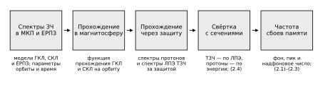
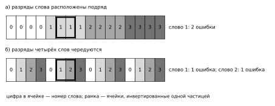
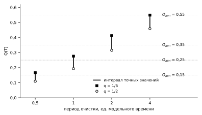
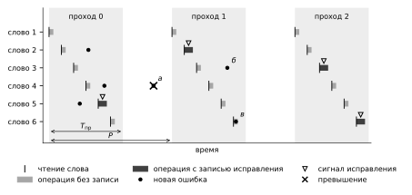
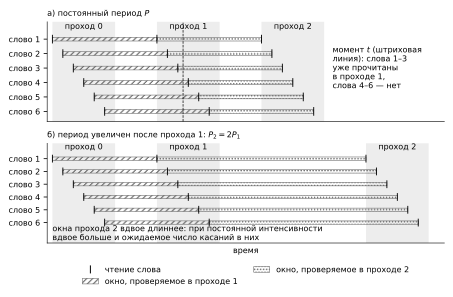
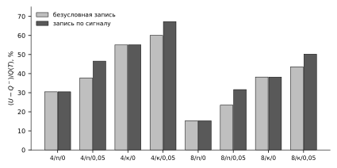

# Глава 2. Модели сбоев и коррекции ошибок в цифровой памяти

Отдельный сбой и отказ защищённой памяти разделяет работа кода. Если две частицы изменят разные разряды одного слова до его исправления, код, исправляющий одну ошибку, уже не гарантирует восстановление данных. Те же две инверсии в разных словах оставят оба слова исправимыми. Чтобы выбрать период контроля, нужно связать поток частиц с состоянием каждого слова и определить, сколько времени в нём может сохраняться ошибка. В главе эта связь устанавливается для заранее заданного порядка чтений и записей.

## 2.1. Радиационные условия эксплуатации и интенсивность сбоев

Заряженные частицы космического пространства (ЗЧ КП) вызывают одиночные сбои в микросхемах памяти бортовой радиоэлектронной аппаратуры (БРЭА) космических аппаратов (КА). Совокупность значений характеристик ЗЧ КП, действующих на БРЭА и её электрорадиоизделия, называют радиационными условиями [@OST1341044, п. 3.2]. Нормативные документы задают расчётные спектры частиц, по которым частоту сбоев сравнивают с допустимой. При периодическом контроле существенен и другой вопрос. Если основная часть сбоев придётся на несколько коротких эпизодов, одно слово может получить повторное повреждение прежде, чем его успеют прочитать. Для оценки вероятности такого события за срок нужны ограничения на изменение интенсивности во времени.

Раздел опирается на следующие допущения.

1. Радиационные условия заданы для КА на фиксированной орбите и не зависят от работы аппаратуры.
2. При заданных радиационных условиях моменты попаданий ЗЧ, вызывающих сбои, образуют пуассоновский поток.
3. Чувствительность электронной компонентной базы (ЭКБ) к ЗЧ описывается сечением возникновения одиночного сбоя, которое зависит от вида ЗЧ, её энергии или линейной передачи энергии (ЛПЭ) и направления падения и не меняется за срок работы.

### 2.1.1. Расчётные радиационные условия

Одиночные эффекты на околоземных орбитах вызывают протоны естественных радиационных поясов Земли (ЕРПЗ), а также протоны и тяжёлые заряженные частицы (ТЗЧ) галактических космических лучей (ГКЛ) и солнечных космических лучей (СКЛ) [@OST1341044, пп. 5.1, 6.2]. Потоки ГКЛ постоянно существуют в межпланетном космическом пространстве и меняются в ходе цикла солнечной активности [@OST1341044, прил. В, пп. В.1, В.2]. Потоки ЗЧ СКЛ возрастают эпизодически, на относительно короткое время, обычно до 10 суток; их причиной служит событие СКЛ — инжекция ЗЧ с поверхности Солнца [@OST1341044, прил. Б, п. Б.1]. Спектры протонов ЕРПЗ рассчитывают непосредственно для орбиты КА, а потоки ГКЛ и СКЛ на орбитах внутри магнитосферы ослаблены геомагнитным полем, что учитывают функцией прохождения ЗЧ в магнитосферу [@OST1341044, п. 5.2].

Соотношение вкладов этих составляющих зависит от орбиты, защиты и чувствительности изделия. Например, в расчётах пиковых частот сбоев для микросхем памяти на круговых орбитах при защите 1 г/см² в отсутствие событий СКЛ на высотах до 10 000 км преобладает вклад протонов ЕРПЗ, на более высоких орбитах — вклад ГКЛ, а при больших событиях СКЛ определяющими на рассмотренных орбитах становятся потоки СКЛ [@KuznetsovCRD]. В соответствии с этим РД 134-0139-2005 различает обычный режим работы радиоэлектронной аппаратуры (РЭА), определяемый суммарной частотой сбоев от ГКЛ и ЕРПЗ, и экстремальный режим, обусловленный эпизодическим появлением потоков ЗЧ СКЛ продолжительностью от нескольких часов до суток [@RD1340139, п. 5.1].

Для выбора режима контроля существенна также предсказуемость изменений обстановки. На низкой орбите время прохождения Южно-Атлантической аномалии можно рассчитать по движению КА и положению границы области повышенного потока частиц. На обсерватории RXTE такой расчёт использовали при составлении расписания защитных переключений аппаратуры [@SmithRXTE1996, разд. 2, 4]. Время прохода позволяет заранее выделить интервал возможного повышения частоты сбоев памяти. Величина повышения зависит от потока частиц во время данного прохода и чувствительности памяти. Дополнительное воздействие солнечного протонного события может прийтись на любую часть витка.

Радиационные условия, от которых зависит работоспособность БРЭА по эффектам одиночных сбоев, ОСТ 134-1044-2007 задаёт спектрами максимальных плотностей потоков протонов ЕРПЗ и ГКЛ, спектрами ЛПЭ максимальных плотностей потоков ТЗЧ ГКЛ, спектрами пиковых потоков протонов СКЛ и спектрами ЛПЭ пиковых потоков ТЗЧ СКЛ [@OST1341044, п. 6.2]. Характеристики ЗЧ СКЛ установлены при вероятности 0,1 их превышения за срок активного существования КА [@OST1341044, п. 6.6]. Этот уровень относится к превышению каждой расчётной характеристики за весь заданный срок. Для типовых орбит, в том числе геостационарной, характеристики рассчитаны программой COSRAD для защиты в форме сферы с толщинами алюминия от 0,01 до 10 г/см² [@OST1341044, пп. 6.4, 6.5].

В техническом задании устанавливают эти спектры за типовыми защитами и показатель сбоеустойчивости — допустимую частоту сбоев [@OST1341044, п. 7.3.1]. По РД 134-0139-2005 частота сбоев — число сбоев РЭА в единицу времени, с⁻¹; её вычисляют по указанным спектрам и сравнивают с допустимой [@RD1340139, пп. 4.8, 5.1, 5.6]. Обозначим эту частоту $\nu_{\text{РЭА}}$. Вероятность за срок РД вычисляет только для одиночных отказов [@RD1340139, п. 5.2].

ГОСТ Р 25645.165-2025 связывает спектры флюенсов и пиковых потоков протонов СКЛ с продолжительностью полёта, уровнем солнечной активности и вероятностью превышения П [@GOST25645165, п. 5.1]. Среднее ожидаемое число солнечных протонных событий в этой модели относится к событиям с флюенсом протонов с энергией более 30 МэВ выше 10⁵ см⁻² и пропорционально сумме среднемесячных чисел Вольфа за время полёта [@GOST25645165, пп. 5.6, 5.7]. При сравнении с наблюдениями существенен способ выделения события. Например, в выборке SEPEM эпизод выделяют по порогу интенсивности и объединяют эпизоды, разделённые менее чем сутками [@SEPEMRDS2]. Поэтому полученные на одном отрезке времени 31,56 эпизода на десять лет по выборке и 100,6 события по модели характеризуют разные совокупности.

Нормативные характеристики определяют наибольшие потоки и флюенс за срок, но не задают изменения потоков во времени. Чтобы описать это изменение, введём интенсивность родительских событий $\lambda(t)$ — интенсивность пуассоновского потока попаданий ЗЧ, каждое из которых изменяет хотя бы один разряд памяти. Её следует отличать от интенсивности битовых инверсий $\lambda_{\text{инв}}(t)$, вычисляемой по сечениям на бит, и от частоты сбоев $\nu_{\text{РЭА}}$, событие и нормировка которой определяются испытаниями изделия. Одно событие может инвертировать несколько битов, поэтому $\lambda \le \lambda_{\text{инв}}$. Равенство выполняется, когда каждое событие инвертирует ровно один бит; постоянство потоков само по себе этого не обеспечивает.

Рассмотрим одно слово, в котором код исправляет одну ошибку. Пусть каждое событие инвертирует один разряд, выбираемый независимо по неизменному распределению. Между двумя проверками слова обслуживания нет. На таком промежутке $J$ среднее число событий равно $\mu_J = \int_J \lambda(t)\,dt$, а среднее число пар пуассоновских событий равно $\mu_J^2/2$. При одном и том же начальном состоянии и заданном $\mu_J$ вероятность превышения одинакова для всех форм интенсивности внутри $J$. Но если ту же суммарную экспозицию сосредоточить на меньшем числе промежутков, возрастёт сумма квадратов $\sum_J \mu_J^2$. Для непересекающихся промежутков длиной не более $P$ из $\mu_J^2 \le |J| \int_J \lambda^2(t)\,dt$ следует $\sum_J \mu_J^2 \le P\int_0^T \lambda^2(t)\,dt$. Так интеграл квадрата интенсивности позволяет ограничить среднее число пар, способных вызвать накопление.

Опишем допустимые изменения интенсивности через фон, пик и суммарное надфоновое воздействие за срок $T$. Потребуем выполнения неравенств

$$
\lambda(t) = \lambda_{\text{ф}}(t) + \lambda_{\text{с}}(t) \le \lambda_{\text{пик}}, \qquad 0 \le \lambda_{\text{ф}}(t) \le \bar\lambda_{\text{ф}}, \qquad \lambda_{\text{с}}(t) \ge 0, \qquad \int_0^T \lambda_{\text{с}}(t)\,dt \le N_{\text{соб}}.
\tag{2.1}
$$

Здесь $\lambda_{\text{ф}}$ — фоновая составляющая, создаваемая постоянно присутствующими ЗЧ (на геостационарной орбите — ГКЛ), $\lambda_{\text{с}}$ — надфоновая составляющая, создаваемая событиями СКЛ, $\lambda_{\text{пик}}$ — наибольшая допустимая интенсивность, $\bar\lambda_{\text{ф}}$ — верхняя граница фона, $N_{\text{соб}}$ — верхняя граница среднего числа надфоновых событий за срок $T$. Класс не фиксирует ни формы событий, ни моментов их наступления: допустим любой профиль, удовлетворяющий этим ограничениям.

Если решение о следующей проверке принимают по уже полученным наблюдениям, важно, насколько может возрасти интенсивность к моменту этой проверки. Для таких режимов класс дополняют условием

$$
H_\ell\bigl(\lambda(t)\bigr) - H_\ell\bigl(\lambda(u)\bigr) \le \rho\,(t - u), \quad u < t, \qquad H_\ell(x) = \begin{cases} x/\ell, & x \le \ell,\\ 1 + \ln(x/\ell), & x > \ell, \end{cases}
\tag{2.2}
$$

где $\ell$ — порог, ниже которого рост интенсивности измеряется линейно, а выше — логарифмически, $\rho$ — наибольшая допустимая скорость роста в этой шкале. Выше порога интенсивность возрастает не быстрее чем в $e$ раз за время $1/\rho$. Спад интенсивности и её начальный уровень условие (2.2) не ограничивает.

Из (2.1) следуют вычислимые верхние границы среднего числа событий за срок и интеграла квадрата интенсивности, а через предыдущее неравенство — и суммы $\sum_J \mu_J^2 \le P \bar S_2$:

$$
\bar F = \min\bigl(\lambda_{\text{пик}} T,\ \bar\lambda_{\text{ф}} T + N_{\text{соб}}\bigr), \qquad
\bar S_2 = \min\bigl\{\lambda_{\text{пик}}^2 T,\ \lambda_{\text{пик}} \bar F,\ \bar\lambda_{\text{ф}}^2 T + (\lambda_{\text{пик}} + \bar\lambda_{\text{ф}}) N_{\text{соб}}\bigr\}.
\tag{2.3}
$$

Последняя ветвь $\bar S_2$ следует из неравенства $\lambda^2 \le \bar\lambda_{\text{ф}}^2 + (\lambda_{\text{пик}} + \bar\lambda_{\text{ф}})\lambda_{\text{с}}$. Величина $\bar F$ безразмерна, $\bar S_2$ измеряется в с⁻¹.

Требование к памяти формулируется для всего класса: вероятность неисправимой ошибки за время работы $Q(T)$ не должна превышать допустимой вероятности $Q_{\text{доп}}$ ни при каком профиле, удовлетворяющем (2.1). Если сами радиационные условия случайны и выходят за пределы класса с вероятностью не больше $\delta_{\text{ср}}$, то выполнение требования для класса с допустимой вероятностью $Q_{\text{доп}} - \delta_{\text{ср}}$ обеспечивает безусловную вероятность неисправимой ошибки не больше $Q_{\text{доп}}$. Вероятность 0,1, при которой установлены характеристики СКЛ, относится к каждой характеристике в отдельности и такой оценки для класса в целом не даёт.

### 2.1.2. Расчёт интенсивности сбоев по спектрам заряженных частиц

Схема на рисунке 2.1 показывает, какие данные зависят от орбиты и защиты, а какие — от выбранной памяти. По параметрам орбиты и времени полёта находят спектры протонов ЕРПЗ и спектры протонов и ТЗЧ ГКЛ и СКЛ, прошедших в магнитосферу. Затем по ОСТ 134-1044-2007 рассчитывают энергетические спектры частиц и спектры ЛПЭ ТЗЧ за защитой [@OST1341044, п. 5.2, рисунок 5.1]. Чтобы получить частоту сбоев, эти спектры свёртывают с сечениями возникновения сбоя в изделии [@RD1340139, п. 5.1].

Рисунок 2.1 — Последовательность расчёта интенсивности сбоев памяти по ОСТ 134-1044-2007 и РД 134-0139-2005

Пусть $\varphi_a(E, \Omega, t)$ — дифференциальная плотность потока частиц вида $a$ с энергией $E$, падающих за защитой с направления $\Omega$, а $\sigma_{a,\text{бит}}(E, \Omega)$ — сечение возникновения сбоя, отнесённое к одному биту. Интенсивность инверсий одного бита и интенсивность битовых инверсий массива равны

$$
\lambda_{\text{бит}}(t) = \sum_a \iint \varphi_a(E, \Omega, t)\,\sigma_{a,\text{бит}}(E, \Omega)\,dE\,d\Omega, \qquad \lambda_{\text{инв}}(t) = N_{\text{бит}}\,\lambda_{\text{бит}}(t),
\tag{2.4}
$$

где $N_{\text{бит}}$ — число учитываемых битов массива. Для полных кодовых слов при одинаковой чувствительности проверочных и информационных разрядов $N_{\text{бит}} = nM$, где $n$ — число разрядов слова, $M$ — число слов. Для ТЗЧ интегрирование ведут по ЛПЭ с сечением, зависящим от ЛПЭ, для протонов — по энергии; в такой форме частота сбоев записана в РД 134-0139-2005 [@RD1340139, п. 5.1, формула (5.1)]. При отсутствии аппроксимаций этих зависимостей РД допускает расчёт по сечениям насыщения, дающий верхнюю оценку [@RD1340139, п. 5.5, формула (5.4)]. Если сечение отнесено к изделию, а не к биту, множитель $N_{\text{бит}}$ не нужен; частота $\nu_{\text{РЭА}}$ совпадает с $\lambda_{\text{инв}}$ только при одинаковом событии и одинаковой нормировке.

Сечения возникновения сбоев обычно измеряют при нормальном падении частиц, тогда как угловое распределение потоков СКЛ в среднем изотропно [@GOST25645165, п. 5.3]. Если угловая зависимость сечения неизвестна, в расчётной модели протонный вклад получают из энергетической свёртки с измеренным при нормальном падении сечением и геометрическим коэффициентом $a_H$. Это параметрическая замена углового интегрирования в (2.4). Для изотропного спектра, заданного на единицу телесного угла, интегрирование по направлениям даёт множитель 4π; для уже всенаправленного спектра этот множитель повторно не вводится. Значение $a_H = 1$ соответствует сечению, не зависящему от угла падения. Угловая зависимость сечения в рассматриваемом расчёте не измерена, поэтому $a_H$ остаётся параметром; ни ОСТ, ни РД выбора этого коэффициента не устанавливают.

Одиночные сбои вызывают ТЗЧ и протоны. ТЗЧ создают заряд в чувствительном объёме ячейки непосредственной ионизацией, и их вклад определяется спектром ЛПЭ. Протоны высоких энергий вызывают сбои главным образом через ядерные реакции, продукты которых ионизируют чувствительный объём [@KuznetsovCRD]; у микросхемы CY62167GE30 сечение сбоя от таких протонов составляет порядка 8·10⁻¹⁴ см²/бит. В микросхемах с глубоко субмикронными топологическими нормами заряд, достаточный для сбоя, может создать непосредственной ионизацией и протон низкой энергии. У CY62167GE30 сечение сбоя от непосредственной ионизации протонами в максимуме, при энергии 0,8–1 МэВ перед слоями металлизации, достигает 1,2·10⁻⁹ см²/бит, что в 15 000 раз больше [@Coronetti2021]. По оценке той же работы непосредственная ионизация протонами может давать до 90 % частоты сбоев таких микросхем в среднем по набору орбит [@Coronetti2021]. Методика испытаний РД 134-0139-2005 предусматривает облучение протонами с энергиями порядка 20–1000 МэВ и эту область энергий не охватывает [@RD1340139, прил. В, п. В.4.1].

Значение этого механизма для памяти показывает сравнение моделей отклика при одних и тех же спектрах COSRAD для геостационарной орбиты и защиты 3 г/см² (таблица 2.1). Рассматривается массив из $M$ = 524 288 слов по 32 информационных и 6 проверочных разрядов, то есть 2 МиБ данных; при одинаковой чувствительности всех разрядов учитываются 19 922 944 разряда. Учёт непосредственной ионизации протонами увеличивает интеграл квадрата интенсивности битовых инверсий в 6,0 раза, а переход от $a_H = 1/2$ к $a_H = 1$, удваивающий протонную составляющую, увеличивает его ещё более чем вдвое. Различие способов численного интегрирования на результат практически не влияет.

Таблица 2.1 — Интеграл квадрата интенсивности битовых инверсий массива при разных моделях отклика (геостационарная орбита, защита 3 г/см², срок 10 лет)

| Модель отклика | $a_H$ | $\int_0^T \lambda_{\text{инв}}^2\,dt$, с⁻¹ |
|---|---|---|
| ТЗЧ и протоны высоких энергий без непосредственной ионизации | 1/2 | 6939,004 |
| ТЗЧ и протоны, включая непосредственную ионизацию | 1/2 | 41 867,13 |
| ТЗЧ и протоны, включая непосредственную ионизацию | 1 | 111 494,6 |

Для того же массива получены условные предельные величины интенсивности битовых инверсий (таблица 2.2). Фон и пик рассчитаны по спектрам COSRAD для среднего цикла солнечной активности и срока 10 лет при заданной ОСТ вероятности превышения характеристик СКЛ 0,1, с экспериментальным сечением, включающим непосредственную ионизацию протонами, и с коэффициентом $a_H = 1$; взаимные произведения вкладов разных видов частиц в интеграле квадрата учтены. Надфоновое число инверсий оценено как $T_{\rm экв}(\lambda_{\text{пик}} - \bar\lambda_{\text{ф}})$. Эквивалентная длительность $T_{\rm экв}=115\,776$ с выбрана так, чтобы покрыть наибольшее по узлам спектров отношение флюенса к пиковому потоку; это не длительность отдельного события. $\bar S_2$ вычислен по последней ветви (2.3), что соответствует прямоугольной форме событий. Значения округлены в бо́льшую сторону. Поскольку каждое родительское событие инвертирует хотя бы один бит, те же величины ограничивают сверху и соответствующие величины для $\lambda$.

Таблица 2.2 — Условные предельные величины интенсивности битовых инверсий массива на CY62167GE30 (геостационарная орбита, срок 10 лет)

| Защита, г/см² | $\bar\lambda_{\text{ф}}$, с⁻¹ | $\lambda_{\text{пик}}$, с⁻¹ | $\bar F$ | $\bar S_2$, с⁻¹ |
|---|---|---|---|---|
| 2,5 | 1,702·10⁻⁴ | 1,365 | 211 600 | 215 500 |
| 3,0 | 1,586·10⁻⁴ | 0,9814 | 163 700 | 111 500 |
| 3,5 | 1,490·10⁻⁴ | 0,7454 | 133 300 | 64 330 |
| 4,0 | 1,409·10⁻⁴ | 0,5872 | 112 400 | 39 920 |

При защите 3 г/см² наибольшая интенсивность превышает фоновую в 6200 раз. Такое отношение получено при выбранных отклике и форме событий. Из установленной ОСТ вероятности превышения отдельных спектральных характеристик нельзя вывести совместный квантиль уровня 0,9 для интеграла квадрата интенсивности. Учёт формы событий по данным SEPEM уменьшил бы $\bar S_2$ при 3 г/см² на 67,8 %, однако обоснования для переноса модельной формы на будущий срок нет, и прямоугольная форма сохраняется.

Условия таблицы 2.2 отличаются от условий учебного примера, в котором каждое попадание изменяет один бит одного слова. Для этого примера приняты отклик без непосредственной ионизации протонами и $a_H=1/2$ при тех же орбите, защите 3 г/см² и размере массива. Здесь частоты частиц, инверсий и затрагивания слов совпадают. Верх фона составляет 1,54704·10⁻⁴ с⁻¹, $\lambda_{\text{пик}}=0{,}244682704$ с⁻¹, $N_{\text{соб}}=28\,310{,}473728$, а в (2.2) приняты $\rho=0{,}048$ с⁻¹ и $\ell=10^{-3}$ с⁻¹.

В основном примере контроля используется эталон из $M_{\rm эт}=524\,288$ слов по 32 информационных и шесть проверочных разрядов. Фон и пик здесь получены по тому же отклику, что в строке для 3 г/см² таблицы 2.2, с учётом непосредственной ионизации протонами и с $a_H=1$. Запишем частоту инверсий эталона как $\nu_{\rm эт}(t)=\nu_{\rm ф}+\nu_{\rm изб}(t)$. Для фона свёртка даёт $\nu_{\rm ф}\approx1{,}586\cdot10^{-4}$ с⁻¹, для пика $\nu_{\max}\approx0{,}9813$ с⁻¹ (до округления 0,9813008497 с⁻¹).

Два расчёта различаются способом задания воздействия за весь срок. В таблице 2.2 при защите 3 г/см² верх среднего числа инверсий 163 700 и верх интеграла квадрата интенсивности 111 500 с⁻¹ получены по эквивалентной длительности и прямоугольной форме событий. Для основного примера выбран наибольший интеграл полной частоты среди 3,31 млн перекрывающихся десятилетних окон реконструкции SEPEM. Полученное значение 187 463,23 округлено вверх до 187 464 ожидаемых инверсий на эталоне, включая фон. Поэтому на надфоновую часть отводится $\int_0^T\nu_{\rm изб}(t)\,dt\le N_{\rm изб}=187\,464-\nu_{\rm ф}T$, где используется неокруглённое значение фона.

Для того же класса по архивным рядам заданы односторонняя граница роста $\gamma_\nu=0{,}004392116$ с⁻², полученная удвоением и округлением вверх наибольшего минутного подъёма в ряду GOES-19 East, и граница $\nu_{\rm изб}(0)+V^+(\nu_{\rm изб})\le V_{\nu,\max}=28{,}855$ с⁻¹. Здесь $V^+(\nu_{\rm изб})$ — суммарная положительная вариация, то есть верх по всем разбиениям срока сумм положительных приращений $\nu_{\rm изб}$; вместе с начальным значением она ограничивает сумму всех подъёмов от нулевого уровня. Связь с (2.2) получается без нового ограничения: если частота в тех же единицах имеет одностороннюю скорость роста не больше $\gamma_\nu$, то функция $H_\ell$ имеет наклон не больше $1/\ell$, и достаточно положить $\rho=\gamma_\nu/\ell$. Удвоение наблюдавшегося подъёма задаёт запас модели. Минутная регистрация не устанавливает предела субминутного роста в будущем полёте.

Множество разрядов, инвертированных одной частицей, назовём меткой события. Сечение на бит определяет интенсивность инверсий в (2.4), но не указывает, какие из них принадлежат одной метке. Это различие существенно для кода, который исправляет ошибки отдельно в каждом слове.

В испытаниях регистрируются группы сбойных ячеек. Метки близких по времени и месту попаданий могут слиться в одну зарегистрированную группу, а одну метку алгоритм регистрации может разделить. Кроме того, переход от измерений на информационных разрядах к интенсивности для всех 38 разрядов предполагает одинаковую чувствительность проверочных ячеек. Эта предпосылка остаётся непроверенной.

Численные примеры относятся к геостационарной орбите. Для низкой орбиты в расчёт потребовалось бы включить также протоны ЕРПЗ. Даже при известном спектре и отклике на бит для оценки исправимости остаётся определить, какие физические разряды входят в одно слово.

## 2.2. Организация памяти и корректирующего кода

Связь между инверсией ячейки и неисправимой ошибкой задают две характеристики памяти. Код определяет, сколько ошибочных разрядов он исправляет в одном слове. Размещение разрядов определяет, сколько ячеек этого слова может одновременно затронуть одна частица.

Раздел опирается на следующие допущения.

1. Память состоит из $M$ кодовых слов одного кода, и каждый разряд каждого слова хранится в отдельной ячейке.
2. Частица одновременно инвертирует все затронутые ею ячейки; повторная инверсия ячейки возвращает её разряд к правильному значению.
3. Исправимость слова определяется по всем его разрядам, включая проверочные, в любой момент работы, в том числе во время обращения к памяти.

### 2.2.1. Структура кодового слова и событие отказа

Кодовое слово содержит $n_{\text{и}}$ информационных разрядов, хранящих данные, и $n - n_{\text{и}}$ проверочных разрядов, которые кодер вычисляет по информационным; всего в слове $n$ разрядов. Корректирующая способность кода определяется минимальным кодовым расстоянием $d$ — наименьшим числом разрядов, в которых различаются два допустимых слова. Код с расстоянием $d$ исправляет в слове любые $t_{\text{код}} = \lfloor (d-1)/2 \rfloor$ ошибок; это число называют корректирующей способностью кода. При $d = 3$ код исправляет одну ошибку, при $d = 4$ исправляет одну и обнаруживает две. Построение кодов второго вида для памяти рассмотрено в [@Hsiao1970].

В работе рассматриваются три варианта слова (таблица 2.5). В микросхеме CY62167GE30 коррекция встроена в саму память: по описанию изготовителя внутреннее слово содержит 32 информационных и 6 проверочных разрядов кода Хэмминга, исправляющего одну ошибку [@InfineonAN88889, разд. 4.1–4.2]. В описанных изготовителем случаях коррекции одиночной ошибки данных во время чтения микросхема формирует сигнал ERR, а автоматической обратной записи исправленных данных в ячейки не выполняет [@CY62167RevF]. Для памяти с внешним декодером рассматриваются код (39, 32) с расстоянием 4 и более сильный код (44, 32) с расстоянием не менее 5, исправляющий две ошибки. При тех же 32 информационных разрядах второму коду нужно 12 проверочных разрядов вместо 7.

Таблица 2.5 — Варианты кодового слова

| Вариант | $n$ | $n_{\text{и}}$ | Проверочных разрядов | $d$ | $t_{\text{код}}$ | Основание |
|---|---|---|---|---|---|---|
| Внутренний код CY62167GE30 | 38 | 32 | 6 | 3 | 1 | описание изготовителя [@InfineonAN88889, разд. 4.1–4.2] |
| Внешний код (39, 32) | 39 | 32 | 7 | 4 | 1 | расстояние доказано в исследовании |
| Внешний код (44, 32) | 44 | 32 | 12 | не менее 5 | 2 | расстояние доказано в исследовании |

В отдельном расчётном примере с внешним кодом (39, 32) на одно кодовое слово отводятся три 16-разрядных адресуемых слова памяти, то есть 48 физических разрядов. Из них 32 разряда информационные, 7 проверочные, а 9 не входят в кодовое слово. Вероятность неисправимой ошибки определяется по 39 разрядам кода, тогда как выделенная ёмкость и число обращений учитываются по 48-разрядной упаковке. Та же упаковка вмещает код (44, 32), для которого вне кодового слова остаются 4 разряда.

Состояние слова $w$ в момент $s$ задаётся множеством $E_w(s)$ его ошибочных разрядов — разрядов, значения которых отличаются от правильного образа. Число элементов этого множества $\operatorname{wt} E_w(s)$ называют весом ошибки. Слово исправимо, пока вес его ошибки не больше $t_{\text{код}}$. Событием отказа за время работы $T$ считается хотя бы одно превышение корректирующей способности хотя бы в одном слове:

$$
A_T = \{\exists\, s \in [0, T],\ w:\ \operatorname{wt} E_w(s) > t_{\text{код}}\}, \qquad Q(T) = \mathrm{P}(A_T).
\tag{2.5}
$$

Показатель $Q(T)$ — вероятность неисправимой ошибки за время работы — определяется первым превышением: учитываются все разряды слова и любой момент работы, а последующее восстановление слова не отменяет состоявшегося события. Такое определение согласуется с моделями надёжности памяти, в которых слово отказывает, как только число ошибок в нём превышает корректирующую способность кода [@Lee2011], а повторное попадание в уже сбойную ячейку не создаёт второй ошибки [@Baeg2009].

Исправление, обнаружение и первое превышение — разные события. Исправление происходит при чтении слова с весом ошибки от 1 до $t_{\text{код}}$: декодер выдаёт правильные данные. Обнаружение без исправления даёт код с запасом расстояния: код с $d = 4$ распознаёт две ошибки в слове, но исправить их не может. Первое превышение наступает в момент сбоя, создавшего вес больше $t_{\text{код}}$, а не в момент чтения. Поэтому обнаружение двойной ошибки не предотвращает превышения: оно сообщает о нём, когда превышение уже состоялось. По той же причине $Q(T)$ не совпадает ни с вероятностью сообщения о неисправимой ошибке, ни с долей слов, содержащих ошибки к концу срока.

Для CY62167GE30 изготовитель описывает логический состав слова и порядок внешнего обращения. В режиме ×16 одно чтение выдаёт 16 информационных разрядов внутреннего слова. Документация не устанавливает, какие два адреса относятся к одному слову, где физически находятся все 38 его ячеек и даст ли изолированная ошибка в каждой из шести проверочных позиций регистрируемый внешним контроллером ERR [@CY62167RevF; @InfineonAN88889, разд. 4.1–4.4].

Открытый архив испытаний содержит физические координаты зарегистрированных информационных ячеек и поле байтового адреса в режиме ×8 [@Zenodo8314389]. Связь координат с записанным полем воспроизводится на обычных записях. Однако для перехода к паре адресов ×16 нужно знать, как при записи байтового адреса учтён вывод 45, выбирающий один из двух байтов. Шесть проверочных ячеек в архиве также не наблюдались. Поэтому для внутреннего слова приходится отдельно задавать модель размещения. Для внешних кодов состав защищаемых разрядов задан их 48-разрядной упаковкой.

### 2.2.2. Многократные сбои и размещение разрядов слова

При облучении CY62167GE30 зарегистрированы группы инвертированных соседних информационных ячеек [@Zenodo8314389]. Чтобы отнести всю группу к одной частице, требуется установить общее происхождение инверсий. Рассмотрим случай, когда одна частица действительно инвертирует несколько ячеек. Их число называют кратностью сбоя по ячейкам. Последствие для кода зависит от того, каким словам эти ячейки принадлежат. Пусть память первоначально чиста. Если соседние ячейки относятся к одному слову, двухклеточный сбой даёт в нём две ошибки, и при $t_{\text{код}} = 1$ это превышение. Если разряды нескольких слов чередуются, так что соседние ячейки принадлежат разным словам, тот же сбой даёт по одной исправимой ошибке в двух словах (рисунок 2.6). На этом основан выбор расстояния чередования разрядов в статической памяти [@Baeg2009].

Рисунок 2.6 — Двухклеточный сбой при разном размещении разрядов: а — соседние ячейки принадлежат одному слову, две ошибки в слове; б — разряды четырёх слов чередуются, по одной ошибке в двух словах

Изменение частицей сразу нескольких разрядов одного слова называют прямым многобитовым воздействием. В изначально чистом слове оно вызывает превышение немедленно, если затронуто больше $t_{\text{код}}$ разрядов. При коде, исправляющем одну ошибку, распределение сбоя по одной ошибке в каждое из чистых слов сохраняет их исправимость. Превышение наступает, если до восстановления такого слова другая частица инвертирует в нём другой разряд. Поэтому для оценки $Q(T)$ нужны не только частоты сбоев по отдельным словам, но и совместное распределение того, какие слова затрагивает одна частица.

Значение совместного распределения видно на учебной модели из четырёх слов с $t_{\text{код}} = 1$, в которой каждая частица затрагивает ровно два разных слова и вносит в каждое одну ошибку в ещё не затронутом разряде. Сравним два случая. В первом частица затрагивает пару слов $\{0, 1\}$ или пару $\{2, 3\}$, каждую с вероятностью 1/2; во втором — любую из шести пар с вероятностью 1/6. В обоих случаях каждое слово затрагивается с вероятностью 1/2, то есть частоты поражения отдельных слов совпадают. Однако две частицы в первом случае затрагивают непересекающиеся пары с вероятностью 1/2, а во втором — только с вероятностью 1/6; в остальных случаях какое-то слово получает вторую ошибку, и наступает превышение.

В общем случае пары затрагиваются с вероятностями $p_{01} = p_{23} = a$, $p_{02} = p_{13} = c$, $p_{03} = p_{12} = e$, где $a, c, e \ge 0$ и $a + c + e = 1/2$; при любых $a$, $c$, $e$ каждое слово по-прежнему затрагивается с вероятностью 1/2. Пары для разных частиц выбираются независимо и одинаково и не зависят от моментов прихода частиц, а сами частицы образуют однородный пуассоновский поток интенсивности $\lambda$. Память мгновенно и полностью очищается с периодом $P$, так что каждый период начинается с чистого состояния; срок $T$ содержит $k = T/P$ периодов, а на период в среднем приходится $m = \lambda P$ частиц.

За период превышения нет, если частиц не больше одной или их ровно две и они затронули непересекающиеся пары; при трёх и более частицах на четыре слова приходится не меньше шести поражений, и какое-то слово получает вторую ошибку. Две частицы затрагивают непересекающиеся пары с вероятностью $q = 2(a^2 + c^2 + e^2)$; при допустимых $a$, $c$, $e$ она меняется от 1/6 до 1/2, и крайние значения дают два сравненных выше случая. Обозначим через $S(q, m)$ вероятность отсутствия превышения за один период. Тогда

$$
S(q, m) = e^{-m}\left(1 + m + \frac{q m^2}{2}\right), \qquad Q(T) = 1 - S(q, m)^k.
\tag{2.6}
$$

Для любой допустимой тройки $a,c,e$ значение $Q(T)$ лежит между значениями (2.6) при $q=1/2$ и $q=1/6$. Обе границы и все промежуточные значения достижимы при тех же частотах поражения отдельных слов. Посмотрим, как эта неопределённость влияет на выбор периода. При $\lambda=0{,}5$ и $T=4$ в единицах модельного времени выберем наибольший из периодов 0,5, 1, 2 и 4, для которого $Q(T)\le Q_{\text{доп}}$. В таблице 2.6 приведён выбор для двух крайних законов.

Таблица 2.6 — Наибольший допустимый период в учебной модели

| $Q_{\text{доп}}$ | При меньшем значении $Q(T)$, $q = 1/2$ | При большем значении $Q(T)$, $q = 1/6$ |
|---|---|---|
| 0,15 | 0,5 | допустимого периода нет |
| 0,25 | 1,0 | 0,5 |
| 0,35 | 2,0 | 1,0 |
| 0,55 | 4,0 | 4,0 |

Рисунок 2.7 — Учебная модель: интервалы точных значений $Q(T)$ при четырёх периодах очистки и уровни $Q_{\text{доп}}$

На рисунке 2.7 концы каждого отрезка соответствуют двум крайним законам поражения. Если весь отрезок ниже заданного уровня, период подходит при любом совместном распределении из этой модели. Если уровень пересекает отрезок, одних частот поражения слов для решения недостаточно. Так, при допуске 0,25 период 1 подходит для двух фиксированных пар, но при равномерном выборе из шести пар приходится сократить его до 0,5. При допуске 0,55 оба закона допускают период 4. Значения, вычисленные по (2.6), сопоставлены с моделированием методом Монте-Карло.

Более сильный код меняет условие превышения. При $t_{\text{код}} = 2$ превышение требует не менее трёх ошибочных разрядов в слове. Частица, изменившая два разряда чистого слова, превышения не вызывает; оно наступит, если до восстановления слова другая частица изменит третий, ещё не затронутый разряд. Если же вторая частица попадёт в один из уже ошибочных разрядов, повторная инверсия вернёт его к правильному значению, и вес ошибки уменьшится. Поэтому важно не только число воздействий на слово до его восстановления, но и то, приходятся ли они на различные разряды. Для пуассоновских воздействий с независимым равномерным выбором разрядов внутри слова и заранее заданных моментов проверки в исследовании получена верхняя оценка. В ней накопление одиночных попаданий даёт член, кубический по их среднему числу в слове, а сочетания двухразрядных воздействий с одиночными и друг с другом — квадратичные члены.

При той же полезной ёмкости код (44, 32) требует больше проверочных разрядов, чем код (39, 32), но в принятой 48-разрядной упаковке оба кода занимают одинаковый объём памяти. Поэтому уменьшение затрат на контроль при усилении кода необходимо сопоставлять с затратами на кодирование и декодирование; дополнительная ёмкость в этом варианте не требуется.

В учебном примере все четыре слова одновременно возвращались в чистое состояние. При последовательном обходе время, в течение которого может сохраняться первая ошибка, для каждого слова отсчитывается от собственной операции контроля. Чтобы оценить накопление в такой памяти, требуется установить, что именно делает контроллер между чтением слова и окончанием его исправления.

## 2.3. Модель последовательного контроля памяти

Сбой меняет состояние слова в момент попадания частицы. Декодер видит это состояние лишь при чтении, а исправление в ячейках заканчивается ещё позже, при записи. Различие этих трёх моментов определяет, к какому интервалу относится обнаруженная ошибка и как долго вторая частица ещё может вызвать превышение.

Модель строится при следующих допущениях.

1. Контроль ведётся по идеальному календарю: слова читаются в фиксированном порядке в заранее заданные моменты, в том числе при смене периода, и каждая операция контроля завершается внутри отведённого ей интервала времени.
2. При чтении исправимого слова декодер выдаёт правильные данные. Если он исправил ошибку, он формирует сигнал исправления. Ложных сигналов нет.
3. Контроллер регистрирует сигнал при исправлении в любой позиции слова, в том числе проверочной.
4. Контроллер записывает правильный образ, не вносит новых ошибок и не прерывает начатое исправление.
5. Модель описывает работу памяти до первого момента, когда хотя бы в одном слове ошибок становится больше, чем исправляет код.

### 2.3.1. Порядок контроля и условия обнаружения ошибок

Контроллер периодического контроля (скраббинга) читает слова в постоянном порядке; такие чтения назовём контрольными, в отличие от чтений приложения. Проходом называется однократное выполнение назначенного списка чтений, в котором каждое из $M$ слов проверяется хотя бы один раз. В абстрактном календаре для каждого слова выделяется одно назначенное чтение, а время между двумя такими чтениями слова — период контроля $P$; дополнительные чтения того же слова сохраняются в фактическом расписании и учёте затрат. Календарь контроллера отводит каждому слову интервал, достаточный для самой длинной операции контроля. Длительность прохода $T_{\text{пр}}$ охватывает отведённые интервалы всех слов и паузы между ними. При постоянном периоде $T_{\text{пр}} \le P$, а если проходы следуют без пауз, $T_{\text{пр}} = P$.

Обозначим через $r_w(k)$ момент контрольного чтения слова $w$ в $k$-м проходе, $k = 0, 1, 2, \ldots$, — момент, когда фиксируется состояние слова (снимок). Через $v_w(k) \ge r_w(k)$ обозначим фактический момент окончания операции контроля, включающей декодирование и при необходимости запись. Окончание операции зависит от того, понадобилась ли запись, и лежит внутри отведённого интервала. При постоянном периоде моменты чтения задаются календарём:

$$
r_w(k) = t_0 + kP + \varphi_w, \qquad 0 \le \varphi_w < T_{\text{пр}},
\tag{2.7}
$$

где $t_0$ — начало первого прохода; $\varphi_w$ — сдвиг чтения слова $w$ от начала прохода. Каждое слово проверяется через $P$ после предыдущей проверки, а моменты проверки разных слов сдвинуты на разность сдвигов $\varphi_w$. При смене периода порядок чтений внутри прохода сохраняется, а меняется время между проходами.

Пусть ошибка возникла в момент $s$ и сохраняется до ближайшего контрольного чтения слова $w$. При постоянном периоде задержка её обнаружения не превышает $P$. Для $k\ge1$ интервал $[r_w(k-1),r_w(k))$ назовём окном наблюдения этого слова. При первом чтении возможна и ошибка, существовавшая в начале работы. Окна одного слова примыкают друг к другу, тогда как у разных слов они сдвинуты по фазе. Если частица попадёт в уже прочитанное слово, ошибка может остаться в памяти к концу прохода.

От снимка $r_w(k)$ до завершения операции $v_w(k)$ декодер выдаёт результат чтения, а контроллер при необходимости выполняет запись. Проследим, какие ошибки к концу этого интервала устраняет каждый из трёх способов обслуживания.

При обслуживании с безусловной записью полный исправленный образ слова записывается после каждого чтения. К окончанию записи слово совпадает с правильным образом: снимаются ошибки, имевшиеся при чтении, и ошибки, попавшие в слово до окончания записи. Ошибки, возникшие после окончания записи, она не устраняет.

При обслуживании с записью после исправимой ошибки запись выполняется, когда при чтении обнаружена исправимая ошибка; контроллер записывает полный исправленный образ слова, поэтому к окончанию записи слово восстановлено полностью. В остальных случаях последней проверкой слова служит само чтение, и ошибки, возникшие после него, операция не устраняет.

При обслуживании с записью по сигналу исправления память исправляет ошибку в выдаваемых данных и формирует сигнал исправления, а ячейки сама не перезаписывает; получив сигнал, контроллер в той же операции записывает исправленные данные через интерфейс памяти. Как микросхема при этом обновляет внутреннее слово, в том числе при записи несколькими обращениями к частям слова, не раскрыто, поэтому принимается более слабое свойство: к окончанию операции снимаются ошибки, существовавшие до её начала, а ошибки от попаданий во время операции могут остаться. Без сигнала запись не выполняется, и слово к окончанию операции может содержать ошибку, пришедшую во время неё.

Сравним три случая на рисунке 2.8. В случае «б» первая ошибка возникает после чтения и обнаруживается только в следующем проходе. В случае «в» она возникает ещё во время операции, но запись не назначена, поскольку снимок был чистым. В случае «а» в слове уже есть ошибка, и новая инверсия другого разряда до окончания записи даёт превышение. Даже если последующая запись полностью восстановит слово, событие (2.5) уже наступило.

Рисунок 2.8 — Временная диаграмма последовательного контроля; независимые иллюстративные случаи: а — ошибка в другом разряде слова, уже содержащего неисправленную ошибку (превышение корректирующей способности); б — ошибка в уже прочитанном слове, обнаруживаемая в следующем проходе; в — ошибка во время операции без записи, остающаяся до следующего прохода

Приложение может читать защищаемую область между контрольными чтениями. Это существенно для долгоживущих данных, например программного кода и таблиц. Чтение приложения проходит через тот же декодер и может раньше контроля выдать правильные данные и сигнал исправления. Если ячейки при этом не перезаписаны, следующие чтения всё ещё могут сообщать о той же ошибке.

При полной перезаписи слова приложение меняет правильный образ и устраняет прежние ошибки. Если нужно сохранить сведения о них, перед перезаписью считывают слово и регистрируют результат коррекции, включая отсутствие сигнала.

В основном примере контроллер обслуживает фиксированную область 64 КиБ долгоживущих данных на CY62167GE30-45. При чтении адреса ×16 микросхема выдаёт запрошенные 16 разрядов. При ERR контроллер отдельной операцией записывает исправленные данные по тому же адресу [@CY62167RevF, с. 1, 15; @InfineonAN88889, разд. 4.1–4.4]. Для расчёта принято, что запись устраняет ошибку, существовавшую до снимка. Попадание во время операции может оставить новую ошибку. В начале работы обе половины каждого охваченного слова чисты и на весь срок защищены от записи приложения, даже если адрес второй половины лежит вне области. Чтения приложения допускаются и не заменяют контрольных обращений.

Контроллер последовательно читает все $A=32\,768$ адресов области. Внутреннее слово посещается дважды за проход, если обе его половины находятся внутри области, и один раз, если вторая половина находится снаружи. Если $N_{\rm пар}$ полных пар попадает в область, число охваченных слов равно $M=A-N_{\rm пар}$, поэтому при любой карте пар $16\,384\le M\le32\,768$. Неизвестная карта не меняет число чтений за проход, но меняет число слов и фазы повторного обслуживания тех слов, обе половины которых читаются. Параметры календаря при номинальной частоте часов приведены в таблице 2.8.

Таблица 2.8 — Контроль области 0,0625 МиБ памяти CY62167GE30-45 по встроенному сигналу ERR

| Параметр | Значение | Основание |
|---|---|---|
| Внутреннее слово | 32 информационных и 6 проверочных разрядов, исправляется одна ошибка | Описание изготовителя [@InfineonAN88889, разд. 4.1–4.2] |
| Обращение по адресу ×16 | Чтение, при ERR — одна обратная запись исправленной половины по тому же адресу | Способ обслуживания [@CY62167RevF; @InfineonAN88889, рис. 5] |
| Адреса и слова за проход | 32 768 чтений, от 16 384 до 32 768 различных слов | Все адреса области, любая карта пар |
| Занятость порта при обращении | 100 нс на чтение, ещё 100 нс при требуемой записи | Расчётный календарь контроллера |
| Базовый период проходов $\tau_0$ | 11,4688 мс | 8192 кадра по 1,4 мкс |
| Занятость порта за проход | 3,2768 мс без записей, 6,5536 мс при записи после каждого чтения | Суммарная длительность операций на номинальных часах |

В таблице 2.8 длительность прохода и занятость порта различаются. Проход длится 11,4688 мс при любом числе исправлений, поскольку под операции заранее выделено время. Порт занят на протяжении самих обращений, и каждая потребовавшаяся запись добавляет 100 нс к сумме длительностей чтений. Поэтому по одному числу адресов можно определить обязательные затраты на чтение. Для числа исправляющих записей существенны также ошибки, накопившиеся к моменту обращения.

При расширении области до 128 КиБ за проход считываются 65 536 адресов за 22,9376 мс непрерывного контроля. Число охваченных слов по-прежнему равно разности между числом адресов и числом полных пар. В условном примере требуется наличие не менее 21 007 полных пар, откуда $M\le44\,529$. Один найденный партнёр подтверждает принадлежность одной пары. Для оценки числа пар требуется знать охват области.

### 2.3.2. Информативность сигнала исправления

Для модели с одним назначенным контрольным чтением на слово в каждом проходе обозначим через $C_k$ число слов, при чтении которых зарегистрировано исправление. Чтения приложения в этот счёт не входят. В микросхеме из таблицы 2.8 регистрируются завершённые обращения с ERR. При неизвестных парах адресов контроллер различает обращения, а число различных исправленных слов непосредственно не наблюдается.

Число сигналов связано с обстановкой через касания слов. Непрямым касанием слова назовём изменение частицей ровно одного разряда этого слова; частица, задевшая несколько слов, даёт по касанию в каждом из них, а прямое многобитовое воздействие касанием не считается. Пусть $R(t)$ — верхняя граница суммарной интенсивности непрямых касаний в рассматриваемой области, и средняя интенсивность касаний каждого слова не больше $R(t)/M$. Обозначим через $N_k$ число непрямых касаний слов в их окнах наблюдения $k$-го прохода, $k \ge 1$. Поскольку окна заданы календарём заранее,

$$
\mathrm{E}\,N_k \le \frac{1}{M}\sum_{w=1}^{M}\int_{r_w(k-1)}^{r_w(k)} R(t)\,dt .
\tag{2.8}
$$

Если в рассматриваемой истории нет прямых многобитовых воздействий, то при $k \ge 1$ ошибочными при контрольном чтении могут быть только разряды, затронутые в окне наблюдения слова: более ранние ошибки сняты предыдущей операцией. Тогда каждому сигналу соответствует хотя бы одно касание в окне слова, и $C_k \le N_k$. Касание же может остаться без сигнала: повторная инверсия того же разряда снимает ошибку.

При постоянном периоде все окна в (2.8) имеют длину $P$, откуда $\mathrm{E}\,N_k\le P\max_t R(t)$. На рисунке 2.9 показано, что произойдёт, если, сохранив фазы чтений, увеличить период с $P_1$ до $P_2=2P_1$. У каждого слова следующее окно удлинится вдвое. При постоянной интенсивности касаний удвоится и их ожидаемое число. Следовательно, изменение числа исправлений после смены периода может быть связано с самим решением контроллера.

Рисунок 2.9 — Окна наблюдения слов при последовательном контроле: а — постоянный период $P$; б — увеличение периода от $P_1$ до $P_2 = 2P_1$ после прохода 1

Одна частица может оставить по ошибке в нескольких словах. Их прочитают в разные моменты, иногда даже в разных проходах. В то же время первая из двух половин одного слова может дать сигнал, после которого исправляющая запись устранит ошибку ещё до чтения второй половины. Поэтому числу сигналов за проход нельзя приписать ни число частиц, ни число затронутых ими слов без учёта календаря и записи.

Для расчёта по CY62167GE30 зададим закон непрямого воздействия. Слова области считаются расположенными на кольце. Частица затрагивает одно равномерно выбранное слово с вероятностью 4/5, а с вероятностью 1/5 — выбранное слово и следующее за ним. В каждом затронутом слове инвертируется одна равновероятная позиция из 38. В этом законе среднее число касаний одной частицы равно $\mu_{\mathcal C}=6/5$. При одинаковой чувствительности разрядов суммарная частота касаний области из $M$ слов равна $\nu_M(t)=M\nu_{\rm эт}(t)/M_{\rm эт}$, где $\nu_{\rm эт}$ — частота инверсий на эталоне (§2.1.2). Соответственно частота родительских частиц $\Lambda(t)=\nu_M(t)/\mu_{\mathcal C}$, а её односторонняя скорость роста ограничена величиной $\gamma_\Lambda=M\gamma_\nu/(M_{\rm эт}\mu_{\mathcal C})$. Закон совместных касаний принят для расчёта и не извлечён из числа зарегистрированных ERR.

Даже при заметном повышении частоты отдельный проход может не дать ни одного сигнала. Например, для условной области 128 КиБ при $M\le44\,529$, одинаковой чувствительности разрядов и округлённом максимуме 0,9814 с⁻¹ из таблицы 2.2 ожидаемое число новых одноразрядных касаний за проход длительностью менее 22,938 мс меньше 0,002. При этом зарегистрированный сигнал может относиться к более раннему попаданию. Для оценки накопления следует учитывать всю последовательность воздействий и восстановлений каждого слова.

## 2.4. Оценки вероятности неисправимой ошибки

Для выбора постоянного периода контроля нужны два разных вывода. Чтобы разрешить период, достаточно ограничить сверху вероятность первого превышения при всех допустимых интенсивностях. Чтобы исключить период, достаточно найти один допустимый закон, при котором нижняя оценка превышает требование. Ни один из этих выводов не требует точного перечисления состояний большой памяти. Верхнюю оценку построим по событиям, без которых превышение невозможно, нижнюю — по конкретным сочетаниям попаданий, которых для превышения уже достаточно.

Обе оценки относятся к следующей модели.

1. Код каждого слова исправляет одну ошибку, и превышение определяется по всем $n$ разрядам слова.
2. Родительские события образуют пуассоновский поток интенсивности $\lambda(t)$ независимо от работы контроллера. Метки разных частиц независимы, а разряды внутри метки одной частицы могут быть зависимы.
3. Интенсивность принадлежит классу (2.1) с заданными пиком, верхней границей фона и верхней границей надфонового числа событий за срок.
4. Каждое слово контролируется с постоянным периодом $P$ по календарю с фиксированными фазами; операции разных слов не пересекаются, первые операции контроля всех слов завершаются не позже момента $P$, а от снимка слова до окончания его записи проходит не более $\Delta$.
5. С вероятностью не меньше $1 - \delta_{\text{нач}}$ в начале работы нет превышения и незавершённых записей, а ошибки содержат не более $K_0$ слов. Сведения о начальном состоянии не меняют закона будущих попаданий из п. 2.
6. С вероятностью не меньше $1 - \delta_{\text{исп}}$ контроллер работает правильно весь срок; до первого превышения запись восстанавливает правильный образ слова так, как описано в п. 2.3.1.

Подставляя ограничения класса, для среднего числа родительских событий и для интеграла квадрата их интенсивности получаем соответственно те же границы, что и в (2.3),

$$
\bar F = \min\bigl(\lambda_{\text{пик}} T,\ \bar\lambda_{\text{ф}} T + N_{\text{соб}}\bigr), \qquad
\bar S_2 = \min\bigl\{\lambda_{\text{пик}}^2 T,\ \lambda_{\text{пик}} \bar F,\ \bar\lambda_{\text{ф}}^2 T + (\lambda_{\text{пик}} + \bar\lambda_{\text{ф}}) N_{\text{соб}}\bigr\}.
\tag{2.9}
$$

В выражении для $\bar S_2$ первая ветвь ограничивает интенсивность пиком на всём сроке. Во второй пиком ограничен один из множителей в $\lambda^2$, а в третьей отдельно использованы фон и надфоновая экспозиция по (2.1). Благодаря этому оценку можно вычислить, даже если неизвестно, на какую часть срока придутся события.

### 2.4.1. Верхняя и нижняя оценки

Верхняя оценка опирается на моменты, заданные календарём заранее. Для каждого слова назовём опорными моментами окончания его записей при безусловной записи и его снимки при записи после исправимой ошибки; к ним добавим начало работы 0 и конец срока $T$. Интервалы между соседними опорными моментами одного слова не перекрываются; внутренние интервалы имеют длину $P$, первый и последний не длиннее $P$. Промежутки между фактическими восстановлениями слова для этой цели не подходят: при записи только после обнаруженной ошибки они случайны и могут быть длиннее $P$.

Рассмотрим первый момент, когда вес ошибки какого-либо слова становится больше единицы. Его вызывает частица, изменившая хотя бы один разряд слова. Если она изменила сразу два разряда или больше, это прямое многобитовое воздействие. Иначе в слове уже была ошибка в другом разряде. Она либо сохранилась с начала работы, и тогда превышение наступает до окончания первой операции контроля этого слова, либо была внесена раньше другой частицей. При безусловной записи в последнем случае обе частицы пришли в одном интервале между опорными моментами, так как ошибку, внесённую до окончания записи, эта запись устраняет. При записи после исправимой ошибки, кроме пар в одном интервале между снимками, возможен ещё один случай: первая частица пришла до снимка, а вторая — после него, но до окончания записи, которую вызвала обнаруженная при снимке ошибка. Если начальное состояние и работа контроллера соответствуют предпосылкам 5 и 6, каждому первому превышению сопутствует хотя бы одно из этих событий; назовём их свидетелями превышения.

Обратное неверно: свидетель не обязательно приводит к превышению. Например, если частицы последовательно изменяют разряды $a$, $a$ и $b$, слово проходит состояния $\{a\}$, $\varnothing$ и $\{b\}$, и превышения нет, хотя пары частиц, изменивших разные разряды, есть.

Поэтому вероятность превышения не больше суммы вероятностей свидетелей и вероятности отступления от предпосылок 5 и 6, которая не превышает $\delta_{\text{нач}} + \delta_{\text{исп}}$. Вероятность появления свидетеля каждого вида, в свою очередь, не больше среднего числа таких свидетелей. В результате получается верхняя оценка, а не точное значение.

Пусть $p_{\text{м}}$ — верхняя граница вероятности того, что одна частица изменит не менее двух разрядов какого-либо слова. Такие частицы образуют прореженный пуассоновский поток со средним числом за срок не больше $p_{\text{м}}\bar F$, поэтому вероятность появления хотя бы одной из них не превышает $1 - e^{-p_{\text{м}}\bar F}$. В оценку входят все многобитовые воздействия, хотя превышение вызывает не каждое из них: в слове с ошибкой двухразрядное воздействие может её погасить.

Слово с ошибкой в начале работы опасно до окончания своей первой операции контроля, которая завершается не позже момента $P$. Пусть частица затрагивает слово $w$ с вероятностью не больше $q_w$ и $q_{\max} = \max_w q_w$. Тогда частица затрагивает одно из $K_0$ таких слов с вероятностью не больше $k_0 = \min(1, q_{\max}K_0)$, а среднее число частиц за время $P$ не больше $\min(\bar F, \lambda_{\text{пик}} P)$. Произведение $k_0\min(\bar F, \lambda_{\text{пик}}P)$ ограничивает среднее число таких касаний и составляет вклад начального состояния.

Основная составляющая связана с парами частиц в одном интервале $J$ между соседними опорными моментами слова. При среднем числе частиц на интервале $\mu_J = \int_J \lambda(t)\,dt$ среднее число их пар равно $\mu_J^2/2$. Верхнюю границу вероятности того, что обе частицы пары затронут слово $w$ в разных разрядах, обозначим $\eta_w$. Для произвольных множеств инвертируемых разрядов достаточно $\eta_w = q_w^2$, а при независимых равновероятных одиночных попаданиях в любой из $nM$ разрядов памяти $\eta_w = (n-1)/(nM^2)$: множитель $(n-1)/n$ учитывает, что вторая частица должна изменить другой разряд. Среднее число таких пар во всей памяти за срок ограничено суммой по словам и их интервалам:

$$
\frac12\sum_{w,J}\eta_w \mu_J^2 \le \frac12\sum_{w,J}\eta_w\,|J| \int_J \lambda^2(t)\,dt \le \frac12\,\chi P\bar S_2, \qquad \chi = \sum_w \eta_w.
\tag{2.10}
$$

Первое неравенство в (2.10) следует из неравенства Коши — Буняковского. Для второго достаточно того, что у каждого слова интервалы не перекрываются и не длиннее $P$. Именно здесь период становится параметром управления. При заданных нагрузке $\bar S_2$ и пространственном распределении попаданий $\chi$ укорочение периода уменьшает верхнюю границу числа пар, способных дать две ошибки в одном слове. Накопление ошибок между проверками учитывают и известные модели надёжности памяти [@Lee2011].

При записи после исправимой ошибки к этим парам добавляются пары, разделённые снимком: первая частица пришла до снимка, вторая — после него, но до окончания вызванной им записи. При $\Delta > 0$ их среднее число не превышает величины $X_{\text{И}} = \frac12(\chi\Delta + \eta_{\max}P)\bar S_2$, где $\eta_{\max} = \max_w \eta_w$; эта вычислимая граница и входит в оценку. При $\Delta = 0$ таких пар нет и $X_{\text{И}} = 0$. При безусловной записи все пары-свидетели лежат внутри интервалов между окончаниями записей, поэтому $X_{\text{Б}} = 0$.

Иногда правильность операции доказана лишь при условии, что в слово ничего не попадает в течение чувствительного окна длиной $\Delta_{\text{ч}}$ внутри операции. Тогда в оценку входит вычислимая верхняя граница среднего числа таких попаданий $S_{\text{обсл}} = \lambda_{\text{пик}} Q_1 \Delta_{\text{ч}}(T/P + 1)$, где $Q_1 = \sum_w q_w$, а $T/P + 1$ ограничивает число окон одного слова за срок. Это слагаемое убывает с ростом периода: частый контроль создаёт больше чувствительных окон. Если правильность доказана и при попаданиях, $S_{\text{обсл}} = 0$.

Сложив составляющие, получаем верхние оценки при безусловной записи (индекс Б) и записи после исправимой ошибки (индекс И):

$$
U_z(P) = \delta_{\text{нач}} + \delta_{\text{исп}} + 1 - e^{-p_{\text{м}}\bar F} + k_0\min(\bar F, \lambda_{\text{пик}}P) + \frac12\,\chi P\bar S_2 + X_z + S_{\text{обсл}}, \qquad z \in \{\text{Б}, \text{И}\}.
\tag{2.11}
$$

При перечисленных предпосылках $Q(T) \le \min\bigl(1, U_z(P)\bigr)$ для любой интенсивности допустимого класса. Если $U_z(P) \le Q_{\text{доп}}$, требование выполнено при периоде $P$. Если же $U_z(P) > Q_{\text{доп}}$, не выполнено лишь достаточное условие, и режим этим не исключён. Допустимые вероятности $\delta_{\text{нач}}$ и $\delta_{\text{исп}}$ входят в оценку один раз за весь срок.

При записи по сигналу исправления гарантия восстановления охватывает только ошибки, существовавшие до начала операции (§2.3.1). Поэтому, кроме пар внутри интервалов между снимками, учитываются пары по разные стороны начала операции, у которых второе попадание предшествует её окончанию. Для такого обслуживания верхнюю оценку удобно выразить через $R(t)$ — верхнюю границу суммарной интенсивности непрямых касаний слов данной области из §2.3.2. Обозначим через $R_{\text{пик}}$ верх этой интенсивности, а через $\bar S_{2,R}$ — верх интеграла $\int_0^T R^2(t)\,dt$. При равновероятных одиночных касаниях разрядов внутри слова получаем

$$
U_{\text{С}}(P) = \delta_{\text{нач}} + \delta_{\text{исп}} + \delta_{\text{обсл}} + N_{\text{м}} + \frac{K_0R_{\text{пик}}P}{M} + \beta P\bar S_{2,R} + X_{\text{С}}, \qquad \beta = \frac{n-1}{2nM},
\tag{2.12}
$$

где $N_{\text{м}}$ — верхняя граница среднего числа прямых многобитовых воздействий за срок, $\delta_{\text{обсл}}$ — допустимая вероятность нарушения правильности самой операции записи по сигналу, а $X_{\text{С}} = \beta(\Delta + P/M)\bar S_{2,R}$ — вычислимая верхняя граница среднего числа пар, разделённых началом операции. И здесь $Q(T) \le \min\bigl(1, U_{\text{С}}(P)\bigr)$. Оценки (2.11) и (2.12) получены для разных правил обслуживания и разных нормировок: первая использует частоту родительских частиц, вторая — частоту касаний слов данной области. Поэтому их слагаемые не переносятся из одной оценки в другую.

Из верхних оценок получаем достаточное условие для выбора периода в виде неравенства $U(P) \le Q_{\text{доп}}$. Большинство слагаемых растёт с периодом линейно, а $S_{\text{обсл}}$ убывает как $1/P$. После раскрытия минимумов каждая ветвь оценки имеет вид $aP + b + \gamma/P$ с неотрицательными коэффициентами, и неравенство сводится к квадратному относительно $P$. Поэтому множество допустимых периодов может состоять из нескольких интервалов, а наибольший найденный период — наибольший по данной оценке, а не наилучший из всех постоянных периодов. Найденный период повторно проверяется по исходным формулам: из-за слагаемого, убывающего с периодом, нарушить условие может даже округление периода вниз.

Нижняя оценка отвечает на другой вопрос: при каком условии режим заведомо не удовлетворяет требованию. Для неё нужен конкретный закон воздействия, допустимый в классе, — свидетель нарушения. Возьмём закон, при котором каждый разряд каждого слова независимо получает одиночные инверсии с интенсивностью $\lambda_{\text{р}}$, так что $\lambda = nM\lambda_{\text{р}}$. Назовём ячейкой отрезок длиной $h$, на котором слово не обслуживается, а $\lambda_{\text{р}}$ постоянна. Из любого исправимого состояния вероятность превышения в ячейке не меньше

$$
p^-(h) = \frac{n(n-1)}{2}\,\lambda_{\text{р}}^2 h^2 e^{-n\lambda_{\text{р}}h}.
\tag{2.13}
$$

Из чистого слова к превышению приводят ровно два попадания в разные разряды, а из слова с одной ошибкой — ровно два попадания, первое из которых приходится не на ошибочный разряд; вероятности обоих событий равны (2.13). Выберем для заданного календаря ячейки, не пересекающиеся внутри каждого слова. Тогда

$$
Q(T) \ge Q^- = 1 - \prod_{w,j}\bigl(1 - p^-(h_{wj})\bigr) \ge 1 - \exp\Bigl(-\sum_{w,j} p^-(h_{wj})\Bigr),
\tag{2.14}
$$

где $h_{wj}$ — длина $j$-й ячейки слова $w$. Независимость фактических превышений в соседних ячейках не требуется: потоки попаданий в разные слова независимы, а внутри слова условные оценки перемножаются последовательно.

Если $Q^- > Q_{\text{доп}}$, данный режим исключён: требование нарушается уже при одном допустимом законе воздействия. Если длинные периоды исключены, частота обязательных чтений ограничена снизу. Эту связь можно использовать для оценки наименьших затрат постоянного контроля. Чтобы исключить все периоды или целый класс календарей, нужна оценка, общая для класса; её строят так же, удаляя из каждого цикла окна обслуживания и оценивая снизу число оставшихся ячеек. Нижняя оценка опирается на одиночные попадания и без дополнительного условия не переносится на смесь одиночных и многобитовых воздействий: инверсии складываются по модулю два, и многобитовое воздействие может погасить ошибку, которую одиночные попадания довели бы до превышения. Перенос на правила, меняющие период по наблюдениям, также требует отдельного доказательства. Оценки (2.11)–(2.14) записаны для кода, исправляющего одну ошибку; для кода, исправляющего две ошибки, аналогичная верхняя оценка при заранее заданных моментах проверки рассмотрена в п. 2.2.2.

Между нижней и верхней оценками остаётся область, в которой ни выполнение, ни нарушение требования не установлено. Её ширина определяется огрублениями: объединением событий и неравенством Маркова в верхней оценке, исключением окон обслуживания и учётом лишь ровно двух попаданий в нижней. Насколько велика эта область, можно установить там, где $Q(T)$ вычисляется точно.

### 2.4.2. Проверка оценок точным расчётом и моделированием

В малой памяти результат можно проверить непосредственным расчётом $Q(T)$. При независимых одиночных попаданиях и равномерном выборе разряда в слове достаточно различать чистое слово, слово с одной ошибкой и слово, в котором уже произошло превышение. В слове с одной ошибкой следующее попадание с вероятностью $1/n$ погасит её, а с вероятностью $(n-1)/n$ вызовет превышение. Состояние превышения поглощающее в силу определения (2.5). При записи по сигналу дополнительно запоминается, обнаружена ли ошибка при снимке и должна ли состояться запись в конце операции. На фиксированном календаре потоки в разные слова независимы. Если $Q_w(T)$ — вероятность превышения в слове $w$, то $Q(T)=1-\prod_w(1-Q_w(T))$.

Проверка выполнена для восьми синтетических случаев при каждом из двух вариантов обслуживания. Память содержит $M = 4$ или 8 слов, срок $T$ = 3,4 с, период $P$ = 1 с; слово с номером $w = 0, \ldots, M - 1$ впервые читается в момент $wP/M$. Интенсивность частиц либо постоянна и равна 0,8 с⁻¹, либо кусочно-постоянна: 0,4 с⁻¹ до момента 0,6 с, 1,6 с⁻¹ до момента 1,4 с и 0,6 с⁻¹ до конца срока. В обоих случаях за срок приходится в среднем 2,72 частицы. Операция завершается через $\Delta = 0$ или 0,05 с после снимка. При безусловной записи рассматривалось внешнее слово из 39 разрядов, при записи по сигналу — внутреннее слово из 38 разрядов, причём запись выполнялась только при сигнале исправления. Серии различаются не только правилом записи, но и длиной слова, поэтому разность их значений $Q(T)$ не приписывается одному правилу записи.

Начальное состояние в этих моделях чистое, многобитовых воздействий нет, контроллер работает правильно, поэтому допустимые вероятности и составляющие прямых воздействий и начального состояния равны нулю. Нижняя оценка вычислялась по (2.14) для ячеек от окончания предыдущей операции до следующего снимка; ячейки дополнительно разделены в моментах изменения интенсивности и обрезаны границами срока, так что в каждой из них интенсивность постоянна, как требует (2.13). Верхняя оценка вычислялась как точное среднее число пар на фиксированных интервалах, то есть по левой части (2.10) и соответствующей сумме для пар, разделённых началом операции: при известной интенсивности и фиксированном календаре переход к $\bar S_2$ не нужен.

Значение $Q(T)$ заключено в гарантированный интервал шириной не более 1·10⁻³⁶ с помощью рациональной арифметики и оценки остатка пуассоновского ряда. Его независимо сопоставили с моделированием, в котором явно хранились все разряды памяти. Для каждого случая разыграно 200 000 реализаций и построен поточечный 95-процентный интервал Клоппера — Пирсона. Дополнительная проверка состояла в переборе состояний всей памяти в арифметике с плавающей точкой.

Во всех шестнадцати случаях нижняя и верхняя оценки охватили весь интервал точного значения. В таблице 2.9 можно проследить, как это соотношение меняется при увеличении числа слов и при конечной длительности записи.

Таблица 2.9 — Точное значение и оценки $Q(T)$ в малых моделях

| $M$ | Интенсивность | $\Delta$, с | Безусловная запись: $Q^-$ | $Q(T)$ | $U$ | Запись по сигналу: $Q^-$ | $Q(T)$ | $U$ |
|---|---|---|---|---|---|---|---|---|
| 4 | постоянная | 0 | 0,1810 | 0,1919 | 0,2395 | 0,1809 | 0,1918 | 0,2394 |
| 4 | постоянная | 0,05 | 0,1665 | 0,1913 | 0,2388 | 0,1664 | 0,2047 | 0,2618 |
| 4 | кусочно-постоянная | 0 | 0,1665 | 0,2186 | 0,2871 | 0,1664 | 0,2185 | 0,2869 |
| 4 | кусочно-постоянная | 0,05 | 0,1561 | 0,2188 | 0,2875 | 0,1560 | 0,2319 | 0,3120 |
| 8 | постоянная | 0 | 0,1033 | 0,1065 | 0,1197 | 0,1032 | 0,1064 | 0,1196 |
| 8 | постоянная | 0,05 | 0,0944 | 0,1064 | 0,1195 | 0,0944 | 0,1148 | 0,1308 |
| 8 | кусочно-постоянная | 0 | 0,0964 | 0,1245 | 0,1440 | 0,0963 | 0,1244 | 0,1439 |
| 8 | кусочно-постоянная | 0,05 | 0,0896 | 0,1243 | 0,1439 | 0,0895 | 0,1334 | 0,1566 |

Примечание — Значения $Q^-$ округлены вниз, $U$ — вверх, $Q(T)$ — до ближайшего; $U$ вычислена по средним числам пар на фиксированных интервалах.

Относительная ширина между оценками $(U - Q^-)/Q(T)$ составляет от 15,3 до 60,0 % при безусловной записи и от 15,3 до 67,2 % при записи по сигналу (рисунок 2.10). Она меньше для памяти из восьми слов, чем из четырёх, и больше при задержке записи и при кусочно-постоянной интенсивности. При $\Delta$ = 0,05 с нижняя оценка уменьшается, поскольку окна операций исключаются из ячеек. Точное значение при безусловной записи при этом почти не меняется, так как запись восстанавливает и ошибки, пришедшие после снимка. При записи по сигналу задержка увеличивает и само $Q(T)$ в рассмотренных случаях. Если при чтении обнаружена первая ошибка, то до завершения записи она ещё остаётся в слове. Попадание в другой разряд за эти 0,05 с вызывает превышение до восстановления. При мгновенной записи первая ошибка к моменту второго попадания уже была бы устранена.

Рисунок 2.10 — Относительная ширина между нижней и верхней оценками в малых моделях; подписи случаев: число слов $M$ / интенсивность (п — постоянная, к — кусочно-постоянная) / $\Delta$, с

Разрыв между $Q^-$ и $U$ на рисунке 2.10 обусловлен отбором и подсчётом сочетаний попаданий. Погрешность вычисления самого $Q(T)$ на этом масштабе пренебрежимо мала. Результаты моделирования согласуются с точным расчётом во всех шестнадцати случаях по поточечным доверительным интервалам. Абсолютное расхождение между оценкой по моделированию и $Q(T)$ не превысило 1,4·10⁻³ при безусловной записи и 1,1·10⁻³ при записи по сигналу.

Таким образом, в этих малых моделях нижняя оценка (2.14) и средние числа пар, из которых получены верхние оценки (2.11) и (2.12), ограничивают точное значение с обеих сторон. Для модели записи по сигналу при положительном снимке в конце операции записывался полный исправленный образ. При переходе к физической памяти нужно отдельно установить, какие её ошибки действительно снимаются внешней исправляющей записью и с какой полнотой регистрируются события.

## 2.5. Требования к исходным данным

При выборе памяти расчёт начинается с требования к системе. Вероятность $Q_{\text{доп}}$ назначают на срок работы с учётом последствий ошибки и возможности восстановления данных [@Cruz2016; @NASASWEHB909]. Если нежелательное событие системы покрыто объединением событий в отдельных подсистемах, для распределения допустимой вероятности достаточно ограничить сумму их вероятностей. Независимость причин для этого не требуется. При таком распределении важно точно указать событие памяти. Формула (2.5) учитывает первое превышение в любом полном слове, в том числе если это слово позже перезаписано и приложение не успело прочитать испорченные данные. Значения допуска от 10⁻¹ до 10⁻⁴, используемые в расчётных примерах, образуют исследовательскую сетку.

В области 64 КиБ на CY62167GE30-45 одна частица может затронуть несколько слов. До первой частицы, инвертирующей несколько разрядов одного слова, превышение может возникнуть за счёт накопления ошибок. Обозначим через $A_{\rm нак}$ событие первого превышения в исходном совместном процессе до первой такой прямой метки, а через $Q_{\rm нак}(T)=\mathrm{P}(A_{\rm нак})$ — его вероятность. Для расчёта задано требование $Q_{\rm нак}(T)\le10^{-3}$ за десять лет, включая $6\cdot10^{-6}$ на исключения исполнения. Для прямых событий нужна отдельная верхняя граница.

Для оценки накопления сначала приводят радиационные данные к нормировке выбранной формулы. В (2.11) используется поток родительских частиц, в (2.12) — интенсивность непрямых касаний в обслуживаемой области. Сечение на бит в (2.4) даёт частоту инверсий. Чтобы получить из неё интенсивность касаний и частиц, необходим закон меток, как в §2.3.2. Вместе с пределами класса (2.1) указывают число учитываемых разрядов и принятый геометрический коэффициент $a_H$. Для режима, использующего сведения о недавних исправлениях, существенна также граница скорости роста (2.2).

Пространственное распределение должно позволять ограничить сверху вероятность попадания частицы в слово величиной $q_w$ и вероятность поражения двумя частицами разных разрядов этого слова величиной $\eta_w$ (§2.4.1). Для нижней оценки, напротив, требуется конкретный допустимый закон одиночных попаданий. Пример §2.2.2 показывает, какое значение может иметь совместное поражение нескольких слов даже при точно известных частотах поражения каждого из них.

К этим данным добавляют календарь. Нужны период и фазы чтений, наибольшее время $\Delta$ от снимка до окончания записи и, если восстановление доказано только при отсутствии попаданий во время операции, длина чувствительного окна. Для учёта начального состояния задают $K_0$ и $\delta_{\text{нач}}$, для работы контроллера — $\delta_{\text{исп}}$. В примере на 64 КиБ известны число чтений и диапазон числа слов для всех карт пар адресов ×16 (таблица 2.8). Для переноса расчёта на изделие необходимо подтвердить, что одиночная ошибка в каждой из 38 позиций даёт регистрируемый ERR, а завершённая запись устраняет прежнюю ошибку. Это требует независимо установленной позиции ошибки, а для попаданий во время операции также их времени относительно чтения и записи. Отчёт о проходе должен поступать полностью и в срок.

Число восстановлений влияет и на затраты. Режимы сравниваются по ожидаемому времени занятости защитного порта в секундах за десять лет. В него входят контрольные чтения, исправляющие записи, пуск, обслуживание у края срока и предусмотренное продолжение работы после момента, до которого доказана оценка накопления. Чтения приложения, процессорное время и энергия в эту величину не входят. Если работа продолжается после прямого поражения, для оценки полной занятости порта требуется задать и последующее обслуживание.

Для прямых многобитовых воздействий требуется сечение события, определённого на полном кодовом слове. Обозначим через $N_D$ число родительских событий за срок, каждое из которых изменило не менее двух разрядов хотя бы одного кодового слова; событие с несколькими такими словами учитывается один раз. Сечение $\sigma_D$ такого события относят ко всему испытываемому массиву. Полноту его регистрации нужно обосновать для выбранной схемы испытания. При включённой коррекции для этого устанавливают связь сигналов декодера с физическими воздействиями; для данных с выключенной коррекцией дополнительно требуется сопоставить инвертированные ячейки полным кодовым словам, включая проверочные разряды. Результаты с разным определением события без такого обоснования не объединяют. Чтобы связать испытания с условиями полёта, область возможных частиц, энергий, ЛПЭ, направлений и состояний изделия разбивают на непересекающиеся части $j$. Для каждой части обозначим через $\sigma_j$ наибольшее сечение $\sigma_D$ в ней и зададим неотрицательный вес $C_j$ — флюенс за срок в той же нормировке. Тогда достаточно выполнить

$$
\mathrm{E}\,N_D \le R + \sum_j C_j\,\sigma_j \le D_0,
\tag{2.15}
$$

где $R \ge 0$ — верхняя граница вклада частей, не покрытых испытаниями, а $D_0$ — назначенная верхняя граница среднего числа прямых многобитовых воздействий за срок; она и служит такой границей в оценках п. 2.4.1. В иллюстрации требований к испытаниям CY62167GE30 для десятилетнего срока задано $D_0$ = 5·10⁻⁵; это назначенная точка, а не результат измерения.

Если при испытании части $j$ не зарегистрировано ни одного события, это означает отсутствие зарегистрированных сигналов, а не физическое отсутствие событий. Граница сечения по такому опыту требует пуассоновского потока подходящих событий и независимой регистрации каждого из них с вероятностью не меньше $q_j$. Общие причины пропусков, такие как мёртвое время, стирание до считывания или насыщение регистратора, произвольно выбранным $q_j$ не учитываются. Состав серий, режимы, экспозиции и уровни $\alpha_j$ задают до получения результатов. Чтобы оценить $\sigma_j$, нужно также обосновать, что отклик во всей части не превышает отклика в испытанной точке; без этого граница относится лишь к самой точке.

При этих условиях вероятность нулевого счёта не превышает $e^{-E_j\sigma_j}$, где $E_j$ — эффективная экспозиция части $j$, и при нулевом счёте $\sigma_j \le -\ln\alpha_j / E_j$ с односторонним уровнем доверия не меньше $1 - \alpha_j$. Это обычная односторонняя граница для пуассоновского счёта, записанная через эффективную экспозицию [@NISTSEMATECH8451]. Правило РД 134-0139-2005, по которому при отсутствии зарегистрированных сбоев сечение считают меньшим величины, обратной флюенсу [@RD1340139, прил. В, формула (В.3)], при полном наблюдении соответствует $\ln\alpha_j = -1$, то есть уровню доверия $1 - e^{-1} \approx$ 0,632.

Из (2.15) получается достаточный флюенс для подтверждения назначенной границы при нулевом счёте. Пусть части $j$ назначена доля $b_j > 0$ допустимой величины, $\sum_j b_j \le D_0 - R$, и уровни $0 < \alpha_j < 1$ с $\sum_j \alpha_j \le \alpha < 1$. Тогда достаточно выбрать номинальный флюенс

$$
F_j \ge \frac{\bigl[-C_j \ln(\alpha_j)/b_j - E_{0,j}\bigr]_+}{(1-\theta_j)\,q_j\,g_j},
\tag{2.16}
$$

где $[x]_+ = \max(x, 0)$, $E_{0,j}$ — пригодная эффективная экспозиция прежних испытаний, $0 \le \theta_j < 1$ — допуск на занижение истинного флюенса относительно номинального, $0 < q_j \le 1$ — нижняя граница полноты регистрации, $g_j > 0$ — коэффициент охвата массива. Полная эффективная экспозиция составляет $E_j = E_{0,j} + (1-\theta_j)q_jg_jF_j$. Прежние испытания засчитывают при том же полном определении события, совместимом отклике, нулевом счёте и статистически обоснованном объединении серий. При указанных условиях границы сечений выполняются одновременно с уровнем доверия не меньше $1-\alpha$; этот уровень характеризует оценивание сечений и не является допустимой вероятностью неисправимой ошибки за срок.

Если $R \ge D_0$, а хотя бы одно сечение с $C_j > 0$ требуется ограничить по нулевому счёту, конечного флюенса для подтверждения (2.15) этим способом недостаточно. При неизвестных $q_j$, $g_j$, $C_j$ или $R$ требуемый флюенс не определён.

Для CY62167GE30 трудность состоит в том, чтобы установить, какие попадания в испытаниях следует включить в число $N_D$. Прямое поражение можно исключить геометрически для заданного набора частиц и направлений, если нижняя граница расстояния между любыми двумя ячейками одного слова с учётом погрешности больше верхней границы диаметра поражения одной частицей. Обе величины должны быть определены в одной системе координат, а в слово должны входить и шесть проверочных ячеек. Для остальных частиц и направлений в (2.15) сохраняется непокрытый вклад $R$. Если границы расстояний перекрываются, требуется измерение частоты прямых поражений с привязкой ячеек к одному слову и одной частице.

В открытом архиве по 14 тяжёлоионным сериям зарегистрировано 33 696 групп инвертированных ячеек. Из них 9036 содержат не менее трёх информационных ячеек. Для перехода от кратности группы к поражению слова нужно установить связь байтового адреса файла с выводом 45 микросхемы [@CY62167RevF, с. 2, 6, 10; @InfineonAN88889, разд. 4.2; @Zenodo8314389]. При нумерации по выводам два байта одного чтения ×16 лежат в одной строке координатной карты. Шаг 16 между ячейками одного байта в этом случае недостаточен для оценки расстояний внутри слова, поскольку ячейки разных байтов могут оказаться соседними. При линейной нумерации те же два байта оказываются в строках на расстоянии 16. Если перенести такую карту на все серии, совпадения уже в пределах одной адресуемой половины обнаруживаются в четырёх из 33 696 ионных групп и ни в одной из 140 106 протонных. В четырёх ионных записях доступны только координаты. Такой пересчёт показывает зависимость результата от адресации. Для определения сечения $\sigma_D$ ещё нужно установить группировку всех ячеек слова, принадлежность поражений одной частице и полноту регистрации.

Парность адресов можно проверять на микросхеме с устойчивым ERR от независимо установленной ошибки. Временно исключив записи, читают обе предполагаемые половины, затем выполняют одну запись исправленного значения и проверяют снятие ERR по обоим адресам. Это даёт сведения о конкретной паре. Для вывода об области необходимы полная карта либо проверенное правило, позволяющее определить охват всех её адресов. В частности, обозначения двух половин на схеме изготовителя не устанавливают номер внешнего адресного входа, который их различает [@InfineonAN88889, разд. 4.4, рис. 5].

Для переноса на орбиту остаётся учесть протяжённые и наклонные поражения. Проекция трека вдоль строки зависит от толщины чувствительного слоя и азимута частицы. Если для выбранной геометрии и углового отклика верх по (2.15) укладывается в выделенную долю допуска, этот вклад можно объединить с границей накопления. Такое объединение опирается на соблюдение условий наблюдения и исправления до первой прямой метки. Пока отклик полного слова и полнота регистрации не определены, значение полной вероятности для физической памяти остаётся неизвестным.

## 2.6. Выводы по главе 2

Для связи радиационных условий с первым превышением корректирующей способности установлены две зависимости. Распределение интенсивности по промежуткам между проверками определяет среднее число пар частиц, способных вызвать накопление. Совместное поражение разрядов определяет, окажутся ли обе ошибки в одном слове. Поэтому свёртку спектра с сечением на бит дополняют сведениями о полном кодовом слове и о метке одной частицы. Уже в модели четырёх слов одинаковые частоты поражения каждого из них допускают разные периоды контроля.

Для заранее заданного календаря и кода, исправляющего одну ошибку, получены верхние и нижние оценки вероятности первого превышения за срок. Время от чтения до окончания исправления включено в верхнюю оценку, поскольку повторный сбой может вызвать превышение во время самой записи. Если верхняя оценка укладывается в заданный допуск, период допустим для всего класса интенсивностей. Нижняя позволяет исключить период, если она превышает допуск хотя бы для одного допустимого закона. В малых моделях с одиночными попаданиями обе оценки проверены сравнением с точным расчётом, включая попадания во время операции.

Для основного примера на 64 КиБ долгоживущих данных в CY62167GE30-45 один проход контроллера включает 32 768 чтений ×16 при любой карте пар. Для оценки накопления до первой прямой метки и для оценки прямых поражений нужны разные данные. Оценка накопления опирается на заданный закон касаний, регистрацию ERR и действие исправляющей записи. Для оценки прямых поражений необходим отклик всех 38 разрядов одного слова на одну частицу. Коды (39, 32) и (44, 32) с внешней коррекцией рассмотрены отдельно, при заданной упаковке в 48 физических разрядов.

При последовательном обходе сигнал исправления сообщает о состоянии слова в момент его чтения. Длина предшествующего окна зависит от периода, который контроллер уже назначил. Если по результатам прохода он изменит период, следующее окно также будет зависеть от наблюдений. Отсюда возникает задача главы 3 — обосновать выбор нового периода по сведениям, доступным к моменту решения, и при этом сохранить ограничение вероятности за весь срок (§3.1, теорема 3.1).
