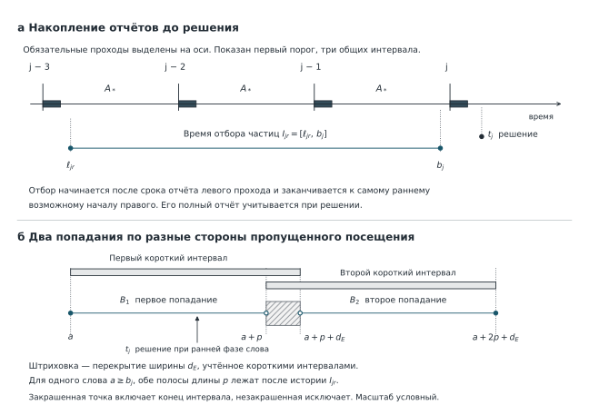

## 3.3. Обнаружение непредсказуемого роста

Когда контроллер вправе увеличить период обхода, если за несколько проходов не зарегистрировано ни одного исправления? Перед решением ему известны показания часов, текущий режим, время назначенных проходов и отчёты о завершённых проходах. Полноту прохода регистратор подтверждает после чтения последнего назначенного адреса, завершения всех обязательных исправляющих записей и освобождения порта. Поэтому контроллер может отличить полный своевременный отчёт с нулевым числом сигналов исправления ERR от потери отчёта. Две истории с одинаковым подтверждённым нулём могут соответствовать разному состоянию памяти. Например, в одном случае инверсий не было, в другом частица изменила разряд после выборки данных и этот дефект сохранился до следующего чтения слова.

**Какие отчёты дают право увеличить период.** Один проход — последовательное чтение всех адресов защищаемой области. В рассматриваемых 64 КиБ долгоживущих данных в CY62167GE30-45 за один проход читаются $A=32\,768$ адресов по 16 разрядов. Полный проход занимает по календарю $L=11{,}4688$ мс. При непрерывном обходе следующий проход начинается через $L$ после начала предыдущего. Если установлен период $2L$, контроллер выполняет такой же проход, пропускает ближайшее начало частого расписания и начинает новый проход через $2L$. Другие ступени удваивают период вплоть до $512L$. Во всех режимах состав прохода один и тот же.

Чтобы сравнивать историю работы при разных периодах, в календаре выделены равные **общие интервалы** длительностью $A_*=512L=5{,}8720256$ с. В начале каждого такого интервала назначен проход при любой ступени, поскольку все периоды делят $A_*$ без остатка. Это **обязательный общий проход**. Пусть его начало имеет номер $j$ и номинальную отметку $jA_*$. Для решения на этой границе учитывают проходы, назначенные **после предыдущего общего прохода и до текущего включительно**. Если всё это время действовал период $L$, в интервале учитываются 512 проходов. При периоде $2L$ их 256, при периоде $512L$ — один. Таким образом, общий интервал задаёт постоянную длительность наблюдения, а число выполненных за него проходов зависит от режима.

Когда заканчивается обязательный проход $j$, контроллер уже может проверить отчёты обо всех проходах предшествующего интервала. Он засчитывает интервал как нулевой, если каждый полный отчёт поступил к своему сроку, относится к назначенному проходу и нигде не зарегистрирован ERR. При исправлении, потере, опоздании или неоднозначности отчёта серия прерывается. Уже выданная команда задаёт время ближайшего назначенного прохода. Для первого прохода, срок которого ещё можно изменить, контроллер назначает интервал $L$ от предыдущего начала. После восстановления связи засчитываются заново только целиком подтверждённые интервалы.

Например, первую редкую ступень контроллер разрешает после трёх общих интервалов подряд без исправлений. После первого и второго он сохраняет $L$, а после подтверждения третьего может назначить следующий проход через $2L$. В общем случае $r$ — номер проверяемой ступени с периодом $2^rL$, $N_r$ — требуемое для неё число последовательных нулевых интервалов. Зафиксируем **заранее** номер общего прохода $j$ и ступень $r$. Обозначим через $t_j$ момент решения по отчёту этого прохода, а через $Z_{jr}$ — событие, что к этому решению контроллер по полной серии отчётов разрешил период не короче $2^rL$. Граница $jA_*$ отмечает начало общего прохода. Отчёт и решение $t_j$ относятся к его завершению.

**Какие попадания могли бы проявиться в этой истории.** Встроенный код исправляет одну ошибку в полном слове из 32 информационных и шести проверочных разрядов. Два 16-разрядных адреса обращаются к половинам одного внутреннего слова [@CY62167RevF; @InfineonAN88889, разд. 4.1–4.4]. Если $N_{\rm пар}$ пар адресов целиком входят в защищаемую область, она охватывает $M=A-N_{\rm пар}$ внутренних слов. Поэтому $16\,384\le M\le32\,768$ при любой карте пар. В начале все охваченные слова исправны. На протяжении срока $T=10$ лет приложение не пишет ни в одну из их половин, в том числе в партнёрскую половину за пределами области.

Рассмотрим попадание в слово между двумя его чтениями. Если оно создало одиночную ошибку и до следующей проверки ничего не произошло, при обслуживании этого слова должен появиться ERR. Но другая частица может коснуться слова раньше и даже погасить инверсию в том же разряде. Ложное подтверждение полного нуля или пропуск обязательной записи тоже нарушают связь между дефектом и полученным отчётом. Поэтому в доказательстве обозначим через $\tau_{\rm stop}$ первый момент, когда нарушено условие исполнения, одна частица непосредственно поражает не менее двух разрядов одного слова или новая частица касается слова, в котором ещё может сохраняться ошибка прежней частицы. Сюда относится и возможный остаток при незавершённой операции. До $\tau_{\rm stop}$ в каждом слове не более одного ошибочного разряда. Первое превышение исправляющей способности к моменту $t$ влечёт $\tau_{\rm stop}\le t$. Две инверсии одной позиции показывают, почему сама остановка ещё не означает превышения. Контроллер продолжает работу по своим часам, командам и отчётам. Момент $\tau_{\rm stop}$, истинный остаток ошибок и профиль воздействия доступны только анализу.

Чтобы оценить вероятность $Z_{jr}$ до остановки, достаточно выделить в прошлом те времена и слова, для которых исправление **обязано было бы попасть в проверяемые отчёты**. На левом краю серии исключим проход, отчёт которого относится к предыдущему интервалу. Справа закончим отбор до самого раннего возможного чтения обязательного прохода $j$. Тогда для любого оставленного попадания проверяющее чтение в этом проходе ещё впереди. Контроллер при этом использует все требуемые отчёты, включая отчёт о проходе $j$.

Пусть $D_o$ — установленное календарём время от начала прохода до предельного момента приёма его полного отчёта. При допустимом масштабе часов $\xi$ номинальному интервалу длительности $h$ соответствует физическая длительность $\xi h$, а отдельная граница может сдвинуться не более чем на $J$. Левый конец гарантированного участка обозначим через $\ell_{jr}$, правый — через $b_j$. Даже при крайних допустимых сдвигах сохраняется участок

$$
I_{jr}=[\ell_{jr},b_j],\qquad \ell_{jr}=\xi((j-N_r)A_*+D_o)+J,\quad b_j=\xi jA_*-J.
$$

Обязательные проходы и гарантированный участок для первой редкой ступени показаны на рисунке 3.1, а. На рисунке 3.1, б увеличен один промежуток между проверками слова, который используется при удвоении периода. Участок отбора заканчивается до приёма отчёта о правом общем проходе. Именно это позволяет учесть попадание во время данного прохода, даже если оно произошло раньше команды. [Открыть рисунок 3.1](../figures/ch3/fig3_01_history_pairs.svg).

*Рисунок 3.1 — История исправлений и интервалы подсчёта пары. На верхней схеме выделены обязательные проходы. На нижней две горизонтальные полосы соответствуют временам первого и второго попаданий по разные стороны пропущенного посещения. Для слова, прочитанного в начале общего прохода, первая полоса может начаться до решения. Обозначения нижней схемы определены в §3.4.*

Внутри $I_{jr}$ остаётся ещё одна неопределённость. Если частица попала в слово во время его обслуживания, новое искажение может пережить запись, а текущий ERR — относиться к прежнему дефекту. Поэтому для каждого $u\in I_{jr}$ исключим полное слово, в котором могла выполняться операция в момент $u$. Для отбора используем расписание самого частого обхода, содержащее все возможные назначения при любой ступени. Обозначим множество оставленных слов через $G(u)$. В однопортовой памяти операции соседних посещений даже с учётом допуска времени не перекрываются, поэтому в каждый момент исключено не более одного слова и $|G(u)|\ge M-1$. На истории, где $\tau_{\rm stop}>t_j$, одиночная ошибка в $G(u)$ даст ERR при обязательном общем проходе или при более раннем обращении, которое её исправило. Такой ERR войдёт в серию либо контроллер обнаружит неполноту отчёта.

Теперь можно оценить, как часто на $I_{jr}$ действительно не оказывается ни одной такой частицы. При фиксированном профиле частицы образуют неоднородный пуассоновский поток. Метка частицы в расчёте накопления указывает множество $\mathcal C$ разных охваченных слов и по одной инвертированной позиции в каждом. Метки разных частиц независимы. Пусть $\nu_{\rm эт}(u)$ — суммарная частота битовых инверсий на эталоне из $M_{\rm эт}=524\,288$ полных слов. Тогда в области из $M$ слов частота инверсий $\nu_M(u)=M\nu_{\rm эт}(u)/M_{\rm эт}$. На частицу в среднем приходится $\mu_{\mathcal C}=\mathsf E|\mathcal C|$ инверсий. Следовательно, интенсивность частиц равна $\nu_M(u)/\mu_{\mathcal C}$. Для отбора достаточно, чтобы хотя бы одно затронутое слово попало в $G(u)$. Интенсивность отобранных частиц и их ожидаемое число равны

$$
\lambda_G(u)=\frac{\nu_M(u)}{\mu_{\mathcal C}}\,
       \Pr\{\mathcal C\cap G(u)\ne\varnothing\},\qquad
\mu_{jr}=\int_{I_{jr}}\lambda_G(u)\,du .
\tag{3.8}
$$

Частица, затронувшая два доступных слова, может породить два сигнала ERR, но в (3.8) входит один раз. Обозначим число таких отобранных частиц через $N_G(I_{jr})$. Время и условие на метку заданы заранее, поэтому отбор из пуассоновского потока даёт пуассоновское число со средним $\mu_{jr}$. Если ступень разрешена и до $t_j$ доказательство не остановилось, на выбранном участке не могло быть ни одной отобранной частицы. Отсюда

$$
 Z_{jr}\cap\{\tau_{\rm stop}>t_j\}\ \subseteq\ \{N_G(I_{jr})=0\},
 \qquad
 \Pr\!\left(Z_{jr}\cap\{\tau_{\rm stop}>t_j\}\right)\le e^{-\mu_{jr}} .
\tag{3.9}
$$

Это верх вероятности совместного события для заранее выбранных $j$ и $r$. По уже полученному нулевому отчёту формула (3.9) не определяет условную вероятность неисправимой ошибки. Соседние серии отчётов могут перекрываться. Пуассоновское распределение здесь имеет число заранее выделенных частиц, тогда как фактические ERR зависят от предыдущих посещений и исправлений.

Для подстановки в (3.9) требуется связь частоты инверсий с частотой **разных** обнаруживаемых частиц. В таблице начальное слово выбрано равномерно на кольце из $M$ слов, а пара разных равномерных слов выбирается без возвращения.

| Слова, затронутые одной частицей | $\mu_{\mathcal C}$ | Нижняя граница вероятности пересечения с $G(u)$ | Нижняя граница $\lambda_G/\nu_M$ |
|---|---:|---:|---:|
| Одно равномерное слово | 1 | $(M-1)/M$ | $(M-1)/M$ |
| Два разных равномерных слова | 2 | 1 | $1/2$ |
| Одно слово с вероятностью $4/5$, иначе два соседних | $6/5$ | $1-4/(5M)$ | $(5M-4)/(6M)$ |
| Пять соседних слов | 5 | 1 | $1/5$ |

В основном примере применяется третья строка. Частица с двухсловной меткой обязательно достигает доступного слова. Из однословных частиц при отборе теряются лишь попавшие в единственное исключённое слово. Следовательно, $\lambda_G(u)\ge s\,\nu_{\rm эт}(u)$ при $s=(5M-4)/(6M_{\rm эт})$. Для пятисловных меток также доступна каждая частица, но при той же суммарной частоте инверсий частиц в единицу времени меньше. Для физического применения необходимы обоснованный пространственный закон меток, достоверная регистрация старой ошибки в любой из 38 позиций и её обязательный ремонт. Открытые данные облучений описывают зарегистрированные кластеры, документация изготовителя — устройство полного слова. Закон попаданий и гарантированное обнаружение ошибки каждой скрытой позиции по этим сведениям остаются условиями применения.

Чем больше ожидаемое число выделенных частиц $\mu_{jr}$, тем меньше верх (3.9) вероятности разрешить ступень до остановки. Например, при том же календаре и законе меток увеличение частоты на всём $I_{jr}$ увеличивает эту меру. Если же частота выросла непосредственно перед окончанием истории или после него, прошедшие отчёты ещё могли остаться нулевыми. Для учёта таких случаев представим частоту инверсий на эталоне как сумму фона $\nu_{\rm ф}$ и превышения $\nu_{\rm изб}$. Для класса геостационарной орбиты задаются максимальная частота $\nu_{\max}$, верх $N_{\rm изб}$ ожидаемого числа инверсий сверх фона, предельная скорость роста $\gamma_\nu$ и верх $V_{\nu,\max}$ начального превышения вместе с суммой последующих подъёмов. Обозначая сумму положительных изменений через $V^+(\nu_{\rm изб})$, получаем

$$
\begin{gathered}
0\le\nu_{\rm изб}(t)\le\nu_{\max}-\nu_{\rm ф},\quad
\int_0^T\nu_{\rm изб}(t)\,dt\le N_{\rm изб},\\
\nu_{\rm изб}(t)-\nu_{\rm изб}(v)\le\gamma_\nu(t-v)\quad(v<t),\qquad
\nu_{\rm изб}(0)+V^+(\nu_{\rm изб})\le V_{\nu,\max}.
\end{gathered}
\tag{3.10}
$$

В расчёте $N_{\rm изб}=187\,464-\nu_{\rm ф}T$, $\gamma_\nu=0{,}004392116$ с$^{-2}$, $V_{\nu,\max}=28{,}855$ с$^{-1}$. Экспозиция и положительная вариация получены по десятилетним окнам реконструкций SEPEM [@SEPEMRDS2]. Ограничение скорости роста принято по минутным средним GOES-19 с двукратным запасом. Для будущей миссии это условия расчётного класса. Предел субминутного физического роста из минутных отсчётов не установлен.

Для выполнения требования за весь срок важна вероятность того, что в **одном слове** встретятся ошибки от разных частиц. При удвоении периода пропускается промежуточное посещение. Тогда ошибка первой частицы может сохраниться до попадания второй по другую сторону пропущенного посещения. Формула (3.9) ограничивает вероятность разрешения такого удлинения до остановки. В §3.4 этот вес применяется к числу дополнительных пар, а конечная длительность записи и возможный поздний рост частоты определяют оставшиеся слагаемые десятилетней оценки.
