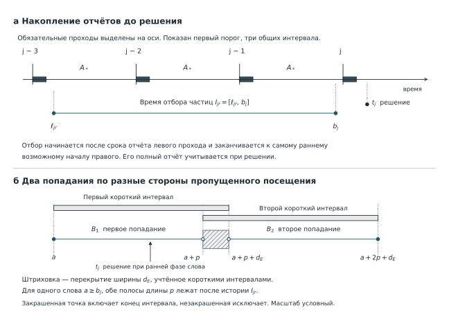

## 3.3. Вероятностные свойства наблюдений при последовательном контроле

Слово проверено, и контроллер получил отчёт без исправлений. Такой ноль возможен и в чистой памяти, и при скрытом повреждении. Например, частица могла изменить разряд сразу после выборки данных. При следующем чтении контроллер ещё увидит эту ошибку, хотя в текущем отчёте её нет. Какую часть предшествующего воздействия всё же можно обнаружить по серии нулевых отчётов? Для ответа установим, какие частицы при заданном порядке обхода обязательно вызвали бы зарегистрированное исправление к моменту выбора периода.

**Наблюдения контроллера.** Рассмотрим память со встроенным кодом $(38,32)$ на примере CY62167GE30-45. Код исправляет одиночную ошибку в полном слове из 32 информационных и шести проверочных разрядов. Один проход по защищаемым 64 КиБ долгоживущих данных включает чтение $A=32\,768$ адресов по 16 разрядов. Два 16-разрядных адреса обращаются к половинам одного внутреннего слова [@CY62167RevF; @InfineonAN88889, разд. 4.1–4.4].

Если в область целиком входит $N_{\rm пар}$ пар адресов, число охваченных полных слов равно $M=A-N_{\rm пар}$ и лежит между 16 384 и 32 768. В начале все эти слова исправны. За десять лет приложение не перезаписывает ни одну из их половин, включая партнёрскую половину за границей области. При изолированной ошибке любой из 38 позиций предполагаются достоверный сигнал ERR и обязательная запись исправленных данных.

По календарю проход занимает $L=11{,}4688$ мс. При непрерывном обходе контроллер начинает новый проход сразу по завершении отведённого времени. При периоде $2L$ он пропускает каждое второе начало. Удвоения периода вплоть до $512L$ изменяют время ожидания между проходами. При каждом назначенном проходе контроллер читает тот же набор адресов.

Всем ступеням соответствует общая сетка времени $0,L,2L,\ldots$ от начала срока. На ступени $2L$ проходы начинаются на каждой второй отметке от нулевой, на ступени $4L$ — на каждой четвёртой. При переключении исходная точка календаря сохраняется.

Чтобы сравнивать историю работы при разных периодах, в календаре выделены равные **общие интервалы** длительностью $A_*=512L=5{,}8720256$ с. Поскольку начала всех расписаний совмещены, а $A_*$ кратно каждому периоду, на отметке $jA_*$ при любой ступени назначен проход. Назовём его **обязательным общим проходом** с номером $j$. Для решения на этой границе учитывают проходы, назначенные **после предыдущего общего прохода и до текущего включительно**. Если всё это время действовал период $L$, в интервале учитываются 512 проходов. При периоде $2L$ их 256, при периоде $512L$ — один. Таким образом, общий интервал задаёт постоянную длительность наблюдения, а число выполненных за него проходов зависит от режима.

Полный отчёт подтверждает, что прочитан последний назначенный адрес, завершены все обязательные исправляющие записи и порт освобождён. Контроллер засчитывает общий интервал как нулевой, если для каждого назначенного в нём прохода получен полный отчёт к своему сроку и во всех этих отчётах число исправлений равно нулю. Исправление, потеря, опоздание либо неоднозначность отчёта прерывают серию. Потерю нельзя принять за нулевое наблюдение.

Пусть для разрешения ступени $r$ с периодом $2^rL$ требуется $N_r$ последовательных нулевых интервалов. Например, для первого удвоения требуются три интервала, значит, до подтверждения третьего контроллер сохраняет частый обход. Зафиксируем номер обязательного прохода $j$ и номер ступени $r$ до получения отчётов. Проход начинается по календарю в $jA_*$. В момент $t_j$, когда истекает срок приёма отчёта о нём, контроллер располагает сведениями для решения. Через $Z_{jr}$ обозначим событие, при котором к этому моменту подтверждённой истории хватило для разрешения периода не короче $2^rL$.

**От попадания в слово к записи в отчёте.** Между возникновением одиночной ошибки и её обнаружением должно состояться проверяющее чтение. Кроме того, ошибка должна до него сохраниться. Второе попадание в ту же позицию способно погасить инверсию. Выделим истории, на которых связь между одиночным повреждением и последующим исправлением ещё можно проследить.

Обозначим через $\tau_{\rm stop}$ момент первой из трёх остановок доказательства из §3.1. Это нарушение исполнения, прямое поражение как минимум двух разрядов слова одной частицей либо повторное касание слова, где ещё может сохраняться инверсия предыдущей частицы. В последнем случае учитывается и остаток ошибки при незавершённой операции. До $\tau_{\rm stop}$ повторных касаний такого слова нет. Одиночная ошибка, возникшая вне операции, к следующей проверке сохранится. На эту связь и опирается вывод из серии наблюдений. Во время работы контроллеру доступны собственные часы, команды, полные отчёты и состояние канала. Самого момента остановки он не наблюдает.

Чтобы оценить вероятность $Z_{jr}$ до остановки, достаточно выделить в прошлом те времена и слова, для которых исправление **обязано было бы попасть в проверяемые отчёты**. На левом краю серии исключим проход, отчёт которого относится к предыдущему интервалу. Справа закончим отбор до самого раннего возможного чтения обязательного прохода $j$. Тогда для любого оставленного попадания проверяющее чтение в этом проходе ещё впереди. Контроллер при этом использует все требуемые отчёты, включая отчёт о проходе $j$.

Пусть $D_o$ — установленное календарём время от начала прохода до предельного момента приёма его полного отчёта. При допустимом масштабе часов $\xi$ номинальному интервалу длительности $h$ соответствует физическая длительность $\xi h$, а отдельная граница может сдвинуться не более чем на $J$. Левый конец гарантированного участка обозначим через $\ell_{jr}$, правый — через $b_j$. Даже при крайних допустимых сдвигах сохраняется участок

$$
I_{jr}=[\ell_{jr},b_j],\qquad \ell_{jr}=\xi((j-N_r)A_*+D_o)+J,\quad b_j=\xi jA_*-J.
$$

На рисунке 3.1, а показаны три общих интервала перед первым разрешением удвоить период. Правый край $b_j$ расположен до самого раннего чтения обязательного прохода $j$. Поэтому у каждого отобранного попадания впереди остаётся проверка, отчёт о которой войдёт в решение. Между $b_j$ и самим решением $t_j$ проходит время. Для слова, прочитанного в начале обязательного прохода, новое попадание в этот промежуток уже может остаться за пределами отчёта. На рисунке 3.1, б показано его возможное место в паре попаданий по разные стороны пропущенной проверки.

*Рисунок 3.1 — История исправлений и интервалы подсчёта пары. На верхней схеме прямоугольниками показаны обязательные проходы. На нижней $a$ — начало рассматриваемого промежутка для одного слова, $p$ — половина времени между началами двух проверок при удвоении периода, $d_E$ — максимальная длительность операции от начала до освобождения порта. Полосы $B_1$ и $B_2$ задают возможное время первого и второго попаданий. Заштрихованное перекрытие уже учтено при более частом обходе. Для слова, прочитанного в начале общего прохода, $B_1$ может начаться до решения $t_j$. Время выражено в секундах, масштаб условный.*

Внутри $I_{jr}$ остаётся ещё одна неопределённость. Если частица попала в слово во время его обслуживания, новое искажение может пережить запись, а текущий ERR — относиться к прежнему дефекту. Поэтому для каждого $u\in I_{jr}$ исключим полное слово, в котором могла выполняться операция в момент $u$. Для отбора используем расписание самого частого обхода, содержащее все возможные назначения при любой ступени. Обозначим множество оставленных слов через $G(u)$. В однопортовой памяти операции соседних посещений даже с учётом допуска времени не перекрываются, поэтому в каждый момент исключено не более одного слова и $|G(u)|\ge M-1$. На истории, где $\tau_{\rm stop}>t_j$, одиночная ошибка в $G(u)$ даст ERR при обязательном общем проходе или при более раннем обращении, которое её исправило. Такой ERR войдёт в серию либо контроллер обнаружит неполноту отчёта.

Теперь можно оценить, как часто на $I_{jr}$ действительно не оказывается ни одной такой частицы. При фиксированном профиле частицы образуют неоднородный пуассоновский поток. Метка частицы в расчёте накопления указывает множество $\mathcal C$ разных охваченных слов и по одной инвертированной позиции в каждом. Метки разных частиц независимы. Пусть $\nu_{\rm эт}(u)$ — суммарная частота битовых инверсий на эталоне из $M_{\rm эт}=524\,288$ полных слов. Тогда в области из $M$ слов частота инверсий $\nu_M(u)=M\nu_{\rm эт}(u)/M_{\rm эт}$. На частицу в среднем приходится $\mu_{\mathcal C}=\mathsf E|\mathcal C|$ инверсий. Следовательно, интенсивность частиц равна $\nu_M(u)/\mu_{\mathcal C}$. Для отбора достаточно, чтобы хотя бы одно затронутое слово попало в $G(u)$. Интенсивность отобранных частиц и их ожидаемое число равны

$$
\lambda_G(u)=\frac{\nu_M(u)}{\mu_{\mathcal C}}\,
       \Pr\{\mathcal C\cap G(u)\ne\varnothing\},\qquad
\mu_{jr}=\int_{I_{jr}}\lambda_G(u)\,du .
\tag{3.8}
$$

Частица, затронувшая два доступных слова, может породить два сигнала ERR, но в (3.8) входит один раз. Обозначим число таких отобранных частиц через $N_G(I_{jr})$. Время и условие на метку заданы заранее, поэтому отбор из пуассоновского потока даёт пуассоновское число со средним $\mu_{jr}$. Если ступень разрешена и до $t_j$ доказательство не остановилось, на выбранном участке не могло быть ни одной отобранной частицы. Отсюда

$$
 Z_{jr}\cap\{\tau_{\rm stop}>t_j\}\ \subseteq\ \{N_G(I_{jr})=0\},
 \qquad
 \Pr\!\left(Z_{jr}\cap\{\tau_{\rm stop}>t_j\}\right)\le e^{-\mu_{jr}} .
\tag{3.9}
$$

Это верх вероятности совместного события для заранее выбранных $j$ и $r$. По уже полученному нулевому отчёту формула (3.9) не определяет условную вероятность неисправимой ошибки. Соседние серии отчётов могут перекрываться. Пуассоновское распределение здесь имеет число заранее выделенных частиц, тогда как фактические ERR зависят от предыдущих посещений и исправлений.

Для подстановки в (3.9) требуется связь частоты инверсий с частотой **разных** обнаруживаемых частиц. Для оценки гарантии и затрат примем [модель поражения одного или двух соседних кодовых слов одной частицей](../ch2/chapter2.md#one-or-two-words). Это расчётное допущение о независимых метках частиц. Для каждой частицы начальное слово выбирается равномерно на кольце из $M$ слов. С вероятностью $4/5$ поражается только это слово, с вероятностью $1/5$ — оно и следующее на кольце. В каждом поражённом слове независимо инвертируется одна равномерно выбранная позиция из 38.

В таблице показано, как меняется частота обнаруживаемых частиц при разных способах выбора слов. В строке с двумя разными равномерными словами пара выбирается без возвращения.

| Слова, затронутые одной частицей | $\mu_{\mathcal C}$ | Нижняя граница вероятности пересечения с $G(u)$ | Нижняя граница $\lambda_G/\nu_M$ |
|---|---:|---:|---:|
| Одно равномерное слово | 1 | $(M-1)/M$ | $(M-1)/M$ |
| Два разных равномерных слова | 2 | 1 | $1/2$ |
| Одно слово с вероятностью $4/5$, иначе два соседних | $6/5$ | $1-4/(5M)$ | $(5M-4)/(6M)$ |
| Пять соседних слов | 5 | 1 | $1/5$ |

В модели поражения одного или двух слов (третья строка) при попадании в пару хотя бы одно слово всегда принадлежит $G(u)$. При попадании в одно слово частица не входит в отбор только в том случае, когда это слово исключено из $G(u)$. Отсюда $\lambda_G(u)\ge s\,\nu_{\rm эт}(u)$, где $s=(5M-4)/(6M_{\rm эт})$. Если же одна частица затрагивает пять соседних слов, при той же частоте инверсий на единицу времени приходится меньше различных частиц. Формула (3.9) тем самым связывает вероятность нулевой серии и с пространственным распределением поражений. Опубликованные результаты облучения описывают зарегистрированные кластеры [@Zenodo8314389]. Для применения к изделию требуется установить связь этих наблюдений с метками отдельных частиц и подтвердить обнаружение изолированной ошибки в любой скрытой позиции.

Чем больше ожидаемое число выделенных частиц $\mu_{jr}$, тем меньше верх (3.9) вероятности разрешить ступень до остановки. Например, при том же календаре и законе меток увеличение частоты на всём $I_{jr}$ увеличивает эту меру. Если же частота выросла непосредственно перед окончанием истории или после него, прошедшие отчёты ещё могли остаться нулевыми. Для учёта таких случаев представим частоту инверсий на эталоне как сумму фона $\nu_{\rm ф}$ и превышения $\nu_{\rm изб}$. Для класса геостационарной орбиты задаются максимальная частота $\nu_{\max}$, верх $N_{\rm изб}$ ожидаемого числа инверсий сверх фона, предельная скорость роста $\gamma_\nu$ и верх $V_{\nu,\max}$ начального превышения вместе с суммой последующих подъёмов. Обозначая сумму положительных изменений через $V^+(\nu_{\rm изб})$, получаем

$$
\begin{gathered}
0\le\nu_{\rm изб}(t)\le\nu_{\max}-\nu_{\rm ф},\quad
\int_0^T\nu_{\rm изб}(t)\,dt\le N_{\rm изб},\\
\nu_{\rm изб}(t)-\nu_{\rm изб}(v)\le\gamma_\nu(t-v)\quad(v<t),\qquad
\nu_{\rm изб}(0)+V^+(\nu_{\rm изб})\le V_{\nu,\max}.
\end{gathered}
\tag{3.10}
$$

В расчёте $N_{\rm изб}=187\,464-\nu_{\rm ф}T$, $\gamma_\nu=0{,}004392116$ с$^{-2}$, $V_{\nu,\max}=28{,}855$ с$^{-1}$. Экспозиция и положительная вариация получены по десятилетним окнам реконструкций SEPEM [@SEPEMRDS2]. Ограничение скорости роста принято по минутным средним GOES-19 с двукратным запасом. Для будущей миссии это условия расчётного класса. Предел субминутного физического роста из минутных отсчётов не установлен.

Таким образом, нулевая серия сообщает о тех частицах, последствия которых успела бы выявить хотя бы одна из проверок. Чем больше таких частиц ожидалось в гарантированной части истории, тем меньше верхняя граница вероятности разрешить длинный период до остановки. После удвоения первое повреждение может сохраниться по одну сторону пропущенного посещения до прихода второй частицы по другую его сторону. Для оценки за срок требуется соединить вероятность разрешения ступени с числом именно этих дополнительных пар.
