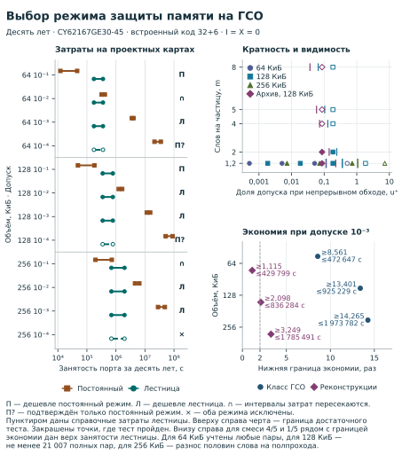

## 4.3. Карта выбора режима

Для заданного объёма памяти карта показывает, какие режимы выполняют требование к вероятности накопления и какой из них занимает защитный порт меньшее время. Выбор зависит от допуска, размещения половин кодовых слов, закона поражения одной частицей и условий, при которых контроллер получит отчёт об исправлении. Порядок проверки этих условий задан в [§4.1](section4_1.md).

Пусть $\varepsilon_{\rm нак}$ — допуск на вероятность накопления за десять лет, а $U_Q$ и $L_Q$ — верхняя и нижняя границы этой вероятности. Если $U_Q\le\varepsilon_{\rm нак}$ на всём заданном множестве профилей, допустимость режима доказана. Для исключения режима достаточно одного допустимого профиля и исполнения, на которых $L_Q>\varepsilon_{\rm нак}$. Если верхняя граница выше допуска, а нижняя не устанавливает нарушения, вопрос о допустимости остаётся открытым. В расчёте накопления уже учтена вероятность исключений исполнения $\delta=6\cdot10^{-6}$. Для прямого поражения нескольких позиций одного слова одной частицей требуется отдельная граница в пределах выделенной ему доли допуска.

У допустимых режимов сравнивают наибольшую по заданному классу профилей **ожидаемую занятость защитного порта за десять лет**. На левой панели рисунка 4.1 приведены границы этой величины в секундах. Для постоянного режима левая граница обязательна при любом допустимом периоде, правая получена для конкретного допустимого периода. Если верхняя граница затрат одного режима ниже нижней границы другого при тех же карте адресов и условиях, первый режим требует меньше времени порта. Знак ∩ означает, что интервалы затрат двух допустимых режимов пересекаются и оценок для выбора по затратам недостаточно.

*Рисунок 4.1 — Выбор режима защиты памяти. Слева показаны интервалы ожидаемой занятости порта на проектных картах. Справа вверху показана проверка вероятности накопления при разных законах поражения. Справа внизу сопоставлены нижние границы экономии при допуске $10^{-3}$, когда постоянный период выбирают для расчётного класса ГСО или для множества принятых архивных реконструкций.*

На правой верхней панели каждому символу соответствует один из проверенных случаев. По горизонтали отложено отношение $u^+=Q_{\rm непр,нак}^{+}(L)/\varepsilon_{\rm нак}$ верхней оценки вероятности накопления при непрерывном обходе к допуску. Здесь $L$ — длительность полного прохода по календарю. По вертикали отложено среднее число разных слов $m$, затронутых одной частицей, которая вызвала хотя бы одну инверсию. Закрашенный символ означает, что верхняя оценка для лестницы укладывается в допуск. Короткая вертикальная черта при данном $m$ отмечает границу достаточной проверки при изменении только допуска. Слева от черты и на ней проверка подтверждает допустимость лестницы для заданных объёма, закона поражения, обслуживания и класса профилей. Координата черты округлена вниз, поэтому для точки правее неё вывод делают по границам вероятности, полученным для этой точки. Положение черты для иных законов по этим точкам не определяется.

В основной смеси начальное слово выбирают равновероятно. С вероятностью $4/5$ частица поражает только это слово, с вероятностью $1/5$ — также следующее на кольце, поэтому $m=6/5$. Для 128 КиБ при допуске $10^{-3}$ с этой смесью сопоставлены ещё четыре закона. В одном из них частица поражает два различных равномерно выбранных слова, в трёх остальных — соответственно 4, 5 или 8 последовательных слов от случайного начала на кольце. В каждом затронутом слове инвертируется одна из 38 позиций. Частота инверсий на разряд сохраняется. Поэтому при большем числе слов на частицу за то же время в среднем происходит меньше отдельных попаданий. Для вероятностной оценки §3.3 существенна частота **различных частиц**, которые при попадании в проверяемую часть истории до остановки обязательно проявились бы в отчёте ERR к моменту решения. Даже если исправления потребовались в нескольких словах, такую частицу учитывают один раз.

Для 128 КиБ условие этой проверки выполнено, если на одну ожидаемую инверсию приходится не менее $6013/16384$ своевременно обнаруживаемых частиц в классе ГСО или $4870/16384$ на множестве реконструкций. При принятом порядке чтения смесь обеспечивает $13653/16384$, закон двух различных слов — $1/2$. Для групп из 4, 5 и 8 слов даже при наблюдении каждой частицы доступны лишь $1/4$, $1/5$ и $1/8$ соответственно. Например, в классе ГСО на 128 КиБ точка при $u^+\approx0{,}186$ лежит слева от черты для двух равномерно выбранных слов ($u\approx0{,}243$) и справа от черты для четырёх соседних ($u\approx0{,}129$). Для группы из четырёх слов допустимость лестницы остаётся открытой. Для вывода о нарушении нужна отдельная нижняя граница вероятности накопления. [Сравнение пяти законов](../../experiments/t542-regime-map/README.md#видимость-кластера-и-архивная-имитация).

В таблице 4.1 сопоставлены три объёма при четырёх допусках для основной смеси и класса ГСО. Все $W$ полных слов охвачены, половины каждого находятся по адресам $(w,w+W)$ и посещаются с разносом на полпрохода. При каждом объёме во всех четырёх случаях действует одна лестница с теми же периодами и порогами числа полных нулевых интервалов. Поэтому границы её занятости повторяются. Изменяется требование, с которым сравнивают границу вероятности накопления. Значения для лестницы относятся именно к этому правилу. Для постоянного режима допустимый период выбирают по каждому требованию отдельно. Время дано для одного защитного порта при $I=X=0$, то есть без дополнительных потерь истории и прочих затрат времени порта на защиту.

**Таблица 4.1 — Выбор режима на проектных картах с разносом половин на \(L/2\)**

| Объём, КиБ | \(\varepsilon_{\rm нак}\) | Постоянный режим, с | Лестница, с | Результат |
|---:|---:|---:|---:|---|
| 64 | \(10^{-1}\) | 12 204–46 162 | 174 260–358 396 | постоянный дешевле, не менее 3,7750 раза |
| 64 | \(10^{-2}\) | 320 345–413 395 | 174 260–358 396 | ∩ интервалы затрат пересекаются |
| 64 | \(10^{-3}\) | 3 518 494–4 026 924 | 174 260–358 396 | лестница дешевле, не менее 9,8173 раза |
| 64 | \(10^{-4}\) | 21 258 128–35 112 343 | 174 260–358 396 (справочно) | постоянный допустим, допустимость лестницы не установлена |
| 128 | \(10^{-1}\) | 49 087–181 259 | 348 497–782 799 | постоянный дешевле, не менее 1,9226 раза |
| 128 | \(10^{-2}\) | 1 248 360–1 639 401 | 348 497–782 799 | лестница дешевле, не менее 1,5947 раза |
| 128 | \(10^{-3}\) | 11 527 603–15 105 097 | 348 497–782 799 | лестница дешевле, не менее 14,7261 раза |
| 128 | \(10^{-4}\) | 51 639 627–88 994 552 | 348 497–782 799 (справочно) | постоянный допустим, допустимость лестницы не установлена |
| 256 | \(10^{-1}\) | 196 890–720 003 | 696 879–1 973 782 | ∩ интервалы затрат пересекаются |
| 256 | \(10^{-2}\) | 4 533 152–6 385 611 | 696 879–1 973 782 | лестница дешевле, не менее 2,2966 раза |
| 256 | \(10^{-3}\) | 28 156 816–48 405 503 | 696 879–1 973 782 | лестница дешевле, не менее 14,2654 раза |
| 256 | \(10^{-4}\) | — | 696 879–1 973 782 (справочно) | нижняя граница вероятности исключает оба режима |

При допуске $10^{-1}$ постоянный режим может обходить память достаточно редко. Для 64 и 128 КиБ даже верхняя граница его затрат ниже нижней границы затрат лестницы. При ужесточении допуска возрастают число обязательных проходов постоянного режима и время, на которое они занимают порт. Лестница после серии полных нулевых отчётов может увеличить период. При $10^{-2}$ её преимущество по занятости уже доказано на 128 и 256 КиБ, а при $10^{-3}$ — на всех трёх объёмах. При $10^{-4}$ на 64 и 128 КиБ предъявлены допустимые постоянные периоды, но верхние оценки вероятности для лестницы выше допуска. На 256 КиБ нижняя граница $0{,}000241506317>10^{-4}$ исключает и эту лестницу, и любой постоянный период. Значения занятости лестницы при $10^{-4}$ приведены в таблице справочно.

Таким образом, из двенадцати сочетаний в пяти лестница требует меньше времени порта, в двух меньше времени требует постоянный режим, в двух интервалы затрат допустимых режимов пересекаются. В двух случаях допустимость установлена только для постоянного режима, в одном нарушение доказано для обоих. На 256 КиБ при $10^{-3}$ учёт двух посещений каждого слова с разносом $L/2$ и исправляющей записи даёт нижнюю границу экономии 14,2654 раза. Дополнительное требование, чтобы непрерывный обход расходовал не более четверти допуска, для этой конфигурации не подтверждено. [Периоды, границы вероятности и затрат до округления](../../experiments/t542-regime-map/map.json).

При допуске $10^{-3}$ для 64 КиБ гарантия накопления действует и без сведений о расположении партнёрских половин. При любой карте $Q_{\rm нак}(T)\le0{,}000552583$, ожидаемая занятость порта лестницей не превышает 472 647 с, а любой допустимый постоянный режим требует не менее 3 452 586 с. Эти две абсолютные границы получены по всем картам раздельно. Чтобы установить выигрыш, нижнюю границу затрат постоянного режима сопоставляют с верхней границей лестницы **на одной и той же карте**. Общая для всех карт нижняя граница отношения равна 8,5619, а для проектной карты с разносом $L/2$ в таблице 4.1 она равна 9,8173.

Для 128 КиБ при том же допуске и любой карте пар $Q_{\rm нак}(T)\le0{,}000715390$, лестница занимает в ожидании не более 1 152 929 с, а допустимый постоянный режим — не менее 11 204 184 с. На каждом таком размещении отношение затрат постоянного режима к затратам лестницы не меньше 13,4014. Если в область целиком входят не менее 21 007 пар адресов, непрерывный обход по принятой верхней оценке расходует не более четверти допуска. При меньшем числе пар этот дополнительный вывод требует уточнения, а границы для лестницы и сравнение затрат сохраняются.

При 256 КиБ от размещения зависит уже допустимость лестницы. Если партнёр каждого из 131 072 обслуживаемых адресов ×16 тоже входит в область, она содержит 65 536 полных слов. При любой фиксированной перестановке их половин вероятность накопления для лестницы не превышает $0{,}000993407$, а ожидаемая занятость порта — 2 031 290 с. Любой допустимый постоянный режим требует не менее 28 156 816 с, выигрыш составляет не менее 13,86 раза. Если половины каждого слова разнесены на $L/2$, верхняя граница вероятности снижается до $0{,}000678$, верхняя граница занятости — до 1 973 782 с, а нижняя граница выигрыша возрастает до 14,26 раза. [Условие замкнутости в §2.5](../ch2/chapter2.md#25-требования-к-исходным-данным) и [оценка для двух разнесённых посещений в §3.5](../ch3/section3_5.md).

Если все партнёрские половины находятся вне области, на одном допустимом профиле для той же лестницы получено $Q_{\rm нак}(T)\ge0{,}00107403>10^{-3}$. На такой карте лестница нарушает требование. Постоянный режим или другое правило проверяют отдельно. Для частично замкнутой области без установленного числа полных пар либо оценки для конкретного размещения допустимость лестницы остаётся открытой.

На проектной карте 256 КиБ с разносом $L/2$ цифровая реализация выполняет переключения между восемью ступенями, обязательную запись и восстановление после потери достоверной истории. Обозначим через $I$ верх ожидаемого числа дополнительных общих интервалов с потерей истории до остановки доказательства, а через $X_A$ — остальные дополнительные секунды защитной занятости порта. Тогда лестница занимает в ожидании не более $1\,973\,781{,}020+57{,}866218I+X_A$ с. Двукратная экономия относительно любого допустимого постоянного режима сохраняется при $57{,}866218I+X_A\le12\,104\,627{,}312$ с. Для переноса на изделие требуются ограничения на частоту и длительность физических вмешательств. [Занятость порта, §4.4](section4_4.md) и [исполнение контроллера, §4.5](section4_5.md).

Для 0,5, 1, 2 и 4 МиБ на проверенных размещениях с разносом половин на $L/2$, основной смесью и одним последовательным портом уже на одном допустимом профиле ГСО нижние границы вероятности превышают $10^{-3}$ для рассматриваемой лестницы и всех реализуемых постоянных периодов. Для 4 МиБ приняты два кристалла на общем порту, одна частица поражает один кристалл. Если выбор ограничен этими способами контроля, требуется пересмотреть организацию памяти или обслуживания и проверить её заново по §4.1.

Правая нижняя панель рисунка 4.1 показывает, как меняется сравнение при выборе одного постоянного периода на весь расчётный класс ГСО или одного периода на все принятые архивные реконструкции. Для 64 КиБ при любой карте нижняя граница выигрыша лестницы составляет соответственно 8,5619 и 1,1151 раза. Обе границы относятся к множествам профилей. На одной истории SEPEM и восьми реконструкциях GOES получены выборочные средние затраты при имитации работы контроллера. [Результаты на отдельных историях, §4.6](section4_6.md). В наземном примере с постоянным пуассоновским потоком известные затраты режима OFF состоят из одного пускового прохода с верхней границей занятости порта 0,015794436 с.

Для применения карты сначала устанавливают охват полных слов и порядок их посещения, затем проверяют вероятность накопления и сравнивают границы ожидаемой занятости порта у допустимых режимов. Вместе с выбором указывают объём, допуск, закон воздействия и условия регистрации ERR. Если для решения недостаёт данных, указывают, какие именно сведения о размещении, наблюдениях или затратах требуется получить.
