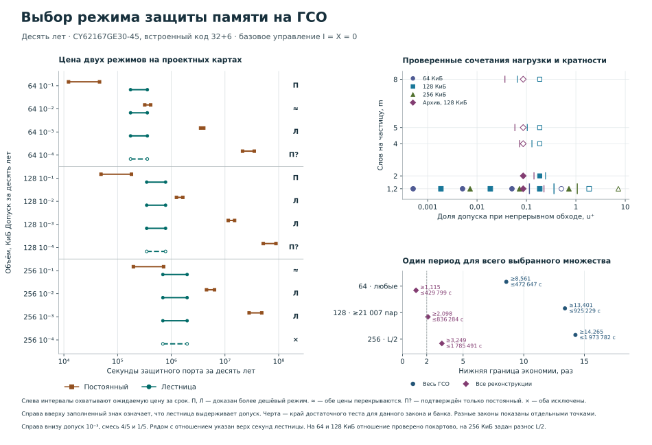

## 4.3. Карта выбора режима

Карта выбора режима переводит проверенные вероятностные границы в решение разработчика при заданных объёме памяти, допуске и сведениях о размещении, не смешивая недоказанную допустимость со строгим нарушением. Порядок назначения допуска, проверки модели и сравнения режимов задан в §4.1; здесь показано, как его результат читается на общей карте.

Одна точка карты относится не просто к объёму памяти, а к полностью заданной расчётной строке: сроку, допуску на накопление, закону частиц и их меток, охваченным полным кодовым словам, порядку посещений, правилам записи, сведениям ERR и классу временных профилей. По одной координате откладывается доля допуска на накопление, которую расходует достаточный верх при непрерывном обходе. По другой — среднее число различных слов, затрагиваемых непустой частицей. Эти координаты помогают увидеть, где частый обход оставляет запас и насколько информативен счёт исправлений, но сами по себе режим не выбирают. Одинаковое среднее число слов не задаёт размещение меток, видимость ERR и нижнюю оценку вероятности неисправимой ошибки. Число прямых поражений относится к событиям, в которых одна частица повреждает два или более разряда одного слова; этот вклад и опасные нарушения контроллера проверяются вне двух осей карты.

Статус точки задаётся видом доказанной границы. Неравенство \(U_Q\le\varepsilon_{\rm нак}\) устанавливает допустимость режима в объявленной области. Неравенство \(L_Q>\varepsilon_{\rm нак}\), полученное на допустимом профиле и исполнении, устанавливает строгое нарушение. Если предъявленный верх больше допуска, но строгого низа нет, допустимость лишь не установлена; такую точку нельзя обозначать как нарушение. После проверки вероятности сравнивают ожидаемую занятость защитного порта за десять лет. Лестница выбирается по цене, когда её верх в секундах меньше нижней цены каждого допустимого постоянного соперника на той же карте и при тех же исходных сведениях. Пересекающиеся интервалы затрат оставляют выбор по цене открытым, а пустой класс допустимых режимов не получает условной нулевой цены.

На рисунке 4.1 расчётные строки различаются формой знака и поэтому читаются без цвета. Левая панель сопоставляет интервалы ожидаемой занятости защитного порта, правая верхняя — долю допуска при непрерывном обходе и среднее число затронутых слов, правая нижняя — гарантированную экономию при допуске \(10^{-3}\). Таблица 4.1 сохраняет двенадцать проектных точек в более компактной форме. Отношение затрат приводится только после границ в секундах и только для одной и той же карты.

*Рисунок 4.1 — Карта выбора режима защиты памяти. Слева показаны интервалы ожидаемой занятости порта для постоянного режима и лестницы на проектных картах; справа вверху — проверенные сочетания нагрузки и кратности поражения; справа внизу — отдельные границы экономии для всего расчётного класса ГСО и для одного постоянного периода, назначенного всем принятым реконструкциям.*

**Таблица 4.1 — Выбор режима на проектных картах с разносом половин на \(L/2\)**

| Объём, КиБ | \(\varepsilon_{\rm нак}\) | Постоянный режим, с | Лестница, с | Результат |
|---:|---:|---:|---:|---|
| 64 | \(10^{-1}\) | 12 204–46 162 | 174 260–358 396 | постоянный дешевле, не менее 3,7750 раза |
| 64 | \(10^{-2}\) | 320 345–413 395 | 174 260–358 396 | интервалы цен перекрываются |
| 64 | \(10^{-3}\) | 3 518 494–4 026 924 | 174 260–358 396 | лестница дешевле, не менее 9,8173 раза |
| 64 | \(10^{-4}\) | 21 258 128–35 112 343 | 174 260–358 396 | подтверждён только постоянный режим |
| 128 | \(10^{-1}\) | 49 087–181 259 | 348 497–782 799 | постоянный дешевле, не менее 1,9226 раза |
| 128 | \(10^{-2}\) | 1 248 360–1 639 401 | 348 497–782 799 | лестница дешевле, не менее 1,5947 раза |
| 128 | \(10^{-3}\) | 11 527 603–15 105 097 | 348 497–782 799 | лестница дешевле, не менее 14,7261 раза |
| 128 | \(10^{-4}\) | 51 639 627–88 994 552 | 348 497–782 799 | подтверждён только постоянный режим |
| 256 | \(10^{-1}\) | 196 890–720 003 | 696 879–1 973 782 | интервалы цен перекрываются |
| 256 | \(10^{-2}\) | 4 533 152–6 385 611 | 696 879–1 973 782 | лестница дешевле, не менее 2,2966 раза |
| 256 | \(10^{-3}\) | 28 156 816–48 405 503 | 696 879–1 973 782 | лестница дешевле, не менее 14,2654 раза |
| 256 | \(10^{-4}\) | — | 696 879–1 973 782 | оба режима исключены |

Интервалы в таблице относятся к десяти годам, одному защитному порту, проектным парам \((w,w+W)\) и всему расчётному классу ГСО. В интервале постоянного режима слева указана обязательная нижняя граница для любого допустимого периода, справа — достаточный верх цены предъявленного кандидата. Условие \(I=X=0\) означает отсутствие дополнительных потерь истории и прочей защитной занятости порта. Запись «подтверждён только постоянный режим» означает, что достаточный верх лестницы не прошёл допуск; меньшая видимая цена лестницы поэтому не является основанием для её выбора. В последней строке строгий низ вероятности превышает допуск для обоих режимов, и сравнение цены прекращается. Точные значения \(Q\), \(u^+\), периоды постоянных кандидатов и неокруглённые границы приведены в [машиночитаемой численной ведомости](../../experiments/t542-regime-map/map.json).

В двенадцати проектных точках лестница доказанно дешевле в пяти случаях, постоянный режим — в двух. В двух строках интервалы цен перекрываются, ещё в двух подтверждён только постоянный режим, а в одной оба режима строго исключены. По сравнению с исходной картой изменился один выбор: на 256 КиБ при \(\varepsilon_{\rm нак}=10^{-3}\) учёт выполненной исправляющей записи и двух фаз установил допустимость лестницы и экономию не менее 14,2654 раза, хотя критерий четверти допуска для этой точки не подтверждён.

Для принятого класса ГСО при \(\varepsilon_{\rm нак}=10^{-3}\) опорной остаётся область 64 КиБ. Гарантия накопления действует при любой карте партнёрских половин: для лестницы \(Q_{\rm нак}(T)\le0{,}000552583\), а её ожидаемая занятость защитного порта не превышает 472 647 с. Любому допустимому постоянному режиму для всего класса требуется не менее 3 452 586 с. Нижняя граница отношения, вычисленная сначала на одной карте, равна 8,5619; её нельзя получать делением двух приведённых общих крайних чисел, поскольку они могут достигаться на разных картах. При выполнении условий наблюдения карта указывает на лестницу. Прямой вклад полного слова и выделенная доля вероятности опасных нарушений контроллера сохраняют отдельные проверки и не поглощаются этим решением.

Для 128 КиБ нужно разделять выбор режима и дополнительный критерий главной точки. Гарантия накопления и сравнение затрат получены при любой карте пар: \(Q_{\rm нак}(T)\le0{,}000715390\), верх занятости лестницы равен 1 152 929 с, нижняя цена любого допустимого постоянного режима — 11 204 184 с, а покартовое отношение составляет не менее 13,4014. Для принятой верхней оценки не менее 21 007 полных пар достаточно, чтобы непрерывный обход расходовал не более четверти допуска. При меньшем числе полных пар этот тест не подтверждает критерий четверти, хотя принятые гарантия лестницы и сравнение её цены на любой карте сохраняются.

При 256 КиБ сведения о размещении меняют уже статус вероятности, поэтому карта разветвляется до сравнения цены. Если партнёр каждого из 131 072 обслуживаемых адресов ×16 тоже входит в область, то область содержит 65 536 полных слов. Для любой фиксированной перестановки их половин лестница допустима, занимает не более 2 031 290 с и как минимум в 13,86 раза дешевле любого допустимого постоянного режима, требующего не менее 28 156 816 с. Если дополнительно половины каждого слова разнесены на \(L/2\), верх занятости уменьшается до 1 973 782 с, а нижняя граница отношения возрастает до 14,26. Эти две замкнутые области нельзя объединять: вторая использует более сильное условие размещения и более сильную вероятностную границу, приведённую в §4.1.

Карта со всеми партнёрами вне области даёт для той же лестницы \(Q_{\rm нак}(T)\ge0{,}00107403>10^{-3}\). Это строгое нарушение, а не отсутствие достаточного верха: данную лестницу на такой карте исключают и отдельно проверяют постоянный режим, иное правило либо изменение организации памяти. Для частично замкнутой области без установленного числа полных пар или индивидуальной оценки результат другой — допустимость лестницы не доказана и не опровергнута. До измерения охвата такую строку оставляют в области недостаточных данных.

Цифровая реализация проектной строки с разносом \(L/2\) при исправном исполнении подтверждает восемь ступеней, обязательную запись и восстановление после потери достоверной истории, но не устраняет условия физического переноса. Если \(I\) ограничивает ожидаемое число дополнительных общих интервалов, испорченных потерей истории до доказательной остановки, а \(X_A\) — остальные дополнительные секунды внешнего порта, его ожидаемая занятость не превышает \(1\,973\,781{,}020+57{,}866218I+X_A\) с. Двукратная экономия против всего допустимого постоянного класса сохраняется при \(57{,}866218I+X_A\le12\,104\,627{,}312\) с. Пока частоты и длительности всех физических вмешательств не ограничены, цифровая реализуемость правила установлена, а полная эксплуатационная экономия остаётся условной.

Для 0,5, 1, 2 и 4 МиБ в принятой однопортовой конфигурации построены строгие нижние границы выше \(10^{-3}\) одновременно для рассматриваемой лестницы и всех реализуемых постоянных периодов. Здесь нет допустимого режима, цену которого следовало бы минимизировать: карта направляет разработчика к изменению организации памяти, кода, обслуживания или класса обстановки. Этот вывод относится к одному последовательному порту, принятому календарю и фиксированному размещению. Он не переносится автоматически на разделённые области с отдельными портами или с доказанной долей общего порта; правила такого пересмотра приведены в §4.1.

Основная карта относится к одному расчётному классу ГСО. Постоянный период, заранее выбранный для всего этого класса, и период, выбранный для конечного множества принятых архивных реконструкций, являются разными соперниками. Средняя занятость на одной истории SEPEM и восьми реконструкциях GOES — результат имитации, а не гарантийная цена для всего класса. Поэтому архивные секунды и их отношения показывают отдельным блоком, как в §3.5, и не используют для изменения статуса основной точки. По той же причине наземный пример с постоянным пуассоновским потоком и режимом OFF остаётся отдельной строкой: при его законе один пусковой проход имеет верх известной занятости 0,015794436 с, но этот результат нельзя переносить на ГСО.

Для разработчика карта задаёт три последовательные проверки: определить ветвь размещения, установить допустимость режима и только затем сравнить секунды защитного порта. В итоговой записи указывают объём и допуск, область закона, сведения о размещении, вид вероятностной границы, абсолютную занятость порта и оставшиеся условия наблюдения. Если охват или достоверность наблюдений не установлены, результатом служит перечень недостающих сведений, а не выбор режима с наименьшей видимой ценой.
