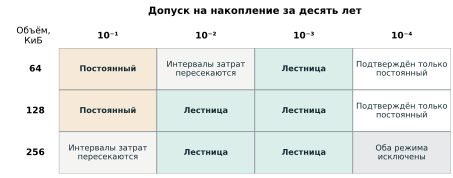

## 4.3. Карта выбора режима

Какой режим занимает меньше времени порта при заданных объёме памяти и допуске на накопление? Сопоставим три области — 64, 128 и 256 КиБ — с одним последовательным портом. В каждой области доступны обе половины всех $W$ полных слов. Их адреса $w$ и $w+W$ в порядке обхода разделены половиной календарной длительности прохода $L$. Приняты десять лет на ГСО, основная смесь одиночных и соседних двухсловных поражений (§3.4) и штатные отчёты без дополнительной занятости управления ($I=X=0$). В допуск на накопление входит $6\cdot10^{-6}$ на исполнительные исключения.

При одном объёме для всех четырёх допусков проверена одна лестница с одними периодами и порогами числа нулевых интервалов. Поэтому границы её занятости сохраняются. Постоянный период можно выбрать для каждого допуска отдельно. Затраты сравнивают по наибольшей среди профилей класса ГСО ожидаемой занятости порта за десять лет. Название режима на рисунке 4.1 означает, что оба режима допустимы, а верхняя оценка затрат выбранного режима ниже нижней оценки для другого. Для постоянного режима нижняя граница относится к любому допустимому периоду, верхняя — к конкретному допустимому кандидату.

*Рисунок 4.1 — Выбор режима по ожидаемой занятости защитного порта за десять лет на проектных картах с разносом половин слова на полпрохода.*

Проследим выбор на 64 КиБ. При штатных отчётах границы ожидаемой занятости лестницы при всех допусках одинаковы — от 174 до 359 тыс. с с округлением наружу. Если допуск равен $10^{-1}$, существует постоянный период с верхом менее 47 тыс. с. При $10^{-2}$ интервал для постоянных периодов составляет 320–414 тыс. с и пересекается с интервалом лестницы. При $10^{-3}$ любой допустимый постоянный период требует не менее 3 518 тыс. с, что выше верха для лестницы. При ужесточении требования постоянному контроллеру приходится чаще обходить память на всём сроке. Лестница может сохранить редкие проходы после полных нулевых отчётов. На 128 и 256 КиБ уже при $10^{-2}$ нижние границы постоянного режима составляют 1,248 и 4,533 млн с, а верхние границы лестницы — 0,783 и 1,974 млн с соответственно с округлением наружу. При $10^{-3}$ лестница занимает меньше порта на всех трёх проектных картах. Там, где интервалы пересекаются, оба режима удовлетворяют требованию, но выбрать один из них по затратам пока нельзя.

При допуске $10^{-4}$ вопрос уже в надёжности. На 64 и 128 КиБ предъявлены допустимые постоянные периоды, а верхняя граница вероятности накопления для лестницы выше допуска. Её допустимость здесь остаётся открытой. На 256 КиБ нижняя граница вероятности накопления для обоих режимов превышает $2{,}41\cdot10^{-4}$ уже на одном допустимом профиле. Она исключает и принятую лестницу, и любой постоянный период.

**Что меняет неизвестная карта адресов.** При допуске $10^{-3}$ лестница для 64 КиБ сохраняет преимущество при любой карте пар. Нижняя граница отношения затрат на одной и той же карте составляет 8,5619 для произвольной карты и 9,8173 для показанной на рисунке карты с разносом $L/2$. На 128 КиБ при любой карте вероятность накопления для лестницы не превышает $0{,}000715390$, а верх её ожидаемой занятости равен 1 152 929 с. Если в область целиком входят не менее 21 007 пар, этот верх снижается до 925 229 с, и на непрерывный обход по расчётной оценке приходится не более четверти допуска.

На 256 КиБ от размещения зависит сама возможность использовать лестницу. Если все партнёрские адреса входят в область, при любой их фиксированной перестановке вероятность накопления не превышает $0{,}000993407$. Если известно также, что половины читаются с разносом $L/2$, верхняя граница снижается до $0{,}000678$. Когда все партнёры находятся за границей области, для той же лестницы на одном допустимом профиле получена нижняя граница $0{,}00107403>10^{-3}$. В этом случае требование нарушено. Если охвачена лишь часть пар, для решения нужны сведения об их числе или расчёт для фактического размещения. [Физическая проверка партнёрских адресов в микросхеме описана в §2.5](../ch2/chapter2.md#25-требования-к-исходным-данным).

На проверенных проектных картах 0,5, 1, 2 и 4 МиБ с тем же разносом $L/2$ и одним последовательным портом даже непрерывный обход возвращается к слову слишком поздно. Даже между последовательными посещениями одного слова остаётся время для двух независимых попаданий, а пропуск прохода сохраняет этот промежуток свободным. Уже на одном профиле класса ГСО нижняя оценка вероятности накопления на 0,5 МиБ равна 0,00107403. На 1, 2 и 4 МиБ нижние оценки превышают соответственно 0,0039, 0,015 и 0,059. На каждой из этих карт они превышают $10^{-3}$ для любого реализуемого постоянного периода и для принятой лестницы. Для 4 МиБ два кристалла делят общий порт, одна частица поражает один кристалл. На этом подмножестве размещений выбор только между указанными режимами не обеспечивает требования.

Для аппаратного сравнения выберем 256 КиБ и зафиксируем положение обеих половин слова. На этой карте можно проследить, когда чтение и исправляющая запись занимают порт и какой ценой контроллер восстанавливает частый обход, если теряет историю наблюдений.
