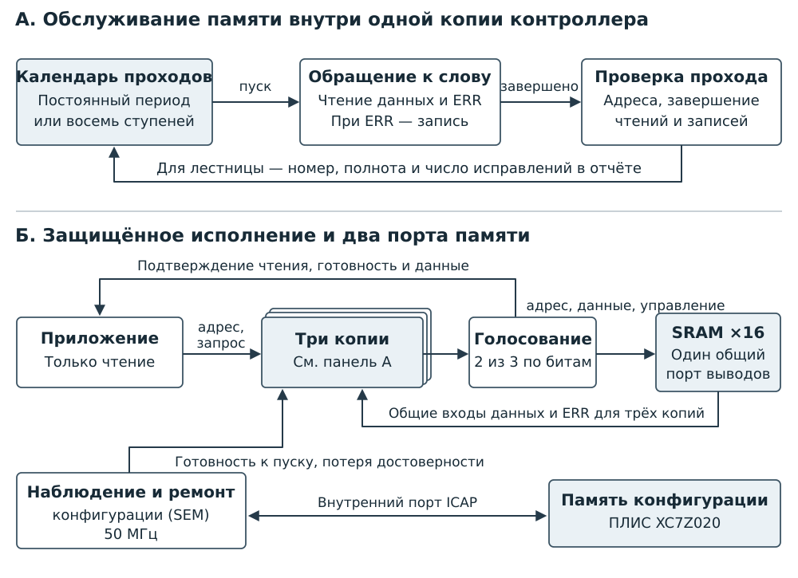

## 4.5. Исполнение и защита контроллера

Сравнение (4.3) применимо к реализации при условии, что контроллер выполняет назначенные проходы и исправляющие записи. Например, пропуск сигнала ERR может иметь два последствия. В памяти останется дефект, который следовало исправить, а адаптивный контроллер может принять отчёт о проходе за нулевой и удлинить период. Поэтому проверка реализации должна проследить путь от назначения прохода до чтения, ремонта и следующего решения.

Для проектной карты 256 КиБ на ПЛИС XC7Z020CLG484-1 размещены и трассированы постоянный и адаптивный контроллеры. На рисунке 4.2, А показан цикл, который выполняется внутри одной копии контроллера. Календарь назначает начало прохода. Счётчик адресов последовательно выдаёт все 131 072 номера, а исполнитель при каждом чтении одновременно запоминает состояние линии ERR и полученные от SRAM 16 разрядов данных. При исправлении внутренним кодом эти данные уже содержат правильное значение. Исполнитель удерживает прежний адрес и записывает его исправленную половину. Обращение засчитывается после завершения чтения или требуемой записи. Только после последнего засчитанного адреса формируется отчёт с номером прохода, подтверждением полноты и числом исправлений.

*Рисунок 4.2 — Устройство контроллеров для области 256 КиБ. А — выполнение прохода и обратная связь по отчёту для адаптивного правила. Б — исполнение с тремя копиями контроллера и отдельным обслуживанием конфигурационной памяти ПЛИС. Постоянный контроллер выполняет тот же ремонт при фиксированном календаре.*

**Обход и следующее решение.** Обе схемы работают на 100 МГц. В кадре длительностью 1,4 мкс отведено четыре места для защитных чтений. Чистое обращение освобождает порт через 100 нс, при записи по ERR — через 200 нс. Полный чистый проход занимает сам порт на 13,1072 мс при календарной длительности 45,8752 мс. Отдельный слот в кадре закреплён за полезным чтением приложения. Адрес приложения фиксируется за один такт до приёма запроса, а правильные данные доступны ещё через десять тактов после подтверждения. При опоздании нового адреса подтверждение в текущем слоте может относиться к прежнему адресу. У встроенного клиента обоих контроллеров первый правильный ответ получен через 1,12 мкс от первого рабочего фронта, повторный — через 1,06 мкс от предъявления нового запроса. Для внешнего источника с заранее подготовленным адресом без очереди номинальная задержка составляет 100–1 490 нс. При опоздавшем адресе источник должен пропустить текущий слот и удерживать адрес до следующего подтверждения. В этом случае до правильных данных проходит не более 1,50 мкс от предъявления запроса.

В испытательной карте вывод A5 выбирает половину внутреннего слова. Для получения требуемого разноса на выходе контроллера меняют местами A5 и разряд 16 адресного счётчика при нумерации от нуля. На уровне выводов в цифровой модели проверены все 131 072 адреса и две выборки каждого из 65 536 слов. Между чтениями партнёров внутри активного прохода прошло 22,9376 мс. Для конкретной микросхемы назначение вывода A5 требует отдельного подтверждения [@InfineonAN88889, разд. 4.4].

Проверим самый поздний отчёт, когда запись требуется на последнем адресе. Номинально эта запись закончилась за 480 нс до конца прохода, а порт освободился и появился полный отчёт за 440 нс до конца. До установленного срока приёма $L-300$ нс оставалось 140 нс. Команду следующего прохода правило устанавливает к $L-100$ нс. В расчёте физических времён допустимы масштаб часов $1\pm10^{-5}$ и смещение фронта не более 0,5 нс. При первом пороге полная серия своевременных нулевых отчётов дала следующий фактический старт адреса 0 через $2L$. Если отчёт отсутствовал или опоздал, старт происходил через $L$, и для нового повышения требовалось снова накопить историю. Переход на каждую из семи старших ступеней проверен по моменту начала чтения на выводах модели SRAM. Постоянный контроллер после выполнения прохода выдерживает паузу до очередного старта через 86,429 мс.

**Защита и её цена.** На рисунке 4.2, Б три копии исполнителя принимают одни и те же внешние данные и ERR. В каждой копии свои календарь, регистры ERR и исправленных данных. По их состоянию каждая формирует команды чтения и записи для общего порта. На общие выводы адреса, данных и управления поступает результат поразрядного голосования «два из трёх». Подтверждение полезного чтения и результат для приложения также выбираются голосованием. Ядро AMD Soft Error Mitigation (SEM) через отдельный внутренний порт ICAP на частоте 50 МГц обслуживает память конфигурации ПЛИС. Достижение состояния наблюдения участвует в разрешении пуска. Его потеря во время работы сообщает о недостоверности и требует от лестницы отказаться от накопленной истории. Штатный обмен SEM не занимает внешний порт SRAM.

**Таблица 4.2 — Ресурсы полных проектов после размещения и трассировки**

| Исполнение | Логические таблицы (LUT) | Регистры в логических ячейках (FF Slice) | Блоки памяти RAMB18 | Расчётная мощность ПЛИС, Вт |
|---|---:|---:|---:|---:|
| Постоянный период, одна копия | 221 | 201 | 0 | 0,286 |
| Лестница, одна копия | 405 | 284 | 0 | 0,289 |
| Постоянный период, три копии и SEM | 1 024 | 970 | 3 | 0,301 |
| Лестница, три копии и SEM | 1 582 | 1 156 | 3 | 0,307 |

Сравнение двух последних вариантов показывает цену адаптации при одинаковой защите — дополнительно 558 LUT и 186 регистров. Обоим проектам нужны три блока RAMB18. После трассировки каждый из четырёх проектов имеет положительные запасы установки и удержания при заданных тактовых частотах. Число существенных позиций конфигурации у защищённой лестницы больше на 106 529. Маска этих позиций показывает, какие биты используются схемой. Для перехода к вероятности нарушения нужны также частоты их повреждения и последствия для обслуживаемой памяти. Разность оценок мощности составляет 6 мВт. Средства проектирования использовали расчётную активность. Для энергии за срок нужны фактическая активность логики и обмена через ICAP, а также токи SRAM при чтении, записи и ожидании.

**Граница физической применимости.** Искажение сохранённого ERR или одного разряда исправленных данных в одной копии не помешало двум исправным копиям выдать требуемую запись. Когда в цифровом опыте была подавлена **общая** выборка ERR, все три копии получили одинаково ошибочные сведения. Обе защищённые схемы пропустили запись, а лестница могла дополнительно разрешить $2L$. Последующий ремонт конфигурации ПЛИС не восстанавливает уже пропущенную запись SRAM. Для исправимого одиночного конфигурационного бита при установленных условиях работы SEM расчётный верх времени обнаружения и ремонта составляет около 17,2 мс. Этот срок не ограничивает восстановление произвольного состояния контроллера или отказавшей общей цепи.

Для каждого исполнения $m$ требуется ограничить вероятность хотя бы одного опасного нарушения обслуживания за десять лет. Обозначим через $B_m$ верх вероятности опасного пуска, общих и многобитовых повреждений, наложений сбоев до восстановления и прочих отдельно учитываемых причин. Для одиночных инициирующих событий из группы $i$ пусть $\lambda_{mi}(t)$ ограничивает их интенсивность, а $h_{mi}(t)$ — условную вероятность опасного последствия с учётом данных, фазы и восстановления. Достаточное условие имеет вид

$$
B_m+\sum_i\int_0^T\lambda_{mi}(t)\,h_{mi}(t)\,dt
\le 6\cdot10^{-6}.
\tag{4.5}
$$

Правая часть (4.5) — доля на исполнение, уже учтённая при сравнении режимов в §4.4. Если её целиком отвести одиночным опасным событиям, допустимая суммарная частота в среднем составит около $1{,}90\cdot10^{-14}$ с$^{-1}$. Для полётной платы нужны интенсивности опасных событий и времена восстановления именно этих двух схем, включая общие входы, выводы и голосование. Цифровые испытания установили последовательность операций, действие защиты при проверенных искажениях и ресурсы реализации. Физическое выполнение (4.5) остаётся открытым для обоих контроллеров.
